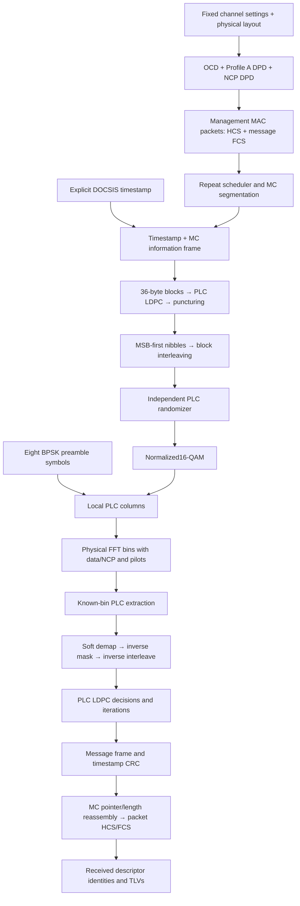

# PLC messages and frequency-domain signals

The complete fixed-setting PLC path now produces acquisition packets, message
frames, LDPC codewords, randomized16-QAM data, BPSK preambles and physical
frequency bins. A known-phase receiver soft-decodes those cells and reassembles
received packets. Recovered descriptors now build a receiver-owned configuration behind a
readiness gate; the PLC bootstrap still uses supplied alignment/numerology. All processing is Rust;
stages remain separately callable.

Run the bounded demonstration:

```bash
./scripts/cargo-local.sh run -p docsis-ofdm-fec --example plc_channel --locked
```

It runs two frames at each spacing, inserts/extracts the PLC in full physical
frequency grids and reports received OCD/ProfileA/NCP descriptors, learned receiver settings, actual LDPC
iterations, information-bit comparisons and small label/IQ windows. A successful
noiseless run reports zero information-bit errors. The other data/NCP cells in
this PLC-focused example are an explicit supplied reference plane. This example
does not simulate payload coding, blind acquisition or a time-domain waveform.



## Ownership and public APIs

| Module | Responsibility |
| --- | --- |
| `transmission::plc::descriptors` | Fixed OCD/ProfileA/NCP packet construction and received TLV parsing |
| `transmission::plc::checksums`, `mac_packets` | Header CRC16/X25, Ethernet CRC32 and complete management MAC framing |
| `transmission::plc::scheduling`, `reassembly` | Repeat timing, cross-frame MC segmentation and independent packet reassembly |
| `transmission::plc::{coding,nibbles,block_interleaving,randomization}` | Separate verified codeword stages and inverses |
| `transmission::plc::preamble`, `mapping` | Preamble table/sign generation, shared16-QAM mapping and soft demapping |
| `transmission::frame::assembly` | Protected physical-bin insertion, normalization and explicit missing-history cells |
| `simulation::plc::transmitter`, `receiver` | Thin bounded known-frame composition and typed completed results |
| `transmission::plc::receiver_configuration` | Received channel/profile interpretation, bounded collection and immutable readiness-gated settings |
| `simulation::plc::acquisition` | PLC I/Q reception through reassembly and configuration admission |
| `simulation::plc::observation` | Selectable read-only stage windows after computation |

Acquisition packet helpers, preamble, mapping and the frame assembler also work
without default features. LDPC-backed frame generation/receiving and common
observations use `simulation`. Codec math has one owner in `fec-codec`; QAM and
pilot math reuse the existing shared Rust modules.

## Acquisition packets and message transport

`FixedPlcDescriptors::new` takes validated settings, the physical layout and an
explicit `DescriptorIdentity`. No host MAC address or wall clock is read.

The OCD contains FFT size, cyclic prefix, roll-off, frequency of PHY bin0,
time-interleaver depth, primary-capability flag and range TLVs for **all**
continuous pilots, PLC carriers and excluded carriers. It enforces the mandatory
outer exclusions:0–147/3948–4095 for4K and0–295/7896–8191 for8K. Laboratory layouts
that omit those edges remain usable for isolated layout tests but are rejected
by the acquisition descriptor builder. The frequency origin must be positive
and aligned to the configured spacing.

The initial data profile is uniform256-QAM, ProfileA(id0). The NCP DPD(id255)
uses caller-selected uniform QPSK,16-QAM or64-QAM. DPD defaults cover the full
FFT; OCD protected assignments take precedence. This fixed subset uses range
TLVs and single-part management messages. Oversized packets fail explicitly;
list/vector TLVs, arbitrary editable profiles and multipart MMMs are outside this
initial fixed-channel contract. MC segmentation across frames is implemented
and is distinct from multipart management messages.

Each complete packet contains a six-byte management MAC header, with FC`0xC2`,
no extended header, and HCS; the enclosed PDU contains multicast DA, caller SA,
LLC/version/type fields, descriptor payload and Ethernet FCS. OCD is type49 and
DPD type50, both version5. Message length counts DSAP through payload; the outer
MAC length includes the message FCS. Checksum fields use their defined reflected
wire order. The receiver checks lengths, HCS, FCS and supported headers before
accepting a packet. `descriptors::parse` exposes received fixed fields and TLVs;
a separate fixed-session configuration owner now applies those fields. It does
not implement dynamic profile activation or a live modem state machine.

For symbol period $T_s=(N+N_{CP})/f_s$, a PLC frame occupies

$$
T_{PLC}=128\frac{N+N_{CP}}{204800000}.
$$

The scheduler uses integer sample ticks and repeats each three-packet acquisition
set every

$$
R=\left\lfloor\frac{204800000/5}{128(N+N_{CP})}\right\rfloor
$$

PLC frames. This rounds toward an earlier transmission than the200ms default
period, staying within the250ms maximum. A set that cannot finish within its
period is rejected at setup. Packets may span multiple MC blocks. The first new
packet in a block is located by its two-byte start pointer; continued packet
bytes precede that pointer. Remaining space is`0xFF` idle. The receiver uses only
these pointers, packet lengths and checksums, never transmitter packet IDs.

Packet storage is bounded to2000 PDU bytes plus six outer-header bytes. Failed
reassembly leaves prior pending history unchanged. Starting in the middle of a
stream can discard an unknown continuation prefix before a known new-start
pointer; it cannot recover missing packet bytes. Frame counters and repeat
arithmetic are checked for overflow.

## Preamble, modulation and physical placement

The local phase convention remains0–119 for data followed by120–127 for the
next preamble. Both tables are explicit carrier-by-symbol arrays. Each preamble
bit maps as

$$
p_{t,f}=1-2b_{t,f}+j0.
$$

The preamble bypasses FEC, interleaving and randomization. Its first column is
phase120, not phase0. PLC data uses AnnexA16-QAM:

$$
x_{t,f}=\frac{I(y_{t,f})+jQ(y_{t,f})}{\sqrt{10}},
\qquad E[|x|^2]=1.
$$

Unit energy is an ensemble constellation property, not a promise that every
individual cell has amplitude1. See [randomization](plc-randomization.md) and
[interleaving](plc-interleaving.md) for masks and permutations. Soft demapping
uses the shared max-log natural-log likelihood convention, positive for bit0;
received values are equalized to the unit reference before that operation.

`frame::assemble` consumes post-cell-interleaving data/NCP in ascending reduced
rank, with empty scattered-pilot placeholders, and one local PLC column. It
inserts pilot values after interleaving, scales normalized cells by an explicit
reference RMS and outputs increasing-frequency PHY bins. Pilots have twice that
reference amplitude; excluded bins are zero. Data `None` is retained as missing
history; it is never converted to a zero sample. A nonempty scattered placeholder,
wrong count, nonfinite sample or invalid scale is rejected. No FFT shift or IFFT
is performed here.

## Stage data and verification

`generate_frame` returns codeword-stage arrays and eight preamble columns, bounded
to10/20 codewords and1024/2048 complex cells. `symbol_iq` borrows a column without
copying a full frame. `PlcFrameReceiver` takes only a known-phase received local
PLC grid and configured spacing/noise/iteration limits. All decoder decisions
and actual iteration counts remain available when decoding fails. An accepted
message requires every LDPC block to converge and timestamp/message parsing to
pass; packet HCS/FCS checks are a separate subsequent acceptance step.

Selectable stages include`tx.plc.message`, `tx.plc.coded`,
`tx.plc.coded_nibbles`, `tx.plc.interleaved`, `tx.plc.randomized`,
`tx.plc.iq`, `tx.plc.preamble` and `tx.frame.bins`, alongside existing pilot
stages. Filters and budgets retain their existing limits. Codeword observations
filter by their first channel symbol; preamble and physical-grid observations
filter by the actual symbol. Selected windows retain original offsets, full PLC
grid dimensions or physical spacing/frequency origin. Missing grid cells export
as JSON null. Callback failures do not alter completed simulation results.

Tests cover independent preamble columns,16-QAM coordinates and energy, standard
CRC check strings, one-bit corruption in every packet byte, descriptor assignments,
repetition cadence, split packet headers, cross-frame segmentation, rejection
invariance, real cell-interleaver startup history and observation limits. Both
spacings recover multiple full frames and segmented acquisition packets through
actual FEC and QAM with zero information-bit errors. These are specification-derived
laboratory tests; external interoperability and waveform validation remain open.

Pinned authority: CM-SP-PHYv3.1-I20-230419 §7.5.13, PDF148–158, including
Tables48/49/PDF151–152 and AnnexA16-QAM; CM-SP-MULPIv3.1-I25-230419
§6.2.3.2/PDF88–89, §6.4.1/PDF99–103, §6.4.40–41/PDF197–203,
§6.5.4/PDF218 and AnnexB/PDF592. PHY4.0 I07 §7.3.5.13 delegates FDD PLC
to PHY3.1; no FDX claim. See [evidence](../reference/plc-evidence.md),
[architecture](../architecture.md) and [checklist](../development/checklist.md).

See the [receiver configuration design](receiver-configuration/README.md) for
subsystem encapsulation, states and how received messages control settings.
Pointer-free MC continuations use their full payload capacity; idle bytes are
added only after packet data ends, never inside an unfinished packet.

The separate [waveform example](waveform/reference-experiment.md) now verifies
this PLC path over actual time samples. The PLC-only example above remains
a frequency-domain experiment.

See the [measured-CE noiseless constellation demonstration](impairments/pilot-plc-constellation.md)
for actual before/after receiver scatter plots and a reproducible Rust example.
