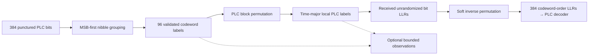

# PLC block interleaving

PLC block interleaving rearranges the 96 four-bit labels from one encoded PLC
codeword across local PLC carriers and consecutive OFDM symbols. It has its own
Rust module, independent of the data/NCP time and frequency interleavers.

```bash
./scripts/cargo-local.sh run -p docsis-ofdm-fec --example plc_interleaving --locked
```

The example uses real PLC message encoding and prints the first codeword's coded
labels, interleaved labels, symbol rows and bounded observation windows at both
spacings. It does not randomize, modulate or insert those labels into FFT bins.



## Grouping and permutation

`PlcCodewordNibbles::from_bits` takes exactly 384 binary values in the PLC
encoder's transmitted order. Every consecutive group of four becomes one label,
with its first bit most significant:

$$
u_i=8c_{4i}+4c_{4i+1}+2c_{4i+2}+c_{4i+3},\qquad 0\le i<96.
$$

For example, bits `1000 0101 1110 0001` become labels `8, 5, 14, 1`. Labels are
validated in 0–15. There is no whole-stream reversal and no QAM calculation in
this stage. The earlier puncturing interpretation remains as documented in the
[PLC coding guide](plc-coding.md).

Let $F$ be local PLC carriers per symbol and $S$ symbols per codeword:

| Spacing | FFT | Diagram array, frequency rows × time columns | Output shape, time × local carrier |
| --- | --- | --- | --- |
| 50 kHz | 4096 | 8 × 12 | 12 × 8 |
| 25 kHz | 8192 | 16 × 6 | 6 × 16 |

Write codeword labels along the diagram's rows and read columns, from lowest to
highest local PLC carrier:

$$
v_{t,f}=u_{t+Sf},\qquad 0\le t<S,\quad0\le f<F.
$$

The flattened output offset is $tF+f$. For 4K, the first symbol reads source
labels `0,12,24,36,48,60,72,84`; the next reads `1,13,25,37,49,61,73,85`.
For 8K the first symbol reads `0,6,12,18,...,90`. The permutation is block-local:
each codeword starts a fresh array, while PLC randomizer state is a separate
frame-level concern.

The coordinates are **local PLC carrier offsets**, not physical FFT bins or the
reduced data-interleaver domain. Physical placement will use the channel's PLC
start bin in a later assembler. The PLC preamble is not passed through this API.

## Public APIs and receiver inverse

| Owner under `transmission::plc` | Operation |
| --- | --- |
| `nibbles::PlcCodewordNibbles` | Validate/group 384 bits into 96 labels; expose labels and inverse bit expansion |
| `block_interleaving::source_indices` | Complete source-coordinate read order for each output offset |
| `block_interleaving::interleave` | Codeword labels to time-major `InterleavedPlcBlock` |
| `InterleavedPlcBlock::{from_values, values, symbol, spacing}` | Validated received/container values and individual symbol rows |
| `block_interleaving::deinterleave` | Validated hard labels back to codeword labels |
| `block_interleaving::deinterleave_llrs` | Four finite MSB-first bit LLRs per received label back to codeword-bit order |

The soft inverse is a permutation only. It preserves sign and magnitude, adds no
priors, performs no clipping or hard slicing, and needs no transmitter bit IDs:

$$
\ell^{\mathrm{coded}}_{4(t+Sf)+b}
=\ell^{\mathrm{received}}_{4(tF+f)+b},\qquad b=0,\ldots,3.
$$

A receiver must undo [PLC randomization](plc-randomization.md) before supplying
these LLRs.
Missing/partial blocks and nonfinite values are rejected; they are not padded
with fabricated observations. Source inputs remain unchanged. Output vectors
are bounded to 96 labels or 384 soft values; symbol lookup outside a block returns
`None`. These direct APIs are available with default features disabled.

## Typed stage results and optional observation

With `simulation`, `simulation::plc::PlcInterleavingStages::generate` composes the
two stages and retains immutable coded/interleaved results. Its block-start
symbol index uses the existing convention: phase0 is the first symbol after the
PLC preamble. The modulo-128 phase must be a multiple of 6 or 12 within data
phases0–119. It rejects a block starting in the preamble or between codeword
boundaries. This is fixed-geometry validation, not a frame scheduler.

The optional observer adds two registered IDs:

| ID | Domain | Payload |
| --- | --- | --- |
| `tx.plc.coded_nibbles` | `codeword_cell` | Codeword-order labels |
| `tx.plc.interleaved` | `plc_cell` | Time-major local PLC labels |

Both use `qam_label` units and a `not_applicable` amplitude reference: labels are
not I/Q amplitudes. Context includes `plc_grid` with spacing, full symbol count
and subcarriers per symbol. Selected `shape` remains one-dimensional and
`element_start` retains the original flat offset. Thus a selected window crossing
a symbol boundary is still unambiguous. Pilot events have no required PLC grid;
their context field defaults to `None`.

Symbol filters match the **block-start** channel index, not every symbol covered
by the block. Select cells inside that block using the element window. The
adapter checks matching channel index/PLC phase and supplies grid metadata;
unknown source identities remain unknown. Codeword IDs are diagnostic metadata
and are not receiver inputs.

Completed scientific results exist before observation. Disabled, filtered and
budget-exhausted outcomes leave them unchanged; callback errors propagate without
retry, consuming the existing dispatch budget. No callback gets mutable stage
state. The [common observer limits](pilot-signals.md#direct-apis-and-observation)
remain unchanged. The [full PLC producer](plc-channel.md) now registers message,
coded-bit, randomized-label, data/preamble I/Q and physical-grid stages as well.
The shared [JSONL writer and CLI](simulation/probe-export.md) now export selected
registered events; producers must still be invoked by the composing experiment.

## Validation and remaining work

Tests cover complete independently transcribed 96-position vectors for both
figures, permutation bijections, all 96 nibble basis positions, all 384 bit basis
positions, exact soft magnitude/sign preservation, bounds and input rejection.
Full 360/720-byte message frames recover after real PLC FEC and interleaving,
using only spacing and received LLRs for the inverse; timestamp CRCs then validate.
Observation tests cover full-grid metadata on selected windows, phase/context
rejection, disabled/exhausted paths and callback-error invariance.

These are specification-derived tests, not external interoperability vectors or
full waveform validation. [PLC randomization](plc-randomization.md) now has a
separate stateful stage and soft inverse. Preamble, mapping, physical-bin
assembly and fixed acquisition packets are now implemented in the
[complete PLC path](plc-channel.md).

Authority: CM-SP-PHYv3.1-I20-230419 §7.5.13.7, Figures65–67, PDF154–156, checked
against the local original PDF; CM-SP-PHYv4.0-I07-250627 §7.3.5.13/PDF146 delegates
FDD PLC to PHY3.1. No FDX behavior is established by that delegation. See the
[architecture](../architecture.md), [evidence](../reference/plc-evidence.md) and
[checklist](../development/checklist.md).
