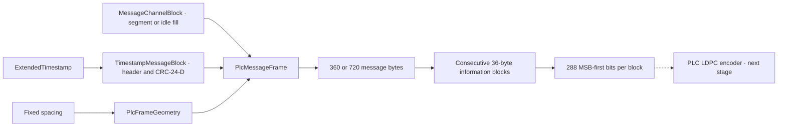

# PLC message blocks and FEC inputs

The PLC message layer now builds and validates unencoded message payloads for a
single downstream OFDM channel. It supports one timestamp message block followed
by one message-channel block, with exact frame capacity and ordered FEC inputs.
Each operation is a separate Rust module under `transmission::plc`.

```bash
./scripts/cargo-local.sh run -p docsis-ofdm-fec --example plc_messages --locked
```

This prints a synthetic timestamp, idle message-channel payload, frame dimensions,
36-byte information blocks and the first block's 288 bits as JSON. It generates
no LDPC parity, PLC preamble or waveform. The timestamp is supplied explicitly;
the example does not read the host clock.



## Frame dimensions

A PLC frame has eight preamble symbols and 120 data symbols. The information
payload excludes the preamble and FEC redundancy:

| Spacing | FFT | PLC carriers | Data symbols/codeword | Codewords/frame | Information bytes/frame | Future encoded bytes/frame |
| --- | --- | --- | --- | --- | --- | --- |
| 25 kHz | 8192 | 16 | 6 | 20 | 720 | 960 |
| 50 kHz | 4096 | 8 | 12 | 10 | 360 | 480 |

`PlcFrameGeometry` derives these dimensions from spacing. The encoded-byte count
is a dimension of the specified code, not evidence that parity has been generated.
The future PLC encoder is the punctured (384,288) code derived from the (480,288)
mother code; payload and NCP encoders are different codes.

## Timestamp and message channel

`ExtendedTimestamp` validates the DOCSIS fields: 55 coarse counter bits at
10.24 MHz, five sample-phase bits counting **0 through 19**, and four fractional
phase bits. For coarse count $C$, sample phase $S$ and fractional phase $F$:

$$
W=(C\ll9)\;|\;(S\ll4)\;|\;F,
\qquad T_{\mathrm{samples}}=20C+S.
$$

The eight-byte wire value $W$ is network byte order. `advance_samples` adds integer
204.8 MHz sample ticks with modulo-20 carry, retaining fractional phase and
rejecting overflow. The reference is DOCSIS TAI time at the end of the PLC
preamble, not Unix seconds or nanoseconds. No wall-clock conversion is performed.

`TimestampMessageBlock` serializes header `0x10`, eight timestamp bytes and a
three-byte CRC-24-D over the preceding nine bytes. Parsing validates type,
reserved bits, CRC and timestamp fields before exposing the result. Reserved-field rejection is a strict laboratory policy,
not the CM receive policy of ignoring reserved fields. The shared
CRC implementation remains in `fec_codec::crc`; no second CRC algorithm is added.

`MessageChannelBlock` emits header `0x30` without a packet pointer or `0x31` with
a two-byte network-order pointer. The pointer names a byte offset into the
following segment where a new packet begins. A present pointer must refer to an
actual segment byte; this is a strict laboratory bound. `None` indicates no new
packet starts. `idle` produces the `0xff` fill pattern without a pointer.

The MC block has no block-level CRC; CRCs belong to embedded MAC packets.
Segments are bounded **opaque transport bytes**. This API preserves them but does
not validate MAC management headers, packet CRCs, descriptor contents or packet
continuations across frames.

## Public API and ownership

| Module/type | Responsibility |
| --- | --- |
| `geometry::PlcFrameGeometry` | Fixed frame capacities |
| `timestamp::ExtendedTimestamp` | Validated fields, wire bytes and integer sample advancement |
| `timestamp_block::TimestampMessageBlock` | TS header, CRC and parsing |
| `message_channel::MessageChannelBlock` | MC header, pointer, bounded segment and idle fill |
| `frame::PlcMessageFrame` | Exact TS+MC composition, serialization and parsing |
| `information::PlcInformationBlock` | Exact 36-byte input and MSB-first conversion |

`PlcMessageFrame::idle` constructs a valid TS+idle-MC frame. `new` accepts an
explicit timestamp and an MC block that exactly fills the remaining capacity;
it does not silently append bytes to a caller's packet segment. `from_bytes`
requires known spacing and the exact information-payload length. EM, trigger and
unknown intervening message blocks are rejected as unsupported in this subset.

`information_blocks` splits the serialized stream into ten or twenty consecutive
36-byte inputs. Message-block boundaries do not reset the FEC block: TS and the
beginning of MC share the first information block. For byte $B_j$:

$$
a_{8j+r}=(B_j\gg(7-r))\mathbin{\&}1,\quad r=0,\ldots,7.
$$

The byte order and bit order follow PHY Figure63. The puncturing stage that
follows must not reverse this input based on the direction of the time arrow in
the diagram.

Inputs are borrowed and unchanged; constructed models own bounded copies. A frame
stores its timestamp and MC model, not another permanent serialized frame buffer.
Serialization produces a new byte vector. A frame holds at most 720 information
bytes; an individual MC block is bounded to 708 bytes before copying.

Geometry, timestamp, MC and information APIs work without default features.
CRC-backed timestamp-block/frame APIs use the existing `simulation` feature and
optional Rust `fec-codec` dependency. Direct typed results and JSON serialization
are available; PLC producer registration with the common observer is still TODO.

## Validation and remaining scope

Separate tests cover both FFT sizes, exact header/pointer/bit vectors, independent
polynomial division for timestamp CRC, timestamp carry/overflow, corrupted and
reserved fields, strict length/pointer bounds and unchanged source bytes.
These are specification-derived unit/integration tests, not external receiver
interoperability vectors.

The idle frame establishes a real message-block and FEC-input boundary. It does
not advertise a channel configuration to a modem. Fixed-setting OCD, Profile A
and NCP DPD MAC packets, packet CRCs, segmentation and repetition scheduling remain
TODO. PLC FEC, block interleaving, randomization, preamble, mapping and physical-bin
assembly also remain separate stages. See [evidence](../reference/plc-evidence.md),
[architecture](../architecture.md) and [checklist](../development/checklist.md).
