# PLC randomization

PLC randomization changes the interleaved four-bit labels before16-QAM mapping.
The receiver reverses the XOR operation by changing soft-bit signs before inverse
block interleaving. `transmission::plc::PlcRandomizer` owns this independent state;
it shares field arithmetic with the data/NCP randomizer, never its live registers.
The API works with or without the `simulation` feature.

```mermaid
flowchart LR
    BITS["PLC encoded bits"] --> INT["Nibble grouping and block interleaving"]
    INT --> TX["PLC randomizer: TX-owned state"]
    TX --> LABELS["Randomized labels"]
    LABELS -. "mapping, waveform and demapping remain separate" .-> LLR["Received soft bits"]
    LLR --> RX["PLC soft inverse: RX-owned state"]
    RX --> INV["Inverse block interleaving"] --> DEC["PLC LDPC and message CRC"]
```



## Arithmetic and ordering

For register values $D_0,D_1$ in $GF(2^{12})$, clock simultaneously after each
local PLC carrier:

$$
D'_0=\alpha^{11}D_1,\qquad D'_1=D_0+D_1,
\qquad \alpha^{12}+\alpha^6+\alpha^4+\alpha+1=0.
$$

Addition is polynomial XOR. Reset seeds are $D_0=\mathtt{0x4A7}$ and
$D_1=\mathtt{0xB4C}$. Let $d_k$ be coefficient $\alpha^k$ of the current $D_0$.
The integer label convention puts the first encoded bit at the highest bit:

$$
m=8d_0+4d_1+2d_2+d_3,\qquad y=v\mathbin{\oplus}m.
$$

Thus the published first raw low nibble `0x7` becomes integer label mask **0xE**.
It changes input bits $a_0,a_1,a_2$ and preserves $a_3$. XOR with raw integer
`0x7` would change the wrong bits in this representation.

With $L_k=\ln[P(b_k=0)/P(b_k=1)]$, the receiver inverse is

$$
L_k^{\mathrm{plain}}=(-1)^{d_k}L_k^{\mathrm{randomized}},\qquad k=0,1,2,3.
$$

Every magnitude is retained; there is no hard slicing, clipping or added prior.
One register clock follows each group of four LLRs, exactly matching TX labels.

## Frame sequence and API

Construct separate `PlcRandomizer::new(spacing)` instances for transmitter and
receiver. Both begin at the first post-preamble symbol, channel index0. Each
successful call processes exactly one96-label codeword. State continues through
all symbols and codewords in the120-symbol data region:

| Spacing | Carriers/symbol | Symbols/codeword | Codewords/frame | Clocks/frame |
| --- | --- | --- | --- | --- |
|25kHz |16 |6 |20 |1920 |
|50kHz |8 |12 |10 |960 |

`apply(&InterleavedPlcBlock)` returns `RandomizedPlcBlock` with borrowed label
access through `values()`. `descramble_llrs(&[f64])` takes exactly384 finite,
time-major, MSB-first LLRs and returns `DescrambledPlcBlock`; pass its `llrs()`
to `block_interleaving::deinterleave_llrs`, then the PLC decoder. Inputs are never
modified. Outputs own their arrays and remain usable after another stream call.
Snapshots include spacing, first channel-symbol index and before/after registers.

After the last data block, `next_symbol_index()` advances past the eight preamble
slots to128. Preamble values never enter this API and consume no clocks. `state()`
still reports the last data cell's post-clock registers; reseeding happens just
before processing the next frame's first label, visible in its `state_before`.
The sequence repeats at256,384,etc. There is no reset at individual codewords.

The caller must supply every consecutive data codeword from a known frame start.
This bounded block API does not detect missing/reordered blocks, acquire phase,
seek into captures or synthesize preamble symbols. Rejected spacing, invalid LLR
count/nonfinite values and index overflow leave the stream unchanged. `apply`
uses an already validated label container. Maximum work/output per call is96
labels or384 LLRs; callers bound total calls. Cloning a stream creates an
independent branch with identical state, not shared mutable history.

## Example and validation

```bash
./scripts/cargo-local.sh run -p docsis-ofdm-fec --example plc_randomization --locked
```

This prints first/last/next-frame snapshots for both spacings using zero labels.
Those labels demonstrate masks, not a valid encoded PLC message. Direct typed
snapshots are available now; the common selectable observer for this stage is
still pending.

Tests use independent carryless polynomial reduction across three frames per
spacing, check the explicit first mask and every cell/state, preserve soft
magnitudes, verify hard inverse and invalid-call invariance, and check data/NCP
state independence. Separate integration tests run real message FEC, block
interleaving, randomization, soft inverse and CRC validation for two complete
frames at each spacing with zero recovered information-bit errors. RX receives
only soft values and independently configured spacing/frame alignment, not TX
masks or truth. These are specification-derived tests, not external interoperability
vectors or waveform receiver validation.

Authority: CM-SP-PHYv3.1-I20-230419 §7.5.13.8, Figure68, PDF157, verified against
the local original PDF. CM-SP-PHYv4.0-I07-250627 §7.3.5.13/PDF146 delegates FDD
PLC to PHY3.1; no FDX claim. See [evidence](../reference/plc-evidence.md),
[interleaving](plc-interleaving.md), [architecture](../architecture.md) and
[checklist](../development/checklist.md). The next signal stage is PLC preamble.
