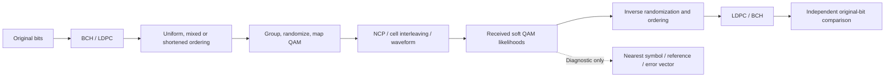

# QAM decisions and coding

These components connect actual BCH/LDPC bits to QAM cells and back. A hard
slicer is available for diagnostics; the receiver still gives soft likelihoods
to LDPC. Data orders are16,64,128,256,512,1024,2048,4096,8192 and16384-QAM.
Control BPSK/QPSK remain separate references.

| Component | Design |
| --- | --- |
| Diagnostic nearest symbol | [Hard slicer](slicer.md) |
| Full uniform codeword rules | [Uniform ordering](uniform.md) |
| Shortened24-column rules | [Shortened ordering](shortened.md) |
| Received boundaries and word length | [Variable receiver](receiver.md) |
| End-to-end shortened reference | [Waveform experiment](waveform.md) |

The normal channel API/CLI supports full words with all of the uniform orders,
as well as its frozen mixed ProfileA. Shortened transport is an explicit Rust
API/reference experiment; it does not automatically replace file EOF padding or
add a new general CLI coding-mode selector. Dynamic profile activation remains
separate work. Passing local specification-derived tests is not external modem
interoperability: QAM-04 external evidence is [deferred](../../development/features/qam-completion/external-vectors.md).
