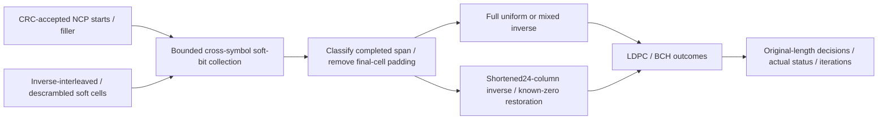

# Receiver length discovery and shortened decoding

The opt-in variable receiver waits for an accepted next-codeword start or a
zero-loaded filler boundary. It counts the actual soft bits between these
boundaries using the acquired profile. It receives no transmitter word length,
codeword ID, source bits or packing metadata. The live PLC gate still supplies
the frozen ProfileA and NCP settings.

PHY I20 §8.3.2, PDF178 requires an odd payload byte count for unambiguous
residual-bit removal. The informative receiver algorithm on PDF179 classifies a
span at least16200 bits as full; below that, it rounds down to the nearest odd
byte count. For a terminated span of $B<16200$ soft bits:

$$
n=\left\lfloor B/8\right\rfloor,\quad
N=8\left(n-\mathbf{1}_{n\ \mathrm{even}}\right),\quad K=N-1968.
$$

This experiment applies that algorithm. Shortened TX admits only $N\bmod16=8$;
invalid/non-byte/even-byte requests reject instead of silently changing data.
Callers still own headers/stuffing; this does not implement DOCSIS MAC framing.
The FEC codec retains its separate bit-granular admission range.

A full uniform word also includes its prescribed bit-interleaver extension.
The receiver discards that extension after inverse ordering and excludes it from
LDPC/payload counts. Any remaining bits must lie in the last nonzero-loaded cell,
not whole unannounced extra cells. Pending storage is bounded to16213 soft bits.
Malformed pointers, orphan continuations, unsupported profiles and impossible
lengths reject. EOF, NULL-with-no-new-start and missing history do not fabricate
a terminal boundary. Supply a real following start/filler through the pipeline
before draining an experiment.

The result retains original-length payload decisions, mother LDPC/BCH decisions,
actual iterations/corrections and known-zero consistency even on failure. The
last source-symbol timestamp describes actual data, not the later boundary that
made its length known. Full-only callers retain their original early-completion
collector; variable reception must be explicitly selected before the session.
