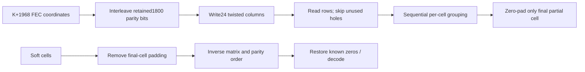

# Shortened codeword ordering

A shortened word uses the [FEC shortening stages](../fec-shortening/README.md)
to transmit $N=K+1968$ bits while retaining all BCH and LDPC parity. Its bit
interleaver always uses24 columns, regardless of whether the data profile is
square, non-square or mixed. It bypasses the uniform demultiplexer.

The row count is

$$
R=\left\lceil\frac{K+1968}{24}\right\rceil.
$$

After parity ordering, coordinate $i$ is written to column $\lfloor i/R\rfloor$
and row $(i\bmod R+t_c)\bmod R$. The final column may have unused locations.
Those locations are represented as holes and **are never transmitted**. This
is distinct from the explicit zero-extension bits of full uniform modes. The
last column starts at twist11 and wraps; row-wise reading skips its holes.
The shortened and full mixed twist tables share the same24-column values.

The immutable stage returns a bijection over exactly $N$ positions. Direct
forward and soft inverse operations expose ordered bits/LLRs for inspection,
preserve caller inputs and reject malformed values. Full $K=14232$ words must
select their full uniform/mixed path, since shortening rules do not apply there.

PHY I20 §7.5.4.3.3 Figure48 and Tables29–30, PDF118–119 governs the matrix;
§7.5.5.2.2, PDF122–123 governs sequential grouping and final-cell zeros. These
rules are shared by the explicit shortened transmitter and receiver. The codec
can handle bit-granular K; [pointer-based transport](receiver.md) adds a separate
byte-size admission requirement.
