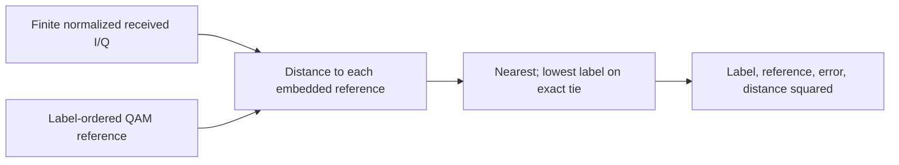

# Diagnostic hard slicer

The slicer answers: **which ideal constellation symbol is closest to this
received I/Q point?** It returns the symbol's bit label, normalized reference
I/Q, received-minus-reference error vector and squared distance. This is useful
for plotting decisions, EVM and symbol-error analysis without duplicating the
QAM table in a future viewer.

For received $r$ and label-ordered ideal points $s_m$:

$$
\hat m=\operatorname*{arg\,min}_m |r-s_m|^2,\qquad
e=r-s_{\hat m},\qquad d^2=e_I^2+e_Q^2.
$$

Exactly equal computed distances choose the lowest label. Near-ties are ordinary
floating-point comparisons; no hidden epsilon changes the boundary. The output
uses unit-average-energy coordinates from the shared mapper. It does not infer
scale, correct gain/phase, inject noise or change the input sample.

The operation is stateless, allocation-free and bounded to at most16384 point
comparisons. Unsupported orders, nonfinite I/Q and overflowing distance metrics
reject. LDPC continues to receive the existing max-log **soft** likelihoods; hard
decisions do not replace that information. Results are direct Rust test points;
no new registered JSONL slicer stream is claimed.
