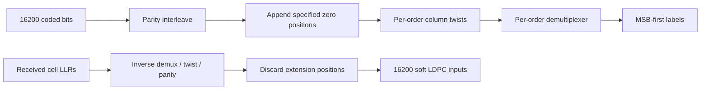

# Full uniform codeword ordering

A full downstream LDPC word has16200 bits. Each uniform modulation order has a
specific column geometry, twist table and bit-to-cell demultiplexer. Using mixed
rules for an unsupported uniform order would produce a reversible but incorrect
transmitter; the implementation now selects the actual per-order tables.

| Order | Rows | Columns | Added zeros | Data cells |
| ---: | ---: | ---: | ---: | ---: |
| 16 | 2025 | 8 | 0 | 4050 |
| 64 | 1350 | 12 | 0 | 2700 |
| 128 | 2315 | 7 | 5 | 2315 |
| 256 | 2025 | 8 | 0 | 2025 |
| 512 | 1800 | 9 | 0 | 1800 |
| 1024 | 810 | 20 | 0 | 1620 |
| 2048 | 1473 | 11 | 3 | 1473 |
| 4096 | 675 | 24 | 0 | 1350 |
| 8192 | 1247 | 13 | 11 | 1247 |
| 16384 | 1158 | 14 | 12 | 1158 |

For rows $R$, columns $C$ and prescribed twist $t_c$, input column position
$(c,r)$ is written to $(c,(r+t_c)\bmod R)$. Reading a row assigns each column to
its demultiplexer substream. Some square modes split each row into two cells;
256-QAM uses one cell per row. PHY non-square modes and16384-QAM use one cell per
row as specified. The output-bit count is $RC$; extension size is $RC-16200$.

The immutable permutation exposes extended coordinate indices: values below16200
refer to the original LDPC word; larger values identify appended zeros. Encoding
inserts those zeros, and soft inversion removes them after reversing their
routing. It preserves the16200 retained likelihoods exactly. Direct twist/demux
stages consume the padded size; callers composing stages insert padding after
parity and remove it after inverse twisting. No new LDPC mother matrix is selected.

Sources: CM-SP-PHYv3.1-I20-230419 §7.5.4.3.1 Tables24–26, PDF116–117;
§7.5.5.2.1 Tables32–37, PDF121–122. Square demultiplexing follows ETSI EN302769
V1.2.1 §6.2.1 Table10(a), PDF36, selecting the16200-bit8/9 entries. Local original
PDF tables were visually checked. DOCSIS4.0 I07 §7.3.5.5 delegates mapping to I20.
Independent transcribed matrices, preserved16/256 anchors and actual randomized
soft/FEC trials cover every order. External interoperability remains separate.
