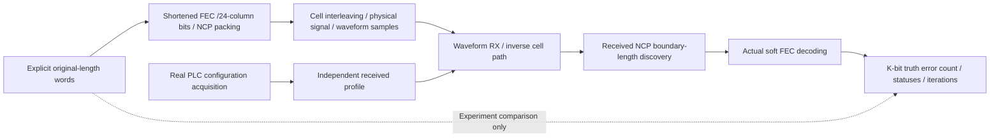

# Shortened waveform reference experiment

This bounded reference runs explicitly supplied shortened words through the
actual transmitter and receiver. It starts by acquiring OCD/ProfileA/NCP over
PLC, then sends coded payload/NCP cells through time/frequency interleaving,
physical assembly, IFFT, prefix/window processing and the sample receiver.



Run from the repository root:

```bash
scripts/cargo-local.sh run -p docsis-ofdm-fec --example shortened_waveform --release --locked
```

The example uses128-QAM,25kHz spacing, depth4 and original lengths1032/6136 bits.
Their transmitted lengths are3000/8104 bits, both odd byte counts. JSON reports
actual recovery and link statistics. No random noise is added. The experiment
fails on configuration/transport errors and reports genuine decoder outcomes;
the example exits unsuccessfully if any expected noiseless recovery fails.

The Rust operation accepts one to16 explicitly supplied words, validates all
lengths/values before processing and limits completion to4096 source symbols.
A following real NCP filler terminates the last word before interleaver drain.
Waveform probe selections use the existing bounded infrastructure. Direct TX
APIs return shortened mother/ordered-bit test points; RX exposes soft/decoded
stages and original-length decisions. No new short-specific JSONL event IDs
or generic channel request schema are introduced.

Tests cover both25/50kHz spacings,128-QAM,16384-QAM and mixed loading including
zero-bit cells. The ordinary channel command separately exercises full uniform
orders through16384-QAM. Existing continuous PRBS/file jobs keep full-word EOF
padding, duration/cancellation behavior and their JSON contract. A general
shortened-traffic scheduler, automatic MAC framing and externally verified
interoperability are beyond this explicit reference experiment.
