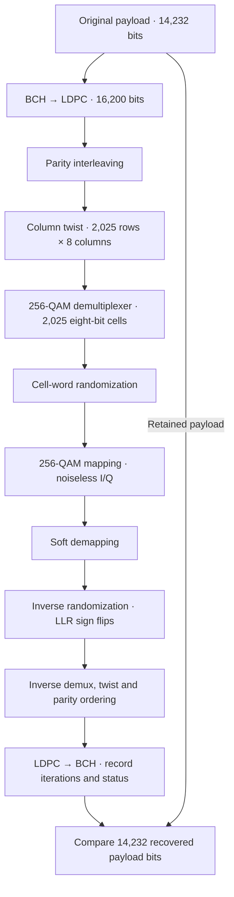

# Noiseless 256-QAM coding loop

This experiment connects BCH/LDPC coding, short256-QAM bit processing, cell-word
randomization, mapping, soft demapping and reverse decoding. It compares the
recovered payload with the original and reports LDPC iterations per codeword.

These are **independent codeword trials**, not physical OFDM transmission. Each
trial initializes fresh phase-zero randomizers. This isolated loop does not use
the separate [stateful symbol packer](symbol-packing.md) or [NCP codec](ncp.md).
The separate [cell-interleaving API](cell-interleaving.md) now transports mapped
cells and pilot placeholders. Actual pilot/control signals and waveform
generation remain pending. The existing CLI `simulate` mode remains16-QAM.

## Run and inspect JSON

From the repository root:

```bash
./scripts/cargo-local.sh run -p docsis-ofdm-fec --example qam256_codec_loop --locked
```

The example runs three seeded random payloads, not PRBS, and prints a JSON array
with one result per codeword. It exits with an error if a payload fails recovery.
Important fields include:

```json
{
  "coding_mode": "ds_short_8_9_256qam_noiseless_cell_loop",
  "data_cells": 2025,
  "coded_bits_tested": 16200,
  "pre_ldpc_bit_errors": 0,
  "post_ldpc_bits_tested": 14400,
  "post_ldpc_bit_errors": 0,
  "payload_bits_tested": 14232,
  "payload_bit_errors": 0,
  "ldpc_iterations": 0,
  "ldpc_success": true,
  "bch_success": true,
  "bch_corrected_bits": 0,
  "llr_reference_noise_power": 0.01
}
```

Actual results also include assumptions documenting the experiment's limits.
`ldpc_iterations` is the decoder's count for that word. **Zero is valid**: initial
hard decisions in a noiseless trial can satisfy parity checks without iterative
updates. Inspect success flags and payload truth errors alongside the count.

The reference variance0.01 supplies finite soft-bit scaling; no random channel
noise is injected. It is not an estimate of measured MER.

## Pipeline



## Bit-processing equations

Let $\lambda$ be the16200-bit LDPC word, with14400 information bits. For
parity-group parameter $Q=5$, parity interleaving produces $u$:

$$
u_i=\lambda_i\quad(0\le i<14400),\qquad
u_{14400+360t+s}=\lambda_{14400+5s+t},
\quad0\le t<5,\quad0\le s<360.
$$

Write column-wise with2025 rows,8 columns and offsets
$t_c=(0,0,0,1,7,20,20,21)$:

$$
c=\left\lfloor\frac{i}{2025}\right\rfloor,\qquad
r=(i+t_c)\bmod2025,\qquad v_{8r+c}=u_i.
$$

The short256-QAM demultiplexer uses

$$
\pi=(7,3,1,5,2,6,4,0),\qquad y_{\pi(c),r}=v_{8r+c}.
$$

Each row yields one MSB-first cell label:

$$
\ell_r=\sum_{k=0}^{7}y_{k,r}2^{7-k},\qquad
16200/8=2025\text{ cells}.
$$

This uniform non-shortened mode needs no padding. The receiver restores original
codeword positions on soft bits before LDPC decoding. Do not reuse the16-QAM
demultiplexer: its permutation differs and it splits each row into two cells.

## Public Rust APIs

`BitInterleaver::new(order)` supports short8/9 uniform16or256-QAM. It owns an
immutable permutation. `encode_labels` accepts16200 binary values and returns4050
or2025 labels. `decode_llrs` reverses the permutation on16200 finite cell-order
LLRs while preserving signs/magnitudes. Unsupported coding orders return
`UnsupportedCodingMode` until padding/demultiplexing rules are verified. Their
[QAM references](qam-mapping.md) remain independently available.

`simulation::coding_loop::NoiselessQam256Codec` owns reusable setup. Call
`run_block(payload, max_iterations)` with14232 binary bits and an iteration cap
from1through100. It returns a typed serializable `Qam256BlockResult`. Inputs remain
unchanged. Each request is bounded to one block; multi-block callers manage
cancellation/progress between requests. Valid requests may return failed decoder
outcomes; flags and truth counts remain separate from invalid-input/setup errors.

## Evidence and tests

- CM-SP-PHYv3.1-I20-230419 §7.5.4.3.1 Tables24–25, PDF116: rows/columns and twists.
- PHY I20 §7.5.5.2.1, PDF121: delegates256-QAM demultiplexing to DVB-C2.
- ETSI EN302769 V1.2.1 (2011-04) §6.1.3, PDF32–34: parity/twist definitions.
- ETSI §6.2.1 Table10(a), PDF36–38: short256-QAM substream order and direct cells.

Independent hand-calculated first/second/last cell index vectors verify direction
and parity handling beyond invertibility. Tests check bijections, impulse routing,
exact soft-value preservation and input rejection. All-zero, all-one, edge-bit
and seeded payloads recover without errors. These are not external DOCSIS
interoperability vectors or a one-second RF/channel result.

The separate [symbol packer](symbol-packing.md) now establishes planned NCP
pointer locations across symbols. The [NCP codec](ncp.md) now encodes and
decodes those messages; see [transmission settings](transmission.md).
