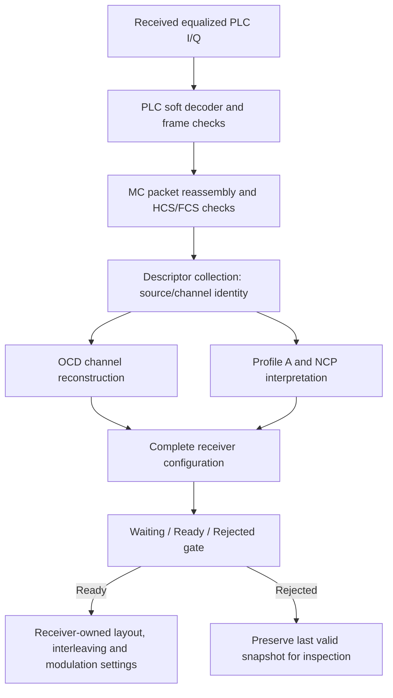

# Receiver configuration from PLC

The receiver now uses recovered PLC descriptors to construct its own channel
configuration. It does not copy transmitter settings or treat a decoded message
as proof that every required setting has arrived.

The design is encapsulated: each subsystem owns one part of acquisition, with
private mutable state and immutable completed configuration passed to consumers.

| Subsystem | Design guide | Responsibility |
| --- | --- | --- |
| Channel reconstruction | [Channel](channel.md) | Decode OCD geometry using the shared physical-layout validator |
| Profile interpretation | [Profiles](profiles.md) | Apply received default/specific assignments and protected-role precedence |
| Descriptor collection | [Collection](collection.md) | Keep one coherent fixed-session set with bounded storage |
| Configuration assembly | [Complete configuration](configuration.md) | Validate available components and construct the complete receiver snapshot |
| Readiness and admission | [State](state.md) | Gate data/NCP settings and preserve history after rejection |
| Receive composition | [Acquisition](acquisition.md) | Connect actual PLC I/Q decoding, MC reassembly and descriptor admission |



The known-phase PLC bootstrap still supplies spacing and frame alignment before
these messages can be recovered. The OCD must agree with that spacing. Channel
identity, frequency origin, physical assignments, prefix, roll-off, interleaving
depth, ProfileA loading and NCP modulation come from the received packets.

This is a fixed-session reference implementation. OCD and each DPD have their
own independent change count; they do not need equal counts. Exact repeats are
accepted. Changed packet content requires an explicit acquisition reset; dynamic
profile activation and live modem behavior remain separate work. A configuration
can describe supported DPD assignments without establishing payload-codec support
for every constellation order.

The [PLC example](../plc-channel.md) now performs receiver configuration as part
of its real message/FEC/QAM receive path:

```bash
./scripts/cargo-local.sh run -p docsis-ofdm-fec --example plc_channel --locked
```

It reports the configuration learned by the receiver, together with received
descriptors, actual decoder iterations and information-bit comparisons. The separate [waveform path](../waveform/README.md) now adds IFFT, windowed
sample transfer and matched FFT recovery. The [fixed payload receiver](../payload-transport/receiver.md) now consumes the
received snapshot and checks the live gate. Duration-based job orchestration
remains a later stage. The readiness gate is available to those
future consumers; existing standalone codec functions remain independently usable.

See [architecture](../../architecture.md), [checklist](../../development/checklist.md)
and [source evidence](../../reference/plc-evidence.md). These pages explain design;
API details remain in rustdoc and the [public API reference](../../reference/public-api.md).
