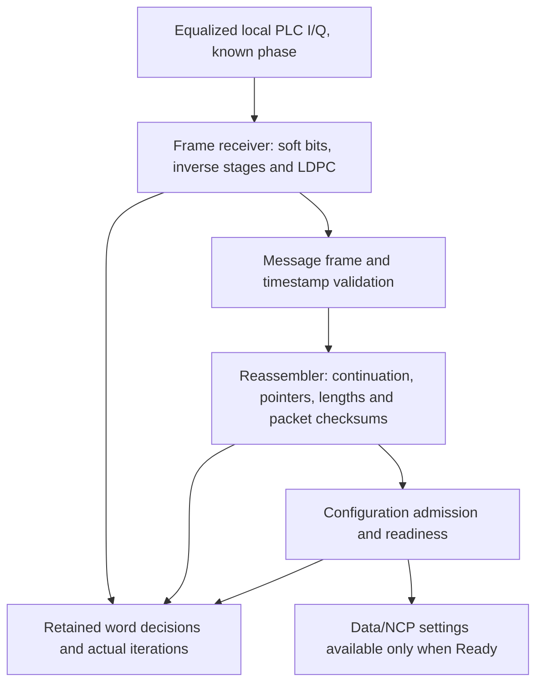

# Receive-path composition

The acquisition component connects three encapsulated receivers: PLC frame
recovery, message-channel packet reassembly and configuration admission. Each
subsystem retains its own responsibility and state.

Only received I/Q, known PLC spacing/alignment and decoder work/noise settings
enter the composed receive path. Transmitter channel/layout/profile objects are
not arguments. Packet boundaries come from decoded MC pointers and lengths;
configuration comes from decoded packet fields.

A decoded message supplies its MC block directly, avoiding serialization just to
slice out the message-channel bytes. Reassembled packets are CRC-validated before
admission. Packet outcomes retain their received bytes for bounded inspection,
including packets rejected later for configuration inconsistency.

FEC nonconvergence, timestamp/message failure, transport failure and descriptor
rejection remain distinct diagnostics. Completed decoder decisions and iteration
counts remain in the returned result when later processing rejects a message.
Failures close the configuration gate without deleting the last valid snapshot.
The receiver can always continue PLC decoding to collect valid repeats or a new
session; a closed data gate does not prevent receiving control messages.

A transport reset and configuration reset occur together for a new acquisition
session. Missing packet fragments are never fabricated; if an interruption leaves
an unrecoverable continuation, reset/reacquisition is explicit in this reference
implementation. Automatic loss recovery and descriptor timeouts are not added.

Integration tests send real descriptors over multiple coded/QAM PLC frames,
observe Waiting then Ready, and construct physical/pilot/interleaver consumers
from received configuration alone. See [the overview example](README.md) and
[the full PLC guide](../plc-channel.md). The separate [waveform experiment](../waveform/reference-experiment.md) now
feeds actual sample-recovered PLC cells into this component. The [payload waveform proof](../payload-transport/reference-experiment.md)
now derives its payload receiver from this gate. The
[channel stepper](../channel-runner/README.md) now uses the same acquisition;
formal cancellable job and CLI delivery remain later work.
