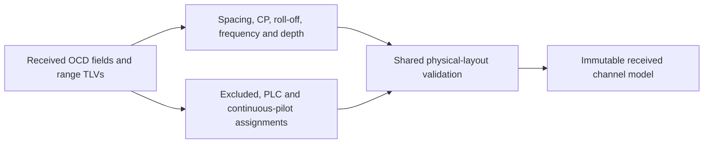

# Channel reconstruction

This subsystem turns a received OCD into receiver-owned channel geometry. The
same physical-layout validator used elsewhere owns the geometry rules, so packet
validation and receiver construction cannot quietly disagree about PLC placement,
pilot locations or exclusions.

Reconstruction checks mandatory excluded edges, PLC neighborhood and grid,
continuous-pilot assignments, frequency overflow and permitted transmission
parameters. There is no second implementation of those physical rules hidden in
the receiver controller. Rejected geometry never becomes an operational setting.

The receiver retains the decoded primary-capability flag and exact frequency
origin. It derives active bounds and internal exclusions from the assignment
map; unspecified nonprotected carriers are data carriers within that map.

OCD does not transmit the source program's occupied-bandwidth setting. For the
existing layout validator, reconstruction infers the smallest allowed envelope:

$$
B_{min}=\max\left(24\,\mathrm{MHz},
6\,\mathrm{MHz}\left\lceil
\frac{(k_{end}-k_{first})\Delta f}{6\,\mathrm{MHz}}
\right\rceil\right).
$$

This is an explicit engineering inference, not a recovered wire field. A
transmitter configured with a 192 MHz cap can describe a smaller active envelope;
the receiver must not claim it learned 192 MHz merely because the transmitter used
that setting in its own program.

The completed model owns its settings and layout assignments. Consumers can
construct a physical role map from those received values without borrowing a
transmitter object. See [configuration assembly](configuration.md).
