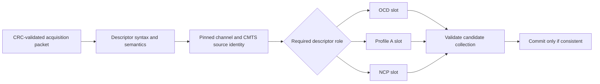

# Descriptor collection

The collector keeps one OCD, one ProfileA DPD and one NCP DPD for a fixed
acquisition session. It accepts any arrival order and reports missing roles
explicitly instead of inventing settings for absent messages.

The first accepted descriptor pins the downstream channel ID and source CMTS
MAC-domain address. Later descriptors must agree. This identifies one session;
it is not cryptographic source authentication.

Storage is bounded to the three required packets and their parsed fields. An
identical packet is an idempotent repeat. Packet changes, including different
content under the same change count, are rejected by the fixed-session policy.
Reset explicitly starts a new collection. This intentionally does not implement
the timing and activation rules for dynamic DPD changes.

OCD's change count and the two DPD counts belong to different objects. They are
preserved independently; requiring all three numbers to match would reject valid
configurations. No numeric newer/older inference is made from modulo counters.

Admission works on a candidate copy. A bad packet or a failed cross-message
check leaves the accepted collection unchanged. If a DPD arrives before OCD,
its structural checks happen immediately and grid/coverage checks happen when
OCD arrives. A contradictory cached set may require an explicit reset; the
collector does not silently evict previously accepted descriptors to make a
later packet fit.

See [state transitions](state.md) for what rejection means to the data gate.
