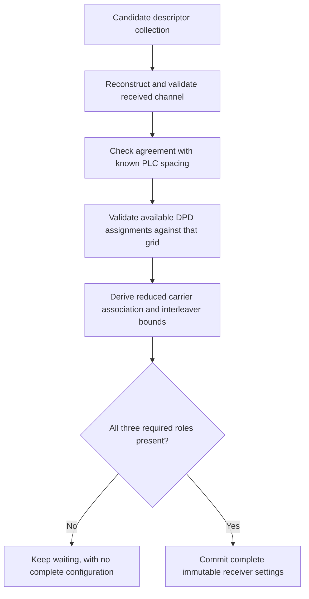

# Complete configuration assembly

Assembly joins the independently received channel and profiles into one complete,
immutable receiver snapshot. It is the point where individually valid messages
must also agree as a usable configuration set.

Validation starts as soon as enough information is available. Once OCD is known,
any available DPD is checked against its grid even if the other DPD is still
missing. No partially assembled object is exposed as Ready.

The complete snapshot retains received channel/source identity, OCD count,
ProfileA count, NCP count, channel geometry, both loading maps and the uniform
positive NCP modulation. It derives the reduced data/scattered-pilot carrier
association by excluding physical PLC, continuous pilots and excluded bins.
Interleaver settings use that received spacing, association size and depth.

All fields are private to their owners. Consumers borrow immutable views or
construct their own downstream processing objects from the snapshot. A caller
cannot mutate a profile map inside the active configuration or assemble a fake
Ready object by editing public fields.

Readiness means this fixed-session configuration is complete and validated. It
does not mean a waveform has synchronized, payload decoding has succeeded, or
all advertised constellation coding modes are implemented. The initial waveform receiver uses explicit reference/bootstrap settings.
The fixed [payload receiver](../payload-transport/receiver.md) now checks this
snapshot and live gate. Dynamic profile activation and full duration-based job
orchestration remain later work. See [readiness state](state.md) and [receive composition](acquisition.md).
