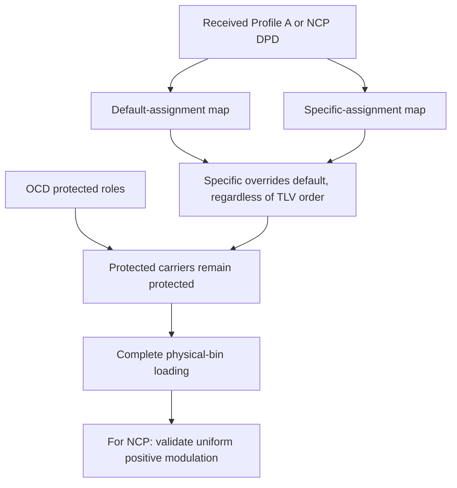

# Received profile interpretation

A DPD describes carrier loading. This subsystem applies received assignments to
the received OCD grid rather than substituting a local default profile.

Each carrier may have at most one default and one specific assignment per DPD.
Specific values win over defaults regardless of the order of TLVs. Duplicate
assignments in either class, ranges outside the OCD FFT or unassigned data bins
are rejected. OCD exclusions, PLC and continuous pilots have higher precedence
than DPD loading.

The resulting map distinguishes three cases:

- Protected carrier: no data/NCP loading applies there.
- Explicit zero-bit loading: the received profile assigns zero bits.
- Positive loading: the received profile assigns a modulation bit count.

These cases must not be merged into a single zero or unknown value. Scattered
pilots remain a symbol-dependent override supplied by the existing physical
pattern, rather than a permanent protected assignment in the DPD.

The NCP profile may mark some carriers zero-loaded. Its positive assignments
must use one uniform QPSK, 16-QAM or 64-QAM constellation. A profile with no positive
NCP assignments is rejected. ProfileA and NCP retain their own profile IDs and
independent change counts.

The current receive subset accepts the existing range TLVs. It does not add
list/vector encodings, multipart descriptors or dynamic profile activation.
Loading information alone does not establish that every data coding mode has
been implemented. See [collection](collection.md) and [complete configuration](configuration.md).
