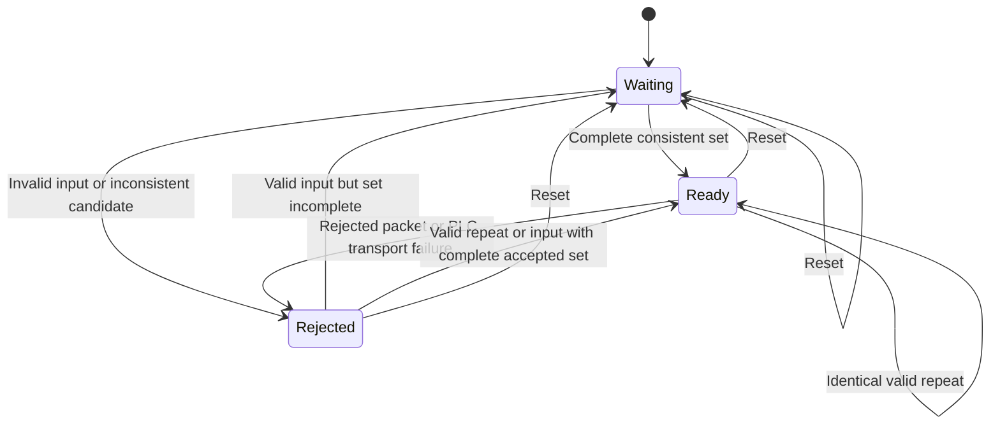

# Receiver readiness and rejection state

The state owner controls whether consumers can obtain settings for data/NCP
recovery. It keeps admission decisions separate from the lifetime of the last
valid snapshot.

**Waiting** means required descriptors are missing. **Ready** means a complete
consistent configuration has been accepted. **Rejected** records a failed
admission or upstream receive operation. Only Ready opens the data-configuration
gate.

On rejection, accepted descriptors and the last valid configuration remain
unchanged. The diagnostic view can still show the last valid snapshot, but that
view must not be used to bypass the closed gate. This conservative laboratory
policy prevents a rejection from silently looking like continued readiness.

A subsequent valid packet can restore Waiting or Ready from the unchanged
accepted collection. An identical repeat is enough to restore Ready when that
collection was already complete. Reset discards descriptors, the historical
snapshot and rejection diagnostics, beginning a fresh fixed session with the
same bootstrap spacing. A different bootstrap spacing requires a new receiver.

The owner records a typed rejection reason. It does not clear good state before
validation, replace a missing profile with guessed values or install a changed
DPD without activation rules. Dynamic switching remains separate work. See
[collection](collection.md) and [acquisition composition](acquisition.md).
