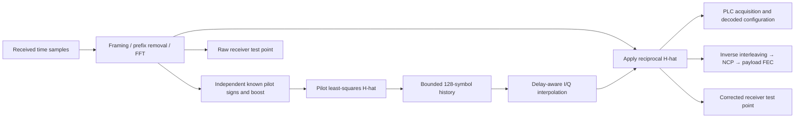

# Receiver Channel Estimation (CH-EST-RX)

Channel Estimation (CH-EST) identifies the processing function; **Receiver Channel
Estimation (CH-EST-RX)** identifies its direction. Transmitter-side work uses
CH-EST-TX. MERLIN now provides a receiver-derived pilot estimate alongside the
existing supplied-channel reference receiver. All algorithms and results are Rust.



| Subsystem | Design |
| --- | --- |
| Independent pilot references and least squares | [Pilot observations](pilots.md) |
| Coverage, delay removal and correction | [Interpolation/equalization](interpolation.md) |
| Bounded sample-boundary acquisition | [Timing search](timing.md) |
| Matched pilot/PLC plots and JSON | [Protected analyzers](analyzers.md) |

Set `receiver_mode` to `pilot_estimated` in a channel request. Omission retains
`supplied_channel`, preserving the earlier reference experiment. The simulation
applies the supplied response H to the channel, but pilot-mode construction never
passes H to the receiver. Channel noise budgets remain simulation calibration;
this is not an implementation of blind modem noise estimation.

**[MERLIN Channel Estimation (MCE)](mce.md)** adds received-only decoder reliability
and an Off-by-default control in Receiver Configuration. Supplied H impairs the
signal in both states: the default workflow uses supplied 1/H when Off, while MCE
On derives 1/H-hat from received pilots without access to H or simulated noise
powers. The toggle does not change the channel impairment. Existing explicit
receiver-mode requests retain their meaning. The [waveform channel filter](../impairments/waveform-filter.md)
independently adds static continuous sample memory and bounded echo/CM-response models.

The CLI runner retains explicit sample timing and PLC phase. The separate timing
API can search an unknown bounded sample offset with known numerology/PLC phase.
It does not discover arbitrary carrier frequency, numerology or PLC frame phase;
full blind acquisition remains WAVE-RX-05. The frozen applied profile remains
ProfileA ID0, with all ten uniform data orders or supported mixed bit loading.

Run the tracked bounded example:

```bash
scripts/cargo-local.sh build -p ofdm-fec-cli --release --locked
target/release/ofdm-fec channel --input examples/cli/channel-pilot-estimated.json \
  --output pilot-receiver-result.json
```

Use new output paths. Results include a final `channel_estimate`, optional
`protected_constellation`, actual FEC outcomes and the effective settings. The
same typed results are available from `ChannelRun`/`run_channel` without a CLI.
Qt consumes these Rust results; future Python bindings will use the same APIs.
