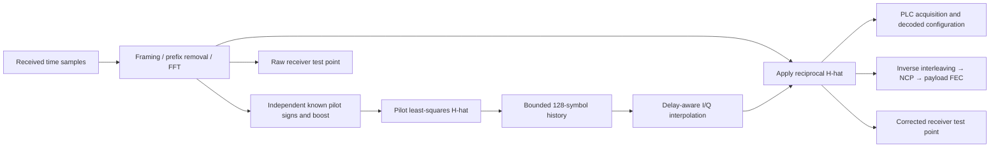

# Receiver Channel Estimation

MERLIN provides a receiver-derived pilot estimate alongside the supplied CM
channel estimate. All algorithms and results are implemented in Rust.

Start with the **[receiver-mode comparison](modes.md)** for the three UI choices,
what each estimates, noise confidence, default/unity behavior and saved-WB/API
names. Both estimated modes use received pilots; MCE additionally estimates noise.



| Subsystem | Design |
| --- | --- |
| Independent pilot references and least squares | [Pilot observations](pilots.md) |
| Coverage, delay removal and correction | [Interpolation/equalization](interpolation.md) |
| Bounded sample-boundary acquisition | [Timing search](timing.md) |
| Matched pilot/PLC plots and JSON | [Protected analyzers](analyzers.md) |

Set `receiver_mode` to `pilot_estimated` in a channel request. Omission retains
`supplied_channel`, preserving the earlier reference experiment. The simulation
applies the supplied response H to the channel, but pilot-mode construction never
passes H to the receiver. Channel noise budgets remain simulation calibration;
this is not an implementation of blind modem noise estimation.

**[MERLIN Channel Estimation (MCE)](mce.md)** adds received-only decoder reliability.
Select **Pilot-based channel and noise estimation (MCE)** in the Receiver mode
dropdown. The default is **Supplied CM channel estimate**. The separate
**Pilot-based channel estimation** choice estimates channel correction while
using simulator-calibrated decoder noise. Supplied channel estimates still
impair the signal independently of the receiver mode. The
[waveform channel filter](../impairments/waveform-filter.md) independently adds
static continuous sample memory and bounded echo/CM-response models.

The CLI runner retains explicit sample timing and PLC phase. The separate timing
API can search an unknown bounded sample offset with known numerology/PLC phase.
It does not discover arbitrary carrier frequency, numerology or PLC frame phase;
full blind acquisition remains WAVE-RX-05. The frozen applied profile remains
ProfileA ID0, with all ten uniform data orders or supported mixed bit loading.

Run the tracked bounded example:

```bash
scripts/cargo-local.sh build -p ofdm-fec-cli --release --locked
target/release/ofdm-fec channel --input examples/cli/channel-pilot-estimated.json \
  --output pilot-receiver-result.json
```

Use new output paths. Results include a final `channel_estimate`, optional
`protected_constellation`, actual FEC outcomes and the effective settings. The
same typed results are available from `ChannelRun`/`run_channel` without a CLI.
Qt consumes these Rust results; the native Python bindings use the same APIs.
