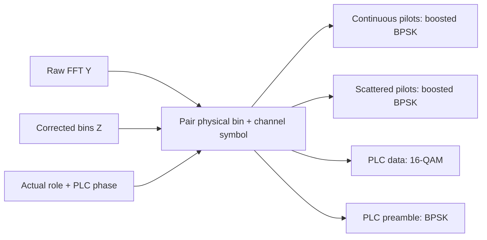
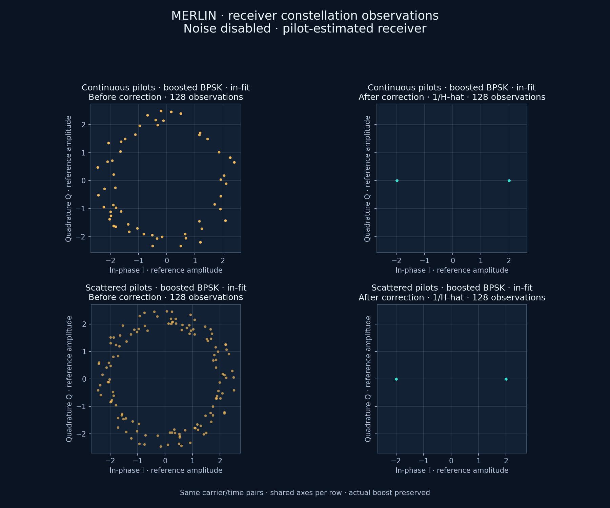
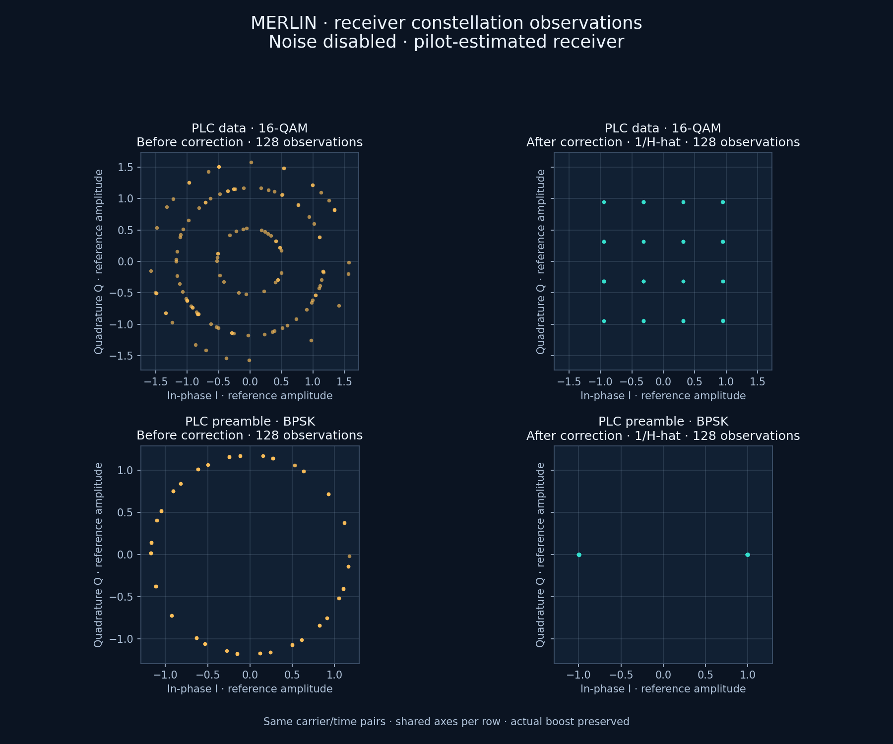

# CH-EST-RX protected-signal analyzers

Pilot and PLC analyzers observe the two existing boundaries at the same physical
carrier/time: `rx.fft.bins` before correction and `rx.equalized.iq` after correction.
They do not use payload eligibility or wait for successful PLC decoding.



Request the shared collector with:

```json
"protected_constellation": {
  "pairs_per_stream": 2048,
  "first_channel_symbol": 128,
  "end_channel_symbol_exclusive": 1024
}
```

This is a fragment; use [the complete example](../../../examples/cli/channel-pilot-estimated.json).
Counts are actual pairs, not OFDM symbols. Four streams each permit1..8192 pairs,
so the combined hard bound is32768 pairs; the CLI additionally bounds output bytes.
A finite half-open channel-symbol window is required. Defaults are2048 per stream
and symbols0..1024. Empty/short streams report unavailable/partial status; samples
are never repeated to fill a target. Completed streams stop retaining.

Output `protected_constellation` names each stream separately and records its
modulation, status, count, bin/frequency/symbol/PLC phase, both I/Q values, estimate
readiness and pilot reference. `used_in_current_fit` labels current pilot training
samples; `prior_channel_prediction` preserves the pre-update prediction where
available. This prevents a fitted pilot collapsing to its own ideal point from
being mistaken for independent receiver accuracy. Do not combine pilot boost
with unit-reference PLC points or merge PLC preamble with16-QAM data.

Capture happens before external callbacks and before PLC frame decoding, so a
failed PLC or observer can still leave earlier/completed receive observations in
the job's partial result. Cancellation before reception returns honest empty
streams. Removing a collector stops diagnostic retention without changing source,
noise or decoder state. Tests compare noisy FEC summaries with capture on/off.

A new bounded test point, `rx.channel_estimation.response`, exports the estimated
full physical grid. `ChannelRun.channel_estimate()` and the final job field
`channel_estimate` expose the same latest response, readiness, pilot observations,
age and interpolation slope. It is not a saved history of every full FFT grid.

The existing [supplied-H demonstration](../impairments/pilot-plc-constellation.md)
remains the reference baseline. The measured pilot-derived figures below come from shared Rust CLI output;
no Python DSP is involved.





These use the full captured channel, noise disabled,8ms observation and128 pairs
per protected stream after symbol128. The run compared9,620,832 payload bits
with zero bit errors. Pilots shown are used in the fit; the PLC samples are
separate observations corrected using interpolation.

To reproduce, import the existing single-channel fixtures, then run:

```bash
mkdir -p docs/development/local/pilot-receiver-demo
target/release/ofdm-fec import-pnm \
  --input examples/measurements/single-channel/import.json \
  --output docs/development/local/pilot-receiver-demo/scenario.json
target/release/ofdm-fec channel \
  --input examples/measurements/single-channel/channel-pilot-estimated.json \
  --scenario docs/development/local/pilot-receiver-demo/scenario.json \
  --output docs/development/local/pilot-receiver-demo/result.json
```

Build the release CLI first as described in the receiver index. Use new paths.
The existing presentation helper accepts this shared job result as well as the
earlier standalone demonstration result; pass `--group pilots` or `--group plc`.
