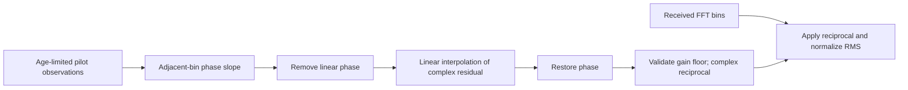

# CH-EST-RX interpolation and equalization

Pilot observations are sparse within one symbol. The engineering estimator uses
a bounded128-symbol history, consistent with the PHY's full scattered-pilot
pattern. PHY I20 section7.5.15.1, PDF166–167 explains interpolation/ingress
limitations; it does not mandate this particular numerical receiver algorithm.

Estimate a mean adjacent-bin phase step from normalized products of adjacent
observed responses. Adjacent bins avoid the ambiguity introduced by the much
wider same-symbol pilot comb. Remove this phase slope before interpolating
complex I/Q, then restore it:

\[
\omega=\arg\!\sum_{k:\,k,k+1\,\mathrm{observed}}
 \frac{\widehat H_{k+1}\widehat H_k^*}{|\widehat H_{k+1}\widehat H_k^*|},
\quad R_k=\widehat H_ke^{-j\omega k},
\]

\[
R(k)=(1-a)R_l+aR_r,\quad a=\frac{k-l}{r-l},\qquad
\widehat H(k)=R(k)e^{j\omega k}.
\]

Before adjacent observations exist, the phase-slope estimate is zero and results
are provisional. At active edges the nearest residual is held constant; internal
gaps, including the PLC strip, are interpolated. Excluded bins are marked unity
for full-grid shape only. They are not measured channel estimates.

The inverse rejects nonfinite values or estimated gain power below1e−12 rather
than emitting unbounded corrections. This floor is an application numerical
policy, not a CableLabs RF threshold. With configured reference RMS A:

\[
Z_k=Y_k/(A\widehat H_k).
\]

In pilot mode, initial raw PLC samples are retained for one bounded128-symbol
frame. At frame end they are corrected with the completed pilot estimate before
PLC FEC/packet admission. This avoids losing the initial descriptors while
training. Analyzer samples retain their original causal pre/post boundaries;
they are not silently replaced by that block-reprocessed PLC decoder input.

The simulator converts its post-reference residual budget to raw-bin variance
using the physical channel model, then scales by the applied estimated inverse
power. It does not add a second noise source. This is conditional demapper noise
calibration, not a complete posterior model of estimator uncertainty. Interpolation
error, aging and pilot noise can still degrade constellation/FEC outcomes.

This estimator assumes a channel sufficiently stable over its history and PLC
frame. Fast variations, narrow ingress, deep nulls and phase structure that the
available pilots cannot resolve may cause decoding failure. The model is a
synchronized frequency-diagonal response, not an arbitrary FIR/RF receiver.
Independent imposed-response tests verify linear-phase compensation across PLC
and edge gaps. Noisy tests verify real decoding and observation invariance;
supplied-H reception remains the separate baseline.
