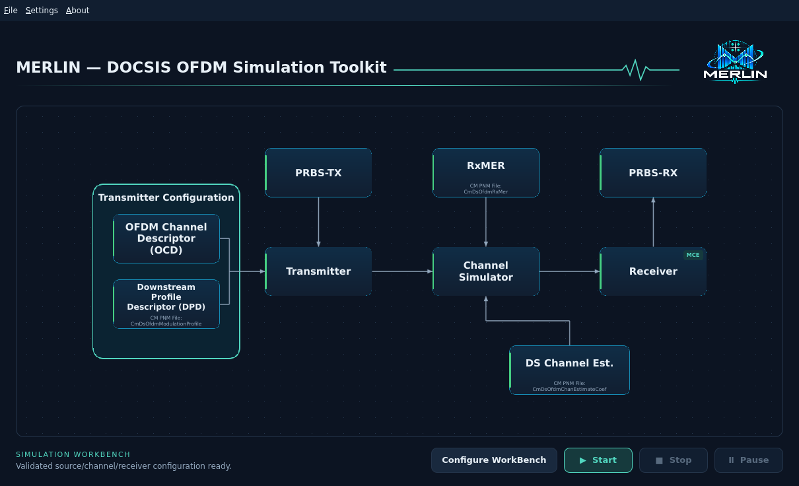
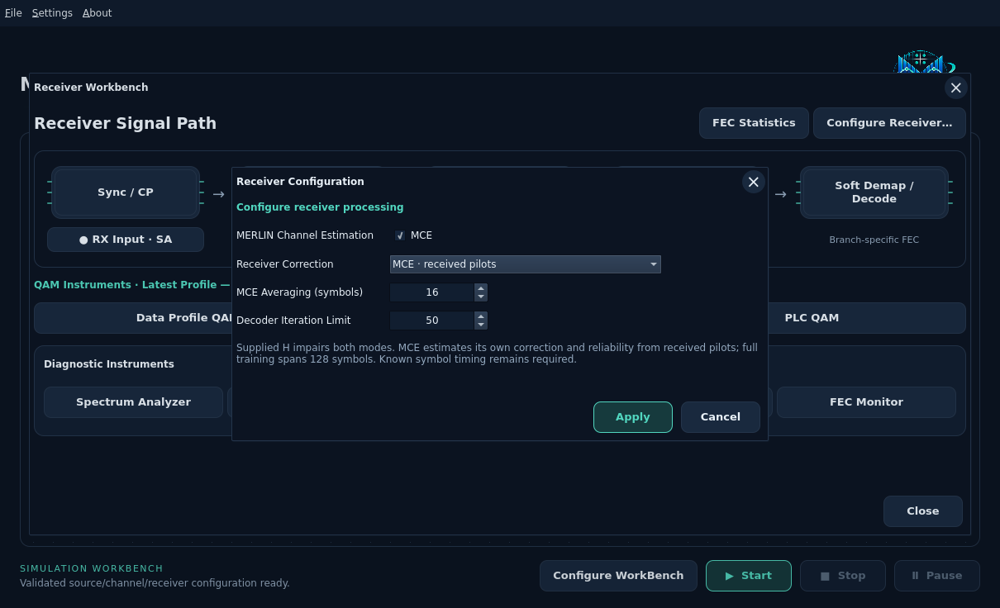
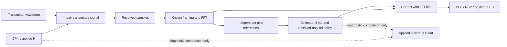
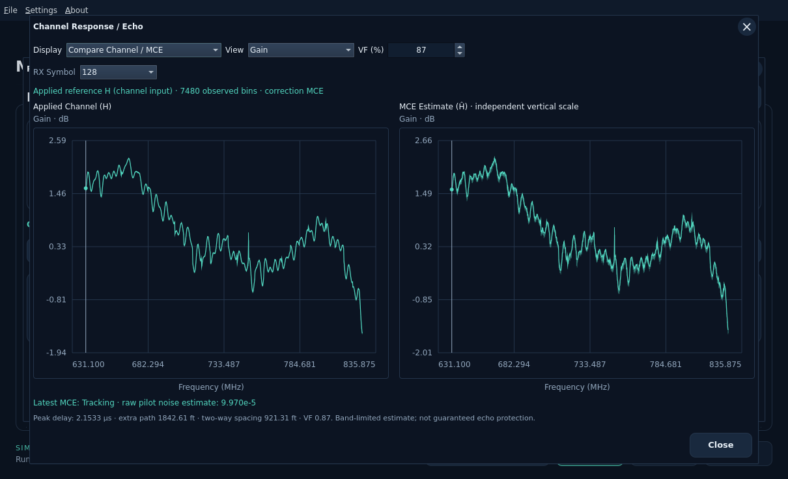

# MERLIN Channel Estimation (MCE)

[Documentation index](../../README.md)

MCE lets the receiver estimate its own channel correction and decoder reliability
from received pilots. It receives neither the imported CM channel coefficients
nor the simulator's exact noise powers. All estimation and decoding run in Rust.

Enable **Receiver → Configure Receiver → MERLIN Channel Estimation → MCE** and
select **Apply**. MCE is **Off by default**. The small **MCE** chip appears on the
main Receiver block when enabled; the block and centered heading keep their
existing layout. Cancel and the title X discard draft changes. Settings persist
with the workbench and take effect on the next run; Apply is disabled while a
simulation is active. Stop the current run before changing accepted settings.

With MCE enabled, the direct DS Channel Est. connection into Receiver is hidden.
The connection to Channel Simulator remains: supplied H still impairs the signal.
The signal connection from Channel Simulator to Receiver stays visible.

| MCE | Channel simulator | Receiver correction |
| --- | --- | --- |
| Off, default reference workflow | Applies supplied H. | Uses supplied H to calculate 1/H. |
| On | Applies the same supplied H. | Estimates H-hat from received pilots and applies 1/H-hat. |

Existing **Pilot-estimated H-hat** requests remain available as a separate legacy
mode with simulation-calibrated noise. They do not enable the MCE chip. Switching
MCE Off selects supplied-H reference correction; opening and cancelling the
dialog does not change an existing mode.

## Training, tracking and elapsed time

The existing pilot estimator uses continuous and scattered pilots. Initial
estimates interpolate available observations; after **128 OFDM symbols** it marks
the full-pattern history ready. The run status shows **MCE Training** and then
**MCE Tracking**. Tracking means sufficient history, not guaranteed accuracy.

Training is part of acquisition, not an automatic extra 128 symbols added after
the reference run's acquisition. For a 45 µs symbol, 128 periods span 5.76 ms of
simulated signal. Estimation and possible additional decoding work can increase
wall-clock runtime. Simulated duration and elapsed processing time remain distinct.

Known symbol timing, sample rate and bootstrap pilot/layout assumptions remain
explicit. MCE is **pilot-assisted**, not arbitrary blind RF acquisition. Existing
bounded timing/CFO search APIs are separate from the production run's known timing.

## Decoder reliability

The receiver compares each continuous pilot with its previous-symbol observation.
For known pilot reference P and independently received pilot estimates:

\[
\widehat\sigma^2=\operatorname{mean}\left(
\tfrac12 |P|^2 |\widehat H_{k,t}-\widehat H_{k,t-1}|^2\right).
\]

For a static channel and independent white noise this estimates raw complex-bin
noise power. Channel motion and other residuals also contribute; it is a noise
proxy, not a calibrated RF measurement or complete posterior uncertainty model.
It does not use the residual of a pilot against its own current fit as accuracy
evidence. The MCE Averaging setting controls exponential smoothing over 1–128
symbols, default 16. Rust/CLI requests also expose a numerical variance floor,
default 1e-8, independent of the simulated channel noise.

The raw proxy is scaled by the actual estimated inverse-gain power for LLR input.
Very small/nonfinite estimates, inadequate continuous pilots or excessive correction
fail explicitly. The receiver never silently switches to supplied H.

## Inspecting results

Run the workbench, then open **Receiver → Channel Response / Echo**. Select
**Display → Compare Channel / MCE** for applied and estimated responses side by side. Choose
Gain, Wrapped Phase or Impulse / Echo; each panel labels its own vertical scale.
Impulse plots are band-limited and peak-normalized, not physical echo guarantees.
The **Display** selector offers **Applied Channel (H)** and **MCE Estimate (Ĥ)**.
It selects a graph; enable MCE in Receiver Configuration. Retained legacy
pilot-estimated runs show **Pilot Estimate (Ĥ)** and **Compare Channel / Pilots**.
Labels follow the retained run even when next-run settings change.

The scalar MCE status reports its received-pilot raw noise proxy. QAM shows actual
TX-reference MER; FEC Monitor shows TotalCW, CCW and UFEC. High MER alone is not
proof of successful payload recovery.

[Waveform Channel](../impairments/waveform-filter.md) independently chooses the
existing per-subcarrier response or a continuous filter. MCE does not change the
applied response, channel model, seed or noise realization. Echoes beyond the
usable guard can cause interference that one-tap equalization cannot remove.

## Rust and CLI

Use `receiver_mode: "merlin_estimated"` and optional `mce` settings with
`minimum_variance` and `averaging_symbols`. Omitted mode retains supplied-channel
reference behavior. Shared Rust settings/results expose the same algorithms;
`ChannelRun::receiver_reliability()` borrows the latest summary, and job results
include `receiver_reliability`. The API has no Qt/Python dependencies; future
Python bindings will call Rust rather than reimplement estimation.

See [pilot observations](pilots.md), [interpolation](interpolation.md),
[terminology](../terminology.md) and [implementation record](../../development/features/independent-channel-estimation/design.md).

## Sources and engineering choices

The pilot inputs follow **CM-SP-PHYv3.1-I20-230419**:

| Source | What it establishes |
| --- | --- |
| §7.5.15 and §7.5.15.1, PDF page 164; §7.5.15.1.2, PDF pages 166–167 | Known downstream pilots, scattered-pilot channel-estimation purpose and the 128-symbol repeating patterns. |
| §7.5.15.3, PDF page 171, Figure 84 | Pilot BPSK sequence and reference signs. |
| §7.5.15.4, PDF page 171 | Pilot amplitude boost relative to other subcarriers. |

These passages were checked in the pinned [downstream PHY text extraction](../../../skills/docsis-phy-3-1-i20/references/sections/07-5-downstream-transmit-and-receive.md).
No new rendered-PDF verification is claimed. The existing [pilot guide](../pilot-signals.md)
records generator implementation and normalization.

The estimator uses standard signal-processing algebra: for one known nonzero
pilot in the diagonal model, Y = HP + noise gives the least-squares estimate
H-hat = Y/P. MERLIN's bounded history, phase-slope removal, interpolation, temporal
pilot-difference noise proxy, smoothing and numerical floors are engineering
choices. DOCSIS does not prescribe this particular complete receiver algorithm.
No paper or external receiver implementation is claimed as the source of these
new policies. Their evidence is analytic tests and actual waveform/FEC tests;
closed-loop success alone is not external interoperability validation.
