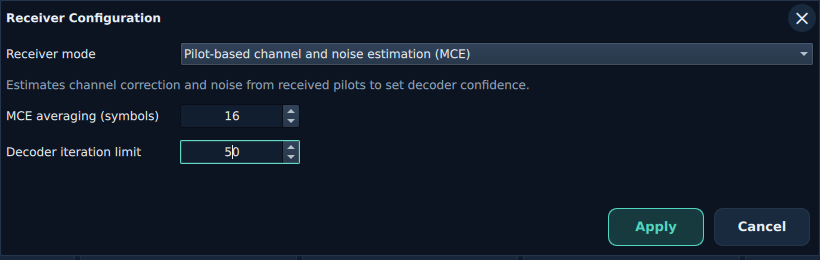

# Receiver modes

[Documentation index](../../README.md) · [Receiver estimation](README.md)

Open **Receiver → Configure Receiver** and choose **Receiver mode**. The three
choices control where the receiver obtains channel correction and noise
information for decoding. Apply saves the choice for the next run; Cancel or X
discards edits. Apply is unavailable while a simulation is active.

| Dropdown choice | Channel correction | Decoder noise information |
| --- | --- | --- |
| **Supplied CM channel estimate** — default | Uses the supplied cable-modem (CM) channel estimate. With no estimate, the CM response defaults to flat/unity. | Uses simulator-calibrated noise power. |
| **Pilot-based channel estimation** | Estimates correction from received continuous and scattered pilots. | Uses simulator-calibrated noise power. |
| **Pilot-based channel and noise estimation (MCE)** | Uses the same received-pilot channel-estimation path. | Also estimates noise from received pilots to set decoder confidence. |

**Both pilot-based choices derive channel correction from pilots.** MCE does
not use a different source for channel estimation. Its additional function is
estimating noise information without using the simulator's exact noise powers.
MCE means **MERLIN Channel Estimation**; see the [acronym reference](../terminology.md).

## Supplied CM channel estimate

This is the default for a new configuration and all bundled runnable WBs. A
loaded CM estimate describes channel gain and phase. The channel simulator uses
that response to impair the signal; this receiver mode uses the known response
to equalize it. The receiver therefore does not have to estimate the correction.

When no estimate is supplied, the WB selects a flat/unity response. Unity means
gain 1 and phase 0. With no added channel effects, equalization makes no change;
it does not remove RxMER noise. Added cable/tilt/echo and power controls remain
separate settings: absence of a CM estimate does not disable those effects.
The supplied-reference receiver uses the known applied response for correction.

Use this mode as a reference when studying RxMER/FEC behavior without adding
pilot channel-estimation error. The simulator's calibrated noise information
also guides the decoder's soft decisions.

## Pilot-based channel estimation

Pilots are known symbols included in the received signal. The receiver compares
their received values with expected references and derives channel correction.
It does not receive the supplied CM estimate as its correction input. The
supplied estimate can still impair the signal in the channel simulator.

Pilots contain noise, so the estimated correction differs slightly from the
exact known response—even for a flat channel. This can change equalized QAM
points, soft decisions and actual corrected/uncorrectable codeword counts.

This mode isolates channel-estimation behavior while keeping the decoder's
noise information calibrated by the simulator. It is useful for distinguishing
channel-correction effects from noise-estimation effects.

## Pilot-based channel and noise estimation (MCE)

MCE uses the same pilot channel correction as the preceding mode and also
estimates a noise-power proxy from changes in continuous pilots between
consecutive symbols. That estimate controls how strongly the decoder trusts
its soft bit decisions. Similar QAM plots can therefore produce different FEC
outcomes when the confidence information differs.

**MCE averaging (symbols)** appears only for this mode. Its default of 16 sets
exponential smoothing of the noise estimate; it is not the pilot-pattern length.
Channel changes can inflate the noise proxy, so MCE is not guaranteed to improve
results. This is a bounded simulation receiver, not a claim of modem performance.
See the [MCE implementation and limitations](mce.md).

Both estimated modes accumulate continuous/scattered pilot observations; full
pilot-pattern history spans **128 OFDM symbols**. That is separate from MCE's
noise averaging. Known symbol timing remains required in the production runner.
These are pilot-assisted modes, not fully blind RF discovery. A tracking label
means sufficient history, not guaranteed estimation accuracy.

## Saved workbenches and APIs

A WB stores the selected mode explicitly. Loading it restores that choice,
even when it differs from the new-configuration default. The Python WB loader
reads the same saved value; it does not replace it with an API default.

| UI choice | Rust ReceiverMode | Python ReceiverMode | Saved WB value |
| --- | --- | --- | --- |
| Supplied CM channel estimate | `SuppliedChannel` | `SUPPLIED_CHANNEL` | `supplied_channel` |
| Pilot-based channel estimation | `PilotEstimated` | `PILOT_ESTIMATED` | `pilot_estimated` |
| Pilot-based channel and noise estimation (MCE) | `MerlinChannelEstimated` | `MERLIN_CHANNEL_ESTIMATED` | `merlin_estimated` |

Saved input also accepts `merlin_channel_estimated` as an MCE alias; the canonical
saved value remains `merlin_estimated` for compatibility. The separate
`run_multi_rxmer_mce.py` example deliberately selects MCE. `run_multi_rxmer_cm_chan_est.py` selects
supplied-channel correction to match the bundled WB. `run_multi_rxmer_cmce_workbench.py` loads the
mode directly from its input WB. See [WB API loading](../python/workbench.md).

**Decoder iteration limit** applies to every mode. It bounds LDPC decoding work;
it is independent of pilot history and MCE averaging. FEC counters remain actual
simulated decoder outcomes, never estimates inferred from the selected mode.
