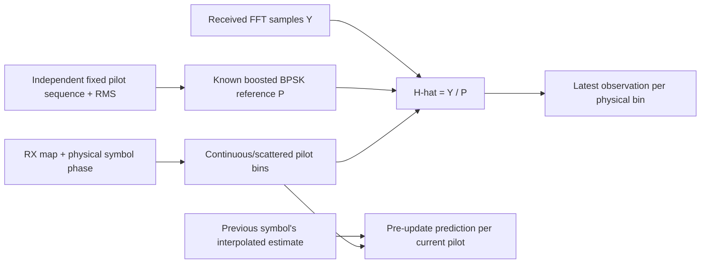

# CH-EST-RX pilot observations

The receiver creates its own pilot sequence from bootstrap spacing and physical
carrier assignments. It selects continuous and phase-dependent scattered pilots
from the received symbol index. It receives no transmitted point arrays or
payload truth. The existing pinned [pilot generator design](../pilot-signals.md)
owns PHY I20 section7.5.15 sequence/boost evidence.

For known pilot sign s and other-carrier RMS A, the reference is P=2As. With
received FFT sample Y, the least-squares pilot response is:

\[
\widehat H_{k,t}=Y_{k,t}/P_k,\qquad P_k\in\{-2A,+2A\}.
\]

The estimator keeps at most one observation per bin, expires observations at
128 symbols, and reports maximum age. It does not reset at payload codewords.
After a full128-symbol pattern, `ready` becomes true. This is a startup marker,
not an accuracy or convergence guarantee. Invalid FFT shape, nonfinite values,
sequence violations and near-zero gains reject without committing new history.

Each pilot record preserves its physical bin, role, raw sample, reference and
H-hat. `prior_prediction` was computed before observing the current symbol.
It can therefore expose a new perturbation that the current pilot fit would
otherwise remove by construction. It is a temporal prediction diagnostic, not
an externally measured channel truth or a certified held-out receiver test.
Pilots used in the current fit must never be presented as independent proof of
successful data demodulation.

Tests independently impose known gain and linear phase across all128 phases at
both spacings, check stale-history bounds, and perturb a pilot to distinguish its
current LS value from its pre-update prediction. Actual waveform/FEC tests verify
that this receiver can acquire PLC and recover PRBS without being given H.
