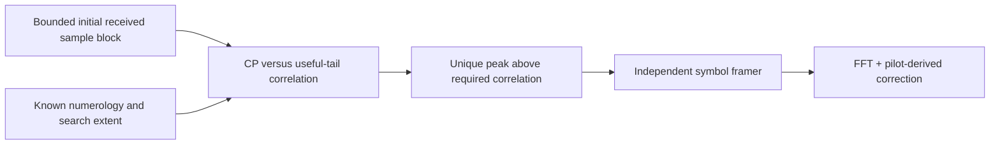

# CH-EST-RX bounded sample timing search

The timing component locates an unknown sample boundary using cyclic-prefix
repetition. It requires known FFT length, prefix/taper settings and PLC symbol
phase; it does not acquire carrier offset, arbitrary numerology or PLC phase.
The channel CLI continues to use its explicit synchronized boundary.

For candidate boundary d, FFT size N, prefix C and taper R, compare the prefix
outside the leading overlap region with its repeated useful-symbol tail:

\[
\rho(d)=\frac{\left|\sum_{n=R}^{C-1}r[d+n]^*r[d+n+N]\right|^2}
{\left(\sum_{n=R}^{C-1}|r[d+n]|^2\right)
 \left(\sum_{n=R}^{C-1}|r[d+n+N]|^2\right)}.
\]

Search at most one symbol period and require the complete input window before
processing. Reject silence, nonfinite correlation, a peak below the explicit
threshold, or tied peaks within numerical tolerance. An unwindowed periodic
signal can genuinely have ambiguous boundaries; no offset is invented.

`WaveformReceiver::acquire_from_pilots` composes this search with independent RX
framing and pilot estimation. It consumes the initial block and returns the live
receiver, measured timing and any completed symbols. Subsequent calls use the
next contiguous samples. The supplied `first_symbol_index` is still explicit
PLC-phase knowledge, not a discovered frame phase.

Tests use independent broadband prefix/tail vectors with unknown offsets and
actual windowed waveform samples at both spacings. Separate tests reject
ambiguous tones/silence and invalid bounds. These checks do not close full blind
acquisition under WAVE-RX-05.
