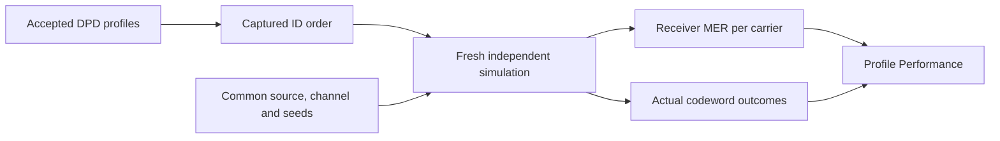
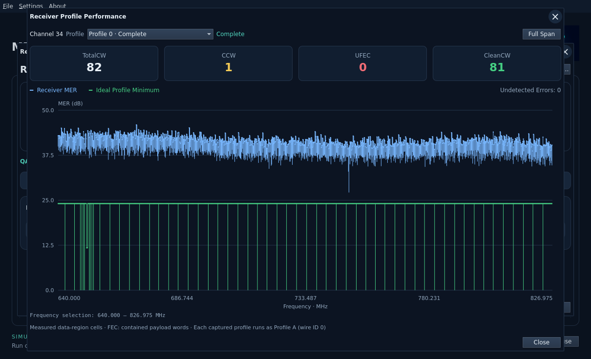

# Receiver Profile Performance

Open **Receiver → Profile Performance** after starting a simulation. Select a
completed profile to compare its measured MER, ideal profile reference and FEC
counters on one screen. Results appear as each profile finishes; completed
results remain available while later profiles run.

## Run every imported profile

In the main **Configure WorkBench → Profiles** tab, check the captured profiles to run.
Use **Select All** or **Clear** to change the list. New WBs initially select only
the applied profile. Older WBs retain their saved all/applied selection. Observation duration applies to each
profile. The active host budget is shared by the whole sweep; paused time is
excluded. These choices are saved in workbench JSON. See [WB configuration](workbench-configuration.md).

Each job starts fresh with the same accepted source, PRBS/noise seeds, OCD,
channel estimate, amplifier, attenuator, cable loss and RxMER playback starting
point. Profiles run in captured-ID order. Their differing capacities can produce
different codeword counts under the same observation duration.

Each captured profile's assignments are transmitted as **bootstrap Profile A
(wire ID 0)** for its separate experiment. The performance selector retains the
original captured ID. This mode does not switch on-wire profiles during a run.
The applied DPD selection remains the choice for transmitter preview.

The sweep accepts up to 32 profiles and 262,144 total assignments. Every profile
is validated before Start admission; incompatible profiles report their ID and
reason, rather than being replaced or silently skipped. Pause resumes the same
current job. Stop cancels it and prevents later jobs from starting. Cancellation
and runtime expiry retain completed results and label the current result partial.

## Read the plot and counters

- **Blue — Receiver MER:** actual equalized data-region samples compared with
  their independent transmitted reference. Linear signal/error powers are
  accumulated before conversion to dB. These samples include payload/NCP/filler
  on data-region carriers; pilots and PLC are excluded.
- **Green — Ideal Profile Minimum:** the profile's ideal Shannon reference,
  `10 log10(2^bits − 1)`, including captured pilot/PLC reference dips. It is not
  a normative DOCSIS receiver requirement.
  Use DPD's View Profile window for the separate bit-loading view.
- **Frequency:** the original capture grid in MHz. Scroll to zoom, drag to select
  a range and use **Full Span** to restore it. Hover for bounded group extrema.
  Missing readings stay gaps; exact zero-error comparisons have no finite dB
  value and are not assigned a made-up ceiling.

| Counter | Meaning |
| --- | --- |
| TotalCW | Completed payload decode attempts wholly inside the observation window |
| CCW | Successful codewords with actual LDPC or BCH hard-decision corrections |
| UFEC | Codewords rejected by LDPC or BCH; a word failing both counts once |
| CleanCW | Successful codewords with no observed hard-decision correction |
| Undetected Errors | Decoder-successful codewords contradicted by original-source comparison |

`TotalCW = CleanCW + CCW + UFEC`. CCW counts words, not corrected bits or LDPC
iterations. Words wholly inside observation still count when completed during
drain. Crossing words and unfinished generated words are excluded from these
counters; they remain separately visible in **FEC Monitor**. Counters are for
the selected profile/channel, not individual frequency bins.

Profile Performance retains bounded per-carrier curves and scalar summaries for
every profile in the sweep. Other instruments retain the latest completed
profile's detailed samples; the Receiver title identifies that profile. Selecting
an earlier performance result does not reroute SA/QAM/FEC Monitor to older data.
This keeps sweep memory bounded without silently showing mismatched snapshots.
The optional configured-RxMER reference trace and a plot export action are not
part of this view.

Results and zoom are transient. Saving a WB stores inputs and run mode, not the
completed result collection. Changing accepted inputs clears stale results.
X and Close dismiss the instrument without changing accepted inputs.

See [Receiver Workbench](receiver-workbench.md),
[FEC counter model](simulation/fec-counters.md),
[FEC and MER Rust APIs](../reference/public-api.md) and
[closed-loop controls](closed-loop-workbench.md).
