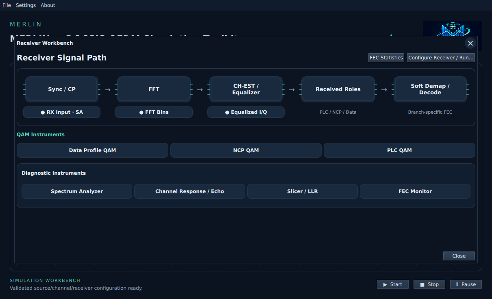
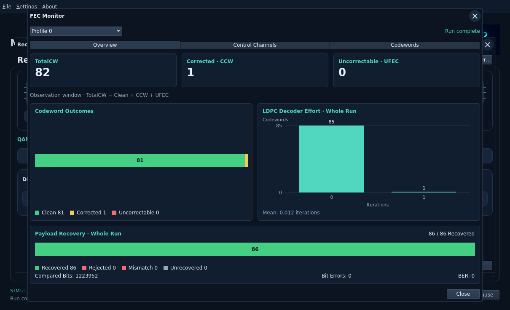
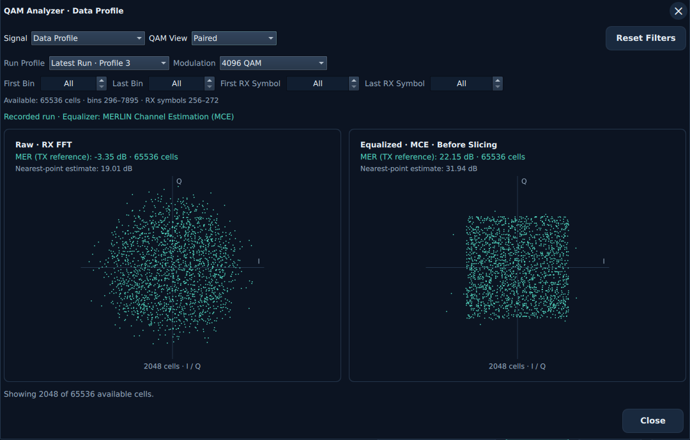
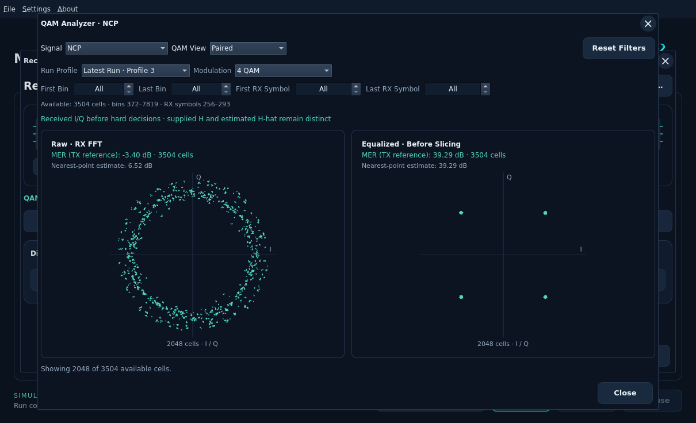
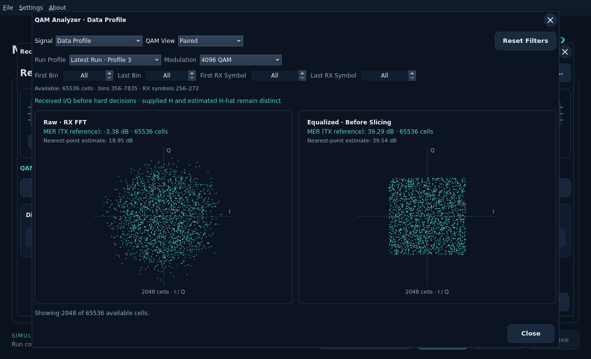
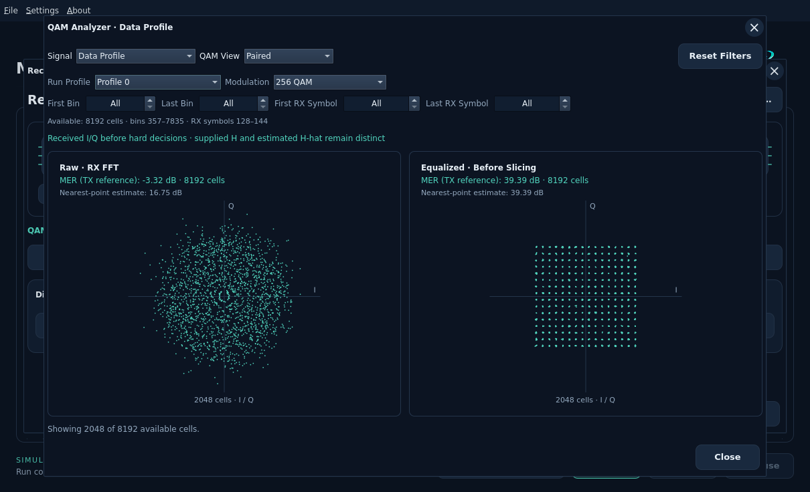
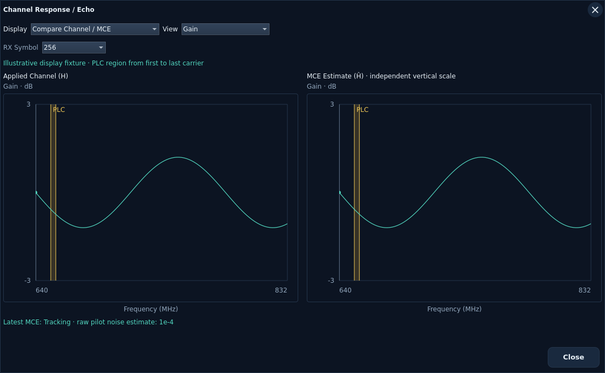
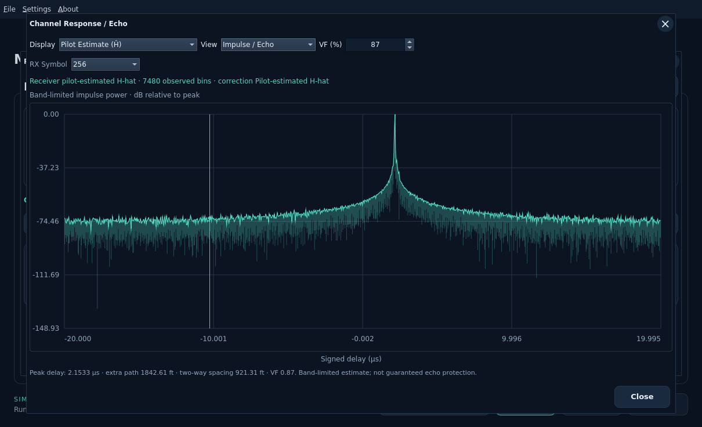
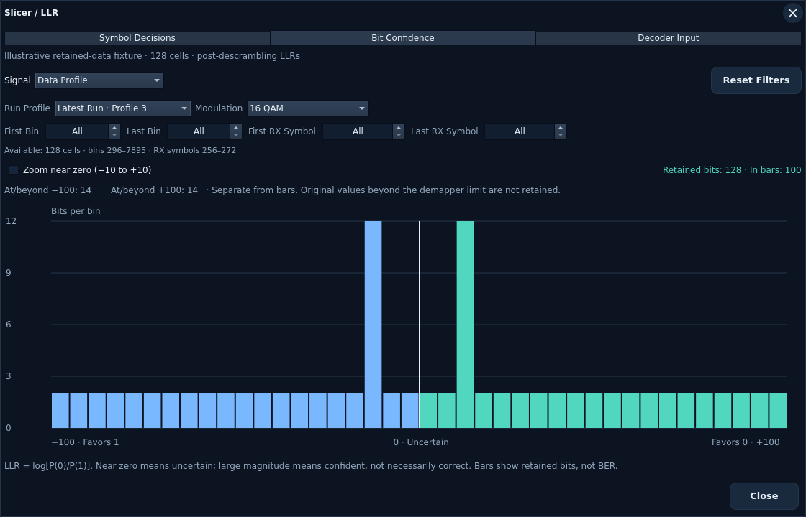
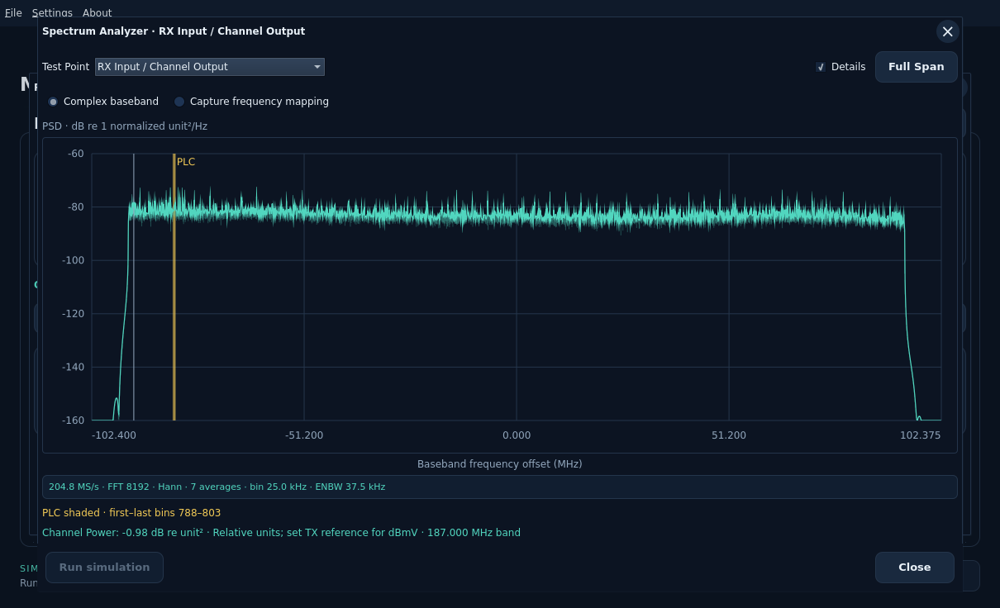

# Receiver Workbench

Click **Receiver** for the processing path and instruments. Use **Configure
Receiver…**, accept the inputs and enable PRBS-RX comparison, then use main
Start. Instruments inspect the same retained complete/partial run and never
advance the simulation. Each popup has X and its existing Close/Cancel controls.
See the [run/save guide](closed-loop-workbench.md).

## FEC statistics

Open **Receiver → FEC Monitor**
in the Diagnostic Instruments row.

Select a completed profile, then use **Overview**, **Control Channels** or
**Codewords**. Overview shows TotalCW/CCW/UFEC, codeword outcomes, actual LDPC
iteration bars and whole-run payload recovery. Details and counting scopes are
explained in the [FEC Monitor guide](fec-monitor.md).

## QAM analyzer and retained selectors

Detached QAM histories share the application's retained-data budget. If a new
history copy exceeds that budget, an existing history for that profile remains
available and the completed scientific report is preserved. Selected history
views keep their data alive until those views release it, including after the
history registry is cleared.

The application selects palette-aware controls directly at startup, including
on Windows. Dark/light appearance applies to selector backgrounds, text,
dropdown lists and number editors. Disabled controls retain readable muted text.

Received I/Q uses circular dots at the actual retained coordinates, before hard
decisions. These are scatter markers, not intensity bins. Channel impairments
can shift, rotate or spread the points; changing their marker shape does not
change those samples. High-order QAM can still have a square overall footprint.
The display limit reports when only a subset of retained cells is shown.

**Signal** selects Data Profile, NCP, PLC, Continuous Pilots or Scattered Pilots.
**QAM View** selects Raw, Equalized or Paired independently. For PLC, choose Data
or Preamble. These groups retain their different modulation and pilot boost.
The paired panels use matching received cells and equal I/Q scale.

The **Recorded run · Equalizer** label identifies the correction that produced
the selected samples, including archived Run Profiles. Changing a receiver
setting does not relabel an old result; run again to produce new samples.
The equalized heading also names **CMCE**, **PE** or **MCE**:

- **CMCE — Supplied CM channel estimation:** correct with the supplied/model response.
- **PE — Pilot estimation:** derive correction from received pilots; retain calibrated decoder noise information.
- **MCE — MERLIN Channel Estimation:** derive correction and decoder noise confidence from received pilots.

With PE or MCE, an imported channel estimate still impairs the channel, but is
not passed to the receiver as its correction. Processing is **RX FFT → channel
estimation → equalization → soft-bit calculation → FEC decoding**. The raw panel
is before correction; the equalized panel is **before slicing**, not reconstructed
from decoded bits. Hover over the recorded-mode label for the explanation.

The screenshot below uses retained samples from a stopped MCE review run.

Select an available **Run Profile** and one modulation order, then optionally
enter inclusive **First/Last Bin** and **First/Last RX Symbol** bounds. **All**
means all retained coordinates, and **Reset Filters** clears the filters. The
shown bounds describe the actual retained data, not all transmitted history.
An empty/invalid range clears the chart; different QAM orders are never pooled.
Each independent run uses wire Profile A/ID0. The Receiver title identifies the
original captured profile used for its loading; QAM metadata retains the actual
wire identity. Profile Performance selects results by original captured ID.

NCP points now come from CRC-classified received cells, using the accepted field's
consumed-cell count and the same inverse coordinate transport as payload. The
plot never regenerates received points from decoded labels or TX reservations.
A failed CRC can leave NCP role attribution unavailable. The core retains up to
65,536 payload pairs, 8,192 NCP pairs and 8,192 per protected stream for this UI;
at most 2,048 selected pairs are displayed. Protected captures cover the first
1,024 physical channel symbols, including acquisition. Payload/NCP pairs carry
actual source and receive coordinates for the configured observation interval.
Changing a filter cannot retrieve data outside these retained windows.

## Calculated MER

Channel Output / RX Input and Receiver QAM show **MER (TX reference)** for
Raw and Equalized separately. Each received sample is compared with the actual
transmitted symbol at the same physical bin and time. The reference is diagnostic
only; the receiver never receives it. All retained cells matching the filters
contribute, including cells beyond the 2,048 rendered dots.

The formula is **MER = 10 log10(total TX reference power / total squared I/Q
error)**. The smaller **Nearest-point estimate** uses the PNM Viewer method:
compare each sample with the nearest ideal point. Dense QAM and wrong decisions
can make that estimate much too high even when the received points look badly
spread. It does not replace TX-reference MER or imported RxMER. Raw includes
uncorrected channel gain/phase; Equalized includes the actual receiver correction.
Zero error is perfect reference; missing samples/references are unavailable.

**Run Profile** selects the original captured profile from a separate simulation
run. Each run currently uses wire Profile A/ID0, which is a different identity.
The Wire Profile filter is shown only if more than one wire ID was received.
Choose the desired profiles in Configure WorkBench and run them; imported IDs
without results show **No Result**. Opening a WB alone does not create results.

Latest Run keeps its full capture. Earlier runs retain at most 8,192 data cells,
1,024 NCP cells and 1,024 per protected stream; MER uses the entire retained
selection, not just displayed dots. Counts show the actual retained population.
Changing Run Profile resets cell filters and queries that run without replaying
it. Slicer/LLR follows the same choice. Spectrum and channel-response instruments use the latest run; FEC and Profile
Performance retain their own profile selectors. Start and new accepted inputs
clear these transient QAM results.

For `multi-rxmer-2`, the captured profiles are 0, 3 and 4. Its 132-capture Average
mode models roughly 45 dB raw MER; a native run measured 44.93 dB Raw and 43.95 dB
Equalized. That is already a finite impairment relative to an ideal transmitter.
It does not automatically add another loss on top of the supplied RxMER.
Averaging uses linear error powers, and individual bins can be worse than the
whole selected constellation reading.

Missing-run messages provide hover/focus help and open the offline FAQ with
click, Enter, Space or F1.

## Channel response and echo

### MCE receiver option

**MERLIN Channel Estimation (MCE)** is Off by default in Receiver Configuration.
The [receiver-mode guide](receiver-estimation/modes.md) explains the three
dropdown choices, including why both estimated modes use pilots.
Enable MCE and Apply to use received-pilot correction and decoder reliability on
future runs. Cancel/X preserves accepted settings. Stop a running simulation
before applying changes. The main Receiver block shows a small **MCE** chip when
enabled; its heading stays centered and the existing block layout is preserved.

| Receiver mode | Channel correction | Decoder noise information |
| --- | --- | --- |
| Supplied CM channel estimate (default) | Supplied estimate; flat CM response when absent. | Simulator calibrated. |
| Pilot-based channel estimation | Estimated from received pilots. | Simulator calibrated. |
| Pilot-based channel and noise estimation (MCE) | Estimated from received pilots. | Estimated from received pilots. |

MCE changes receiver correction, not the applied response or seeded noise.
Training builds a 128-symbol history, then the status shows Tracking; that is
coverage, not an accuracy guarantee. This is pilot-assisted reception with known
bootstrap timing. Existing explicit pilot-estimated mode remains compatible and
retains its separate simulation noise calibration. See the [MCE guide](receiver-estimation/mce.md)
for source citations, numerical choices, settings and limits.

### Current response instrument

Open **CH-EST / Equalizer** or **Channel Response / Echo**. Select **Applied
Reference H** for the channel's supplied/unity response, or **Receiver H-hat**
for actual pilot-estimated snapshots. H-hat requires a run with pilot-estimated
correction; the UI never substitutes supplied H when no estimate was retained.
Choose among up to four retained observation-symbol snapshots.
**Compare H / H-hat** shows both responses side by side for Gain, Wrapped Phase
or Impulse / Echo. Each panel labels its independent vertical scale; applied H
uses the actual realized filter response when continuous filtering is selected.

Frequency views shade the continuous region from the first to last PLC carrier
from the recorded run, including both comparison panels. **VF (%)** and cable
distance details appear only in **Impulse / Echo**; VF does not affect gain,
phase or real/imaginary values. Delay plots have no PLC frequency shading.

Views include gain, wrapped phase, real/imaginary H and the band-limited impulse
response. Excluded/unknown frequency bins remain gaps in response curves and are
zero-filled for the impulse transform. Band limits produce ringing, so plotted
peaks are not automatically identified physical echoes. Signed delay is relative
to the receiver's timing reference. The displayed uniform-cable velocity factor
is explicit; path/reflector distances are estimates, not reach or protection.

## Slicer and LLRs

Open **Slicer / Soft Demap** or **Slicer / LLR**. The filters initially follow
the QAM selection and can then be changed independently. Three tabs separate
physical symbol decisions from soft bit confidence:

- **Symbol Decisions:** select one of the first 128 retained cells. The plot
  shows nearby ideal symbols (+), the received symbol and error vector (teal),
  and the selected symbol's nearest-point decision region (yellow). Zoom changes
  the displayed neighborhood. Coordinates are normalized and relative to the
  selected ideal symbol; pilot amplitude boost is removed for this display.
  The region is calculated against the complete constellation, including cross
  QAM. An outer unbounded region is clipped to the local viewport.
- **Bit Confidence** (default): histogram bars count actual post-descrambling
  LLRs from at most 2,048 selected cells (32,768 soft values). Positive favors
  bit 0, negative favors bit 1, and near zero means uncertain. Values at or
  beyond ±100 are counted separately from the bars. The demapper clips at ±100;
  retained values cannot recover the original unclipped magnitude. Near-zero
  zoom shows only −10 < LLR < +10 and displays how many bits remain in view.
  Hover for each bin's range, count and percentage of all retained bits.
- **Decoder Input:** actual coding-order LLRs from the first retained payload
  decoder word, plotted by zero-based bit index. Min/max display groups preserve
  extremes. The profile selector remains available; cell/bin/symbol filters do
  not apply to this separately retained snapshot.

Large LLR magnitude means confidence, not proof of correctness. Refer to FEC
Monitor for actual decoder outcomes. Physical labels precede descrambling; do
not compare their bits directly with the post-descrambling LLR signs. These
hard decisions are diagnostic and never feed back into FEC decoding. Protected
streams without retained LLRs explicitly show that limitation.

The following UI captures use an **illustrative test fixture**, not field
measurements or simulation performance results:

[Light theme](../images/workbench/slicer-confidence-light.png) ·
[Symbol decisions](../images/workbench/slicer-symbol-dark.png) ·
[Decoder input](../images/workbench/slicer-decoder-dark.png)

## Spectrum Analyzer

Click **RX Input · SA**, **FFT Bins** or **Spectrum Analyzer**. Its Test Point
selector is independent of QAM selection: RX Input / Channel Output, RX Framed,
RX Useful and RX FFT Bin Power. Time spectra use retained contiguous samples;
useful symbols are not joined across prefix gaps. FFT-bin power has distinct
units and physical frequency coordinates. The local Run button is disabled:
main Start owns the full loop. TX timing graphics remain hidden in RX instruments.

Accepted input changes clear every retained instrument result. Retention and
query limits are shared across windows. Known-boundary timing, the admitted
coding/profile set and initial host limits remain explicit implementation limits;
these instruments do not add arbitrary RF acquisition or external-interoperability
claims. See the [design](../development/features/receiver-instruments/design.md)
and [workbench guide](workbench.md). Dark screenshots are actual Ubuntu VM captures.

## Profile performance and independent runs

**Diagnostic Instruments → Profile Performance** combines measured receiver MER,
the ideal profile reference and TotalCW/CCW/UFEC counters. The main **Configure WorkBench → Profiles** tab selects which imported profiles run
separately. Receiver configuration retains correction mode and iteration limit. The performance
selector reviews each result; other instruments remain labelled with the latest
completed profile. See the [profile performance guide](receiver-profile-performance.md)
for counter scope, Profile A mapping and sweep controls.

The **DEMUX** stage separates PLC, NCP and data symbols for their respective
receiver paths. Select it to inspect the received QAM symbols.

Select **Slicer / Soft Demap** to open the Slicer / LLR instrument. **FEC Decode**
underneath identifies the subsequent decoding stage. Hard nearest-point
decisions are available for inspection; FEC uses soft bit confidence.

Receiver QAM views default to **Paired**, showing raw and equalized I/Q together
for data, NCP, PLC and pilots. Your selected view is retained when switching
receiver entry points. Transmitter/channel taps retain their single-point view.
