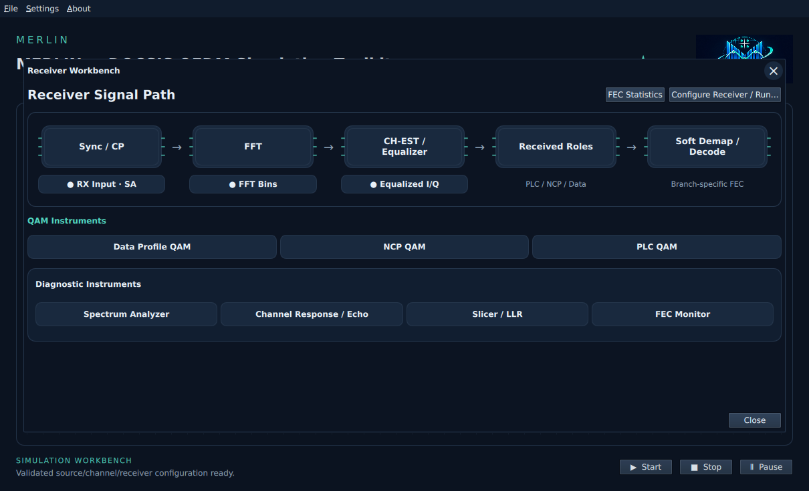
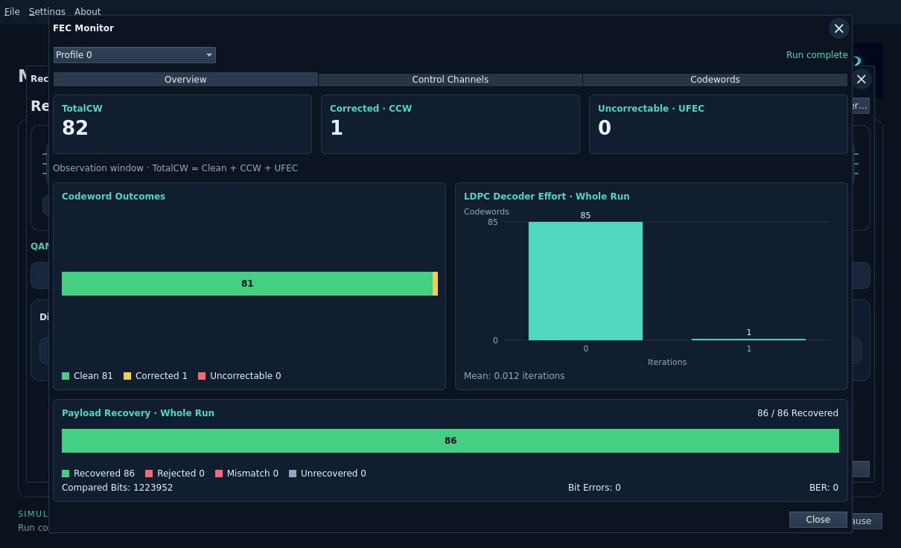
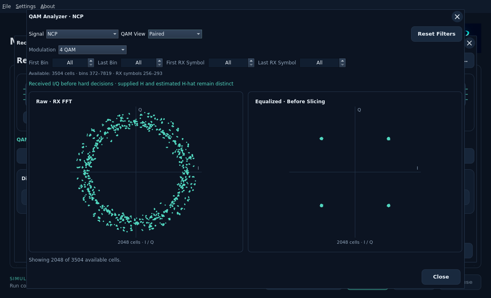
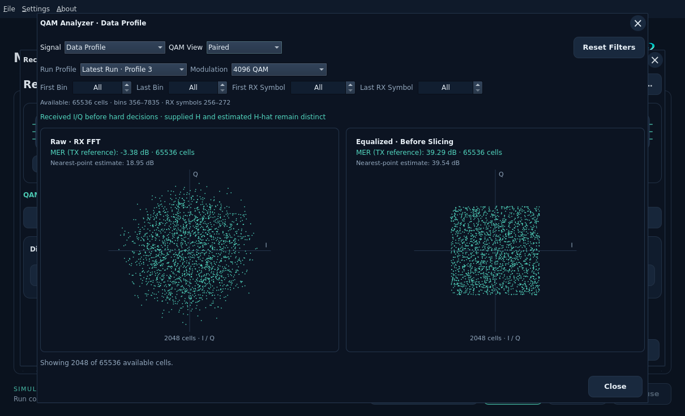
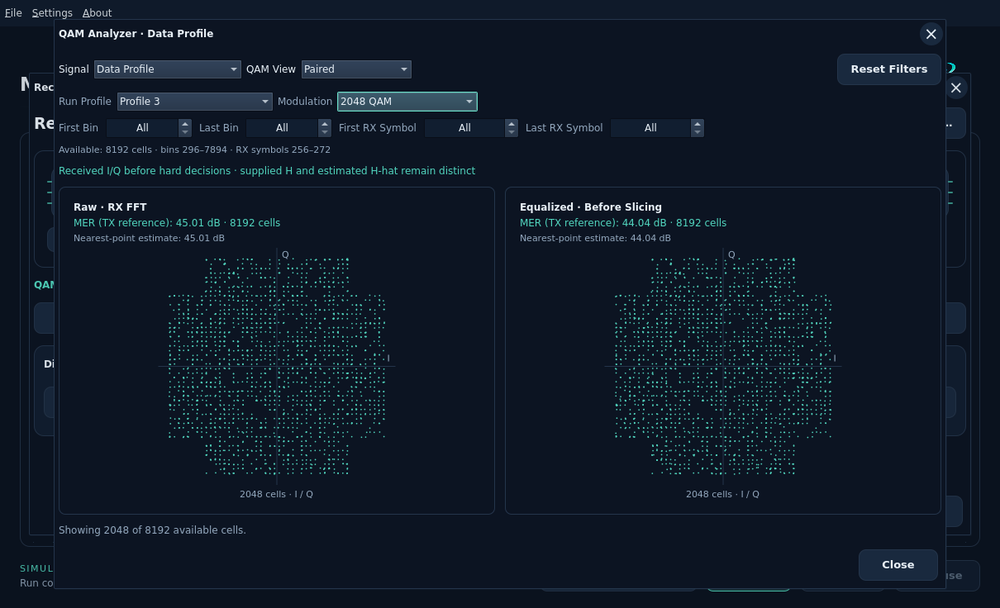
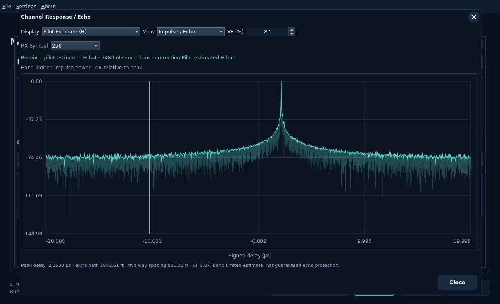
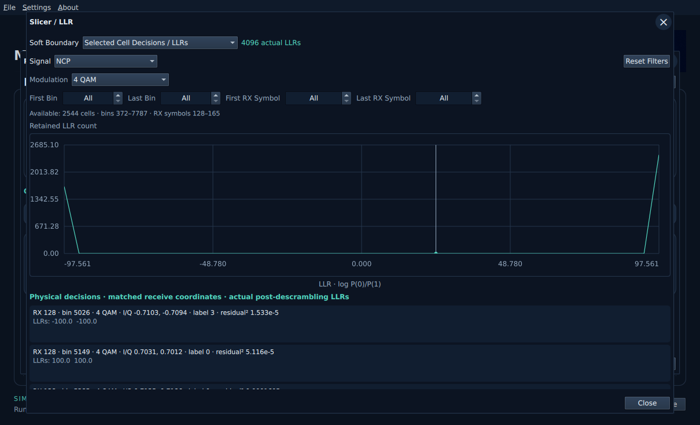
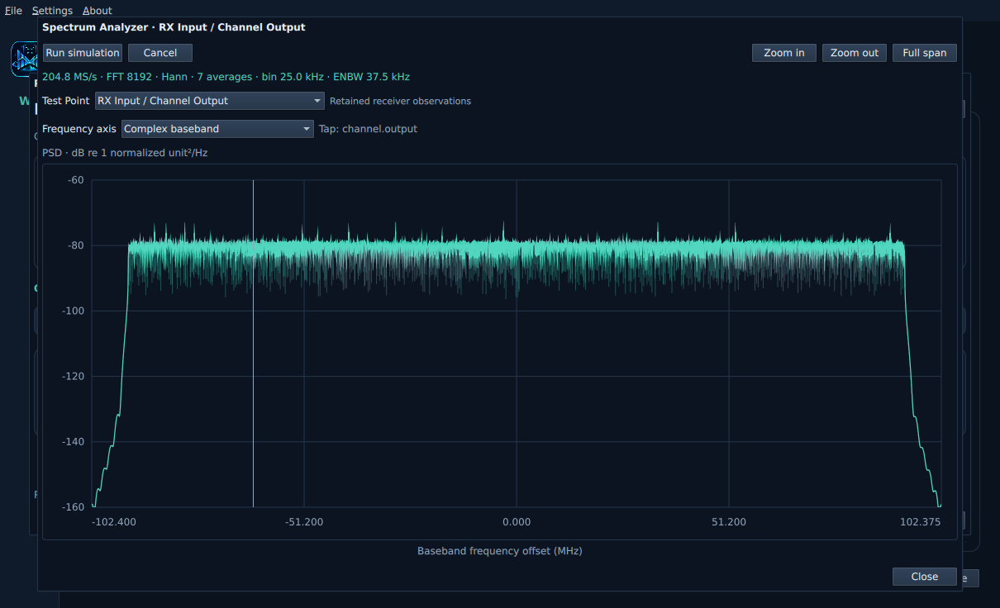

# Receiver Workbench

Click **Receiver** for the processing path and instruments. Use **Configure
Receiver…**, accept the inputs and enable PRBS-RX comparison, then use main
Start. Instruments inspect the same retained complete/partial run and never
advance the simulation. Each popup has X and its existing Close/Cancel controls.
See the [run/save guide](closed-loop-workbench.md).

## FEC statistics

Open **Receiver → FEC Statistics** in the upper-right header, or **FEC Monitor**
in the Diagnostic Instruments row. Both open the same window.

Select a completed profile, then use **Overview**, **Control Channels** or
**Codewords**. Overview shows TotalCW/CCW/UFEC, codeword outcomes, actual LDPC
iteration bars and whole-run payload recovery. Details and counting scopes are
explained in the [FEC Monitor guide](fec-monitor.md).

## QAM analyzer and retained selectors

Received I/Q uses circular dots at the actual retained coordinates, before hard
decisions. These are scatter markers, not intensity bins. Channel impairments
can shift, rotate or spread the points; changing their marker shape does not
change those samples. High-order QAM can still have a square overall footprint.
The display limit reports when only a subset of retained cells is shown.

**Signal** selects Data Profile, NCP, PLC, Continuous Pilots or Scattered Pilots.
**QAM View** selects Raw, Equalized or Paired independently. For PLC, choose Data
or Preamble. These groups retain their different modulation and pilot boost.
The paired panels use matching received cells and equal I/Q scale.

Select an available **Run Profile** and one modulation order, then optionally
enter inclusive **First/Last Bin** and **First/Last RX Symbol** bounds. **All**
means all retained coordinates, and **Reset Filters** clears the filters. The
shown bounds describe the actual retained data, not all transmitted history.
An empty/invalid range clears the chart; different QAM orders are never pooled.
Each independent run uses wire Profile A/ID0. The Receiver title identifies the
original captured profile used for its loading; QAM metadata retains the actual
wire identity. Profile Performance selects results by original captured ID.

NCP points now come from CRC-classified received cells, using the accepted field's
consumed-cell count and the same inverse coordinate transport as payload. The
plot never regenerates received points from decoded labels or TX reservations.
A failed CRC can leave NCP role attribution unavailable. The core retains up to
65,536 payload pairs, 8,192 NCP pairs and 8,192 per protected stream for this UI;
at most 2,048 selected pairs are displayed. Protected captures cover the first
1,024 physical channel symbols, including acquisition. Payload/NCP pairs carry
actual source and receive coordinates for the configured observation interval.
Changing a filter cannot retrieve data outside these retained windows.

## Calculated MER

Channel Output / RX Input and Receiver QAM show **MER (TX reference)** for
Raw and Equalized separately. Each received sample is compared with the actual
transmitted symbol at the same physical bin and time. The reference is diagnostic
only; the receiver never receives it. All retained cells matching the filters
contribute, including cells beyond the 2,048 rendered dots.

The formula is **MER = 10 log10(total TX reference power / total squared I/Q
error)**. The smaller **Nearest-point estimate** uses the PNM Viewer method:
compare each sample with the nearest ideal point. Dense QAM and wrong decisions
can make that estimate much too high even when the received points look badly
spread. It does not replace TX-reference MER or imported RxMER. Raw includes
uncorrected channel gain/phase; Equalized includes the actual receiver correction.
Zero error is perfect reference; missing samples/references are unavailable.

**Run Profile** selects the original captured profile from a separate simulation
run. Each run currently uses wire Profile A/ID0, which is a different identity.
The Wire Profile filter is shown only if more than one wire ID was received.
Choose the desired profiles in Configure WorkBench and run them; imported IDs
without results show **No Result**. Opening a WB alone does not create results.

Latest Run keeps its full capture. Earlier runs retain at most 8,192 data cells,
1,024 NCP cells and 1,024 per protected stream; MER uses the entire retained
selection, not just displayed dots. Counts show the actual retained population.
Changing Run Profile resets cell filters and queries that run without replaying
it. Slicer/LLR follows the same choice. Spectrum and channel-response instruments use the latest run; FEC and Profile
Performance retain their own profile selectors. Start and new accepted inputs
clear these transient QAM results.

For `multi-rxmer-2`, the captured profiles are 0, 3 and 4. Its 132-capture Average
mode models roughly 45 dB raw MER; a native run measured 44.93 dB Raw and 43.95 dB
Equalized. That is already a finite impairment relative to an ideal transmitter.
It does not automatically add another loss on top of the supplied RxMER.
Averaging uses linear error powers, and individual bins can be worse than the
whole selected constellation reading.

Missing-run messages provide hover/focus help and open the offline FAQ with
click, Enter, Space or F1.

## Channel response and echo

### Planned HGCE receiver option

**Homegrown Channel Estimation (HGCE)** is planned, not yet an implemented
receiver control. It will default to Off and be configured in Receiver
Configuration, with accepted changes saved in the WB and applied on the next run.

| HGCE | Channel simulator | Receiver correction |
| --- | --- | --- |
| Off (default reference workflow) | Applies supplied DS response H. | Uses supplied H to calculate 1/H. |
| On | Applies the same supplied DS response H. | Estimates H-hat from received pilots and applies 1/H-hat, without access to supplied H. |

HGCE changes how the receiver corrects the signal; it does not turn channel
distortion on or off. Known DOCSIS pilots make this pilot-assisted estimation,
not fully blind reception. Existing explicitly selected receiver modes remain
compatible. See the [HGCE plan](../development/features/independent-channel-estimation/design.md)
for continuous-waveform filtering, received-only noise estimation and validation.

### Current response instrument

Open **CH-EST / Equalizer** or **Channel Response / Echo**. Select **Applied
Reference H** for the channel's supplied/unity response, or **Receiver H-hat**
for actual pilot-estimated snapshots. H-hat requires a run with pilot-estimated
correction; the UI never substitutes supplied H when no estimate was retained.
Choose among up to four retained observation-symbol snapshots.

Views include gain, wrapped phase, real/imaginary H and the band-limited impulse
response. Excluded/unknown frequency bins remain gaps in response curves and are
zero-filled for the impulse transform. Band limits produce ringing, so plotted
peaks are not automatically identified physical echoes. Signed delay is relative
to the receiver's timing reference. The displayed uniform-cable velocity factor
is explicit; path/reflector distances are estimates, not reach or protection.

## Slicer and LLRs

Open **Soft Demap / Decode** or **Slicer / LLR**. It begins with the current QAM
selection; its filters can then be changed independently. The first 128 selected
cells show physical nearest-symbol labels, received I/Q, residual squared distance
and actual post-descrambling NCP/payload LLRs. Physical labels precede
descrambling, so do not compare their bits directly with those LLR signs.
Pilot slicing explicitly accounts for its existing amplitude boost.

Select **Payload LDPC Input** to inspect the first retained coding-order
16,200-value decoder-input window and its likelihood distribution. Cell filters
do not relabel this separate word boundary. Positive LLR favors zero; negative
favors one. These are diagnostics: production FEC continues to consume soft
values, and hard decisions never feed back into decoding.

Protected PLC/pilot streams provide physical decisions but do not expose a
retained per-cell soft boundary in this view. They show that distinction explicitly;
LLRs are not synthesized from decided labels.

## Spectrum Analyzer

Click **RX Input · SA**, **FFT Bins** or **Spectrum Analyzer**. Its Test Point
selector is independent of QAM selection: RX Input / Channel Output, RX Framed,
RX Useful and RX FFT Bin Power. Time spectra use retained contiguous samples;
useful symbols are not joined across prefix gaps. FFT-bin power has distinct
units and physical frequency coordinates. The local Run button is disabled:
main Start owns the full loop. TX timing graphics remain hidden in RX instruments.

Accepted input changes clear every retained instrument result. Retention and
query limits are shared across windows. Known-boundary timing, the admitted
coding/profile set and initial host limits remain explicit implementation limits;
these instruments do not add arbitrary RF acquisition or external-interoperability
claims. See the [design](../development/features/receiver-instruments/design.md)
and [workbench guide](workbench.md). Dark screenshots are actual Ubuntu VM captures.

## Profile performance and independent runs

**Diagnostic Instruments → Profile Performance** combines measured receiver MER,
the ideal profile reference and TotalCW/CCW/UFEC counters. The main **Configure WorkBench → Profiles** tab selects which imported profiles run
separately. Receiver configuration retains correction mode and iteration limit. The performance
selector reviews each result; other instruments remain labelled with the latest
completed profile. See the [profile performance guide](receiver-profile-performance.md)
for counter scope, Profile A mapping and sweep controls.
