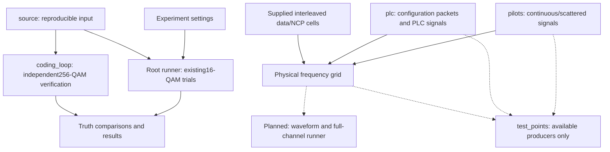

# Simulation design guide

The five folders under `crates/ofdm/src/simulation/` organize distinct parts of
an experiment. They are modules with different responsibilities, rather than
five copies of the simulator. Root files coordinate the existing CLI experiment.

Start with the component you want to understand:

| Source location | Design guide | Purpose |
| --- | --- | --- |
| `source/` | [Payload source](source.md) | Generate reproducible input and retain comparison truth |
| `coding_loop/` | [Coding loop](coding-loop.md) | Check noiseless256-QAM encoding and recovery, one codeword at a time |
| `pilots/` | [Pilot signals](pilots.md) | Compose continuous/scattered reference signals for a physical symbol |
| `plc/` | [PLC transmission and reception](plc.md) | Carry actual configuration messages through PLC coding and frequency bins |
| `test_points/` | [Stage observations](test-points.md) | Inspect selected intermediate data without changing the experiment |
| `config.rs`, `runner.rs`, `results.rs` | [Experiment runner](runner.md) | Validate limits, run the existing16-QAM trials and collect outcomes |

These are design guides. Method signatures and binding details belong in the
separate [public API reference](../../reference/public-api.md).

The solid arrows describe implemented paths. The root runner does not yet use
the pilot/PLC physical grid; these paths currently meet in dedicated examples
and tests. Its progress notifications are separate from common stage observations;
common producers are implemented for pilots, PLC transmit stages and physical bins.
The waveform/full-channel runner remains planned. The root experiment's source
and the independent coding loop are not one continuous OFDM transmission.

For the complete planned system, use the [architecture](../../architecture.md)
and [checklist](../../development/checklist.md). Stage guides below explain what
exists now without treating a successful component test as a complete receiver.
