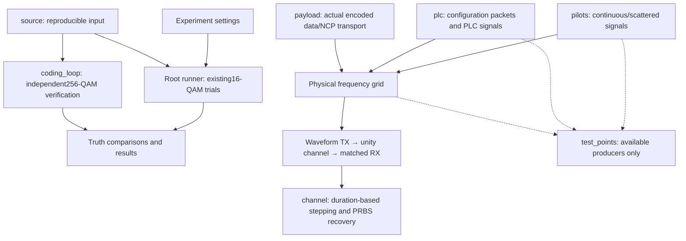

# Simulation design guide

The component folders under `crates/ofdm/src/simulation/` organize distinct parts of
an experiment. They are modules with different responsibilities, rather than
copies of the simulator. Root files coordinate the existing CLI experiment.

Start with the component you want to understand:

| Source location | Design guide | Purpose |
| --- | --- | --- |
| `source/` | [Payload source](source.md), [PRBS15](prbs.md), [file source](file-source/README.md) | Separate seeded/PRBS input, continuous state and independent comparison truth |
| `coding_loop/` | [Coding loop](coding-loop.md) | Check noiseless256-QAM encoding and recovery, one codeword at a time |
| `pilots/` | [Pilot signals](pilots.md) | Compose continuous/scattered reference signals for a physical symbol |
| `plc/` | [PLC transmission and reception](plc.md) | Recover actual PLC messages and build receiver-owned configuration |
| `waveform/` | [Waveform TX/channel/RX](../waveform/README.md) | Separate sample-domain stages, known-reference receive and bounded actual PLC verification |
| `channel/` | [Duration-based channel](../channel-runner/README.md) | Duration plan, source-window metrics, bounded cancellable jobs and CLI results |
| `payload/` | [Actual payload/NCP transport](../payload-transport/README.md) | Continuous TX/RX, received configuration, bounded recovery and waveform proof |
| `test_points/` | [Stage observations](test-points.md) | Inspect/export bounded selected intermediates without changing scientific state |
| `config.rs`, `runner.rs`, `results.rs` | [Experiment runner](runner.md) | Validate limits, run the existing16-QAM trials and collect outcomes |

These are design guides. Method signatures and binding details belong in the
separate [public API reference](../../reference/public-api.md).

The solid arrows describe implemented paths. The root runner does not yet use
the pilot/PLC physical grid; these paths currently meet in dedicated examples
and tests. Its progress notifications are separate from common stage observations;
common producers cover pilots, PLC, physical bins, waveform TX/RX and actual
payload/NCP boundaries.
The bounded waveform reference experiment and separate configurable-duration
payload stepper, job cancellation and [channel CLI](../channel-runner/cli.md) are implemented. The separate payload verifier additionally
recovers actual encoded data/NCP using PLC-derived settings. The root experiment's source
and the independent coding loop are not one continuous OFDM transmission.

For the complete planned system, use the [architecture](../../architecture.md)
and [checklist](../../development/checklist.md). Stage guides below explain what
exists now without treating a successful component test as a complete receiver.
