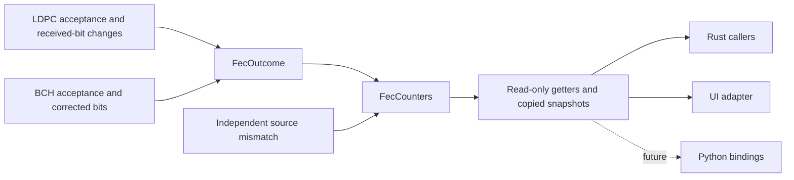

# FEC codeword counters

The reusable `FecCounters` type counts completed decoder attempts. It owns only
constant-size scalar state; source generation, decoding, file access and charts
remain separate. Each independent simulation creates fresh counters.

TotalCW counts completed attempts. If either decoder rejects the word, it adds
one UFEC. Otherwise, an actual change to received hard decisions by LDPC or a
BCH correction adds one CCW. A successful word without observed correction adds
one CleanCW. A word corrected by both stages counts only once. Iteration count
alone does not determine whether a correction occurred.

Independent source comparison can contradict a successful decoder outcome.
That increments Undetected Errors; it does not overwrite the decoder status or
silently turn the word into UFEC. Clean means no observed hard-decision change,
not a guarantee established from parity checks alone.

`TotalCW = CleanCW + CCW + UFEC`. A copied snapshot is unaffected by later
updates. Counters saturate together at the integer limit to preserve the
partition. New counters reset a scope; there is no public mutable field access.
Getters return exact integers for Rust and future Python consumers.

LDPC compares decoded bits with nonzero received LLR signs. Exact zero LLRs have
no hard-decision evidence and do not contribute to changed-bit counts.
Shortened-code synthetic positions are excluded. The change count remains a
decoder diagnostic even when decoding fails; only successful words qualify as
CCW.

Channel summary counters include all completed payload attempts. Observation
window counters include only whole-contained words, including words completed
during drain. Generated words that never complete do not become UFEC. Crossing
and outside words stay separate. PLC and NCP are not added to payload counters.
Scalar counters continue beyond bounded retained word-detail records and remain
available in partial/cancelled jobs.

The type and outcome enum live in `fec-codec`, with re-exports in the OFDM
channel API. They use no Qt, Python or filesystem interfaces. Python bindings
remain deferred; future bindings can expose these same getters/snapshots without
implementing a second accounting algorithm.

See the [Rust API guide](../../reference/public-api.md) for operations and the
[Receiver Profile Performance guide](../receiver-profile-performance.md) for UI
scope and plots.
