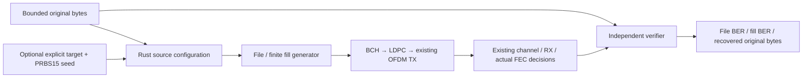

# Text and binary file payloads

A file is a finite source of test bits beside continuous PRBS15. Text and binary
inputs follow the same exact-byte path: BOM, line endings, zeros and invalid
UTF-8 are preserved. This is test traffic, not a DOCSIS MAC/file-transfer service.
The file source does not replace PHY data randomization.



| Component | Design |
| --- | --- |
| Generation, EOF and information-word padding | [File generator](generation.md) |
| Independent truth, segment BER and recovered output | [Verification](verification.md) |

The application permits0..16MiB original bytes and at most134,217,728 meaningful
bits including optional fill. These are memory/work bounds, not DOCSIS file-size
requirements. Empty files are accepted; without fill they send no payload words.
An empty file with a positive fill target sends finite PRBS traffic.

There is no mandatory minimum, alignment or automatic channel-derived file size.
Those rules remain a later design decision. An explicit fill target is currently
measured in **total meaningful bits**, including the original file. Reject a
target below the file length, above the work bound, or an invalid15-bit PRBS seed.
A target equal to the file length appends nothing. Partial-byte fill is allowed;
original input and recovered original output remain bytes.

## CLI example

Build once, then use new output paths:

```bash
scripts/cargo-local.sh build -p ofdm-fec-cli --release --locked
target/release/ofdm-fec channel \
  --input examples/channel-file.json \
  --payload-file examples/payloads/message.txt \
  --output file-result.json \
  --recovered-file recovered-message.txt
cmp examples/payloads/message.txt recovered-message.txt
```

The [complete request](../../../../examples/channel-file.json) uses pilot-derived
reception,1ms observation and a20,000-bit target with fill seed1. Any binary file
within the bounds can replace the text path; file extensions are not interpreted.
Set `"source": {"kind":"file"}` to send once without appended PRBS. Omitting
`source`, or selecting `{"kind":"prbs15"}`, retains the original continuous
PRBS behavior and `prbs_seed` setting. File fill uses its own `source.fill.seed`.

`--payload-file` is required exactly for a file source. `--recovered-file` is an
optional new destination for recovered original-file bytes. These options apply
to `channel` only. Measurement `--scenario` and bounded `--probes-output` remain
independent and can be combined with a file source.

`settings.source` contains file size/target/fill metadata, never raw file bytes or
paths. `summary.file_source` reports meaningful generated bits, actual coding
padding, separate file/fill comparison counts, errors/BER and completion flags.
`recovered_file` contains metadata in JSON; its bytes are available separately
through the Rust result or CLI binary export. No input content is logged.

A completed duration run may still have an incomplete file: inspect
`summary.file_source.fully_compared` and `recovered_file.complete`. Cancellation,
budgets and errors preserve the actually recovered prefix. Original-file output
can contain actual decoded errors; complete does not mean error-free.
See [verification](verification.md) before interpreting a partial export.

The Rust API takes immutable bytes through `FilePayload`/`PayloadSourceConfig`
or `ChannelDocument.settings_with_inputs`; it never needs a filesystem path.
The future Qt Source block will call this same API for editable file selection,
size feedback and optional append-to-fill. Qt is still unimplemented.
