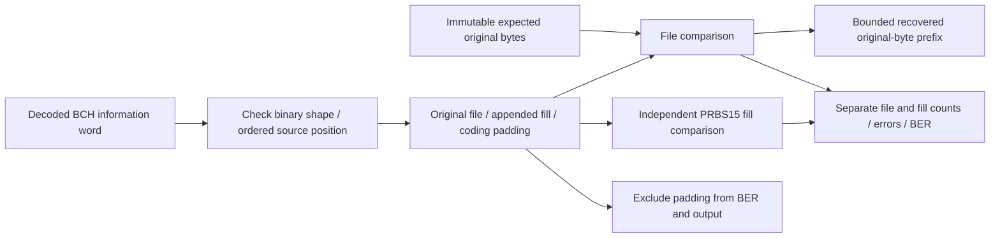

# File verification and recovered output

Receiver decisions reach an independent truth stage only after actual LDPC/BCH
decoding. Original bytes or TX queue labels never become receive-decoder input.
The verifier reads expected file bits directly from immutable input and owns an
independent PRBS15 verifier for the appended segment.

For each meaningful segment s:

\[
E_s=\sum_{n\in s}\mathbf{1}(\hat x_n\ne x_n),\qquad
\mathrm{BER}_s=E_s/N_s\quad(N_s>0).
\]

No compared bits means unavailable BER, not zero. Generic channel comparison
fields sum meaningful file and fill bits; `summary.file_source.file` and `.fill`
keep separate counters. File first-error indices are original-file bit offsets;
fill first-error indices are relative to the first appended bit. The combined
comparison uses absolute file-plus-fill offsets. The existing Rust
`PrbsComparison` counter representation is reused for these ordered bit windows;
its use does not mean file bytes are PRBS.

Final information padding is excluded even if its decoded values are wrong.
LDPC/BCH success/failure and iteration counters still describe the entire encoded
word independently of meaningful BER. Whole-codeword source-window accounting
continues to classify the word's symbol span; its compared bits now exclude file
padding. No new per-symbol fractional attribution is inferred.

Recovered output packs actual decoded original bits into bytes. It never appends
PRBS or information padding and never substitutes expected bytes on an error.
A partial export contains only the whole-byte recovered prefix; metadata retains
the exact recovered-bit count. The current BCH payload size is byte-aligned, but
API callers must still inspect the explicit count and completion flags.

`fully_generated` means the source emitted its finite target; it does not prove
all those bits were enqueued, transmitted or recovered. `file_fully_compared`
means all original-file bits were compared. `fully_compared` additionally requires
all requested fill bits. A duration job can finish with these flags false when
the input outlasts the source window. `recovered_file.complete` means all original
bits were recovered, regardless of errors; check file BER separately.

Cancellation before reception yields no recovered bytes. Mid-run cancellation,
runtime expiry and observer failure preserve completed comparisons and bytes.
The retained buffer is bounded by original-file size, independent of simulated
duration; scalar fill totals do not retain its full stream. JSON includes only
metadata, while library byte access and optional CLI export expose the bytes.
Existing output files are never replaced.
