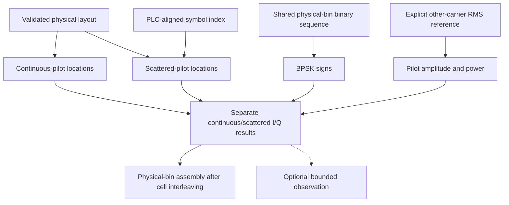

# Pilot-signal design

Pilots are known reference signals at selected physical subcarriers. A receiver
can use them to assess the channel and track a signal; payload cells carry
unknown data and cannot serve the same reference role without decoding.

The simulation module composes independent sequence, location and power stages
from signal processing. It retains their completed results before optional
observation. The physical-bin sequence can be reused; there is no pilot RNG stream
whose state changes when a chart or logger is enabled.

Continuous pilots retain their configured bins. Scattered-pilot locations change
with the PLC-aligned symbol phase. The first symbol after the PLC preamble is
phase0; using an unrelated source-symbol index would misplace the scattered
pattern after interleaving.

Pilot signs are BPSK. Their amplitude is twice the supplied other-subcarrier RMS,
so their power is four times that reference power. This is a relative amplitude
reference, not a measured RF level in dBmV. Pilot insertion happens in physical
frequency bins after the reduced data/NCP cells have been interleaved.

The current model supplies reference signals. It does not itself estimate a
channel, acquire timing or implement a modem tracking loop. Additional continuous
pilot positions are explicitly supplied by the layout; automatically choosing
them remains separate work.

See [pilot equations and example](../pilot-signals.md),
[cell interleaving](../cell-interleaving.md) and [PLC](plc.md).
