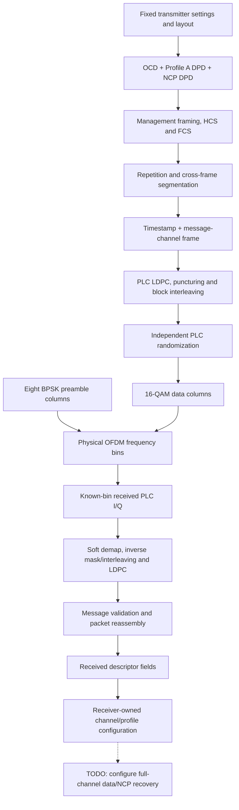

# PLC simulation design

PLC is the signaling part of the OFDM channel. It carries real serialized
configuration messages and a timestamp, using a robust coding path distinct from
payload data coding.

The transmitter composition retains separate codeword-stage outputs and preamble
columns. Numerical algorithms remain in their transmission/codec/DSP owners.
The receiver starts with received equalized PLC cells and known frame alignment;
it never receives original information bits or transmitter masks as decoding input.

A frame contains120 data symbols and eight preamble symbols. In this project's
index convention, data is0–119 and the following preamble is120–127. Preamble
bits bypass FEC, interleaving and randomization. PLC randomizer state continues
across codewords and resets for the next post-preamble data region.

Messages are serialized bytes, then coded bits, then QAM I/Q cells in the assigned
physical frequency bins. They currently pass between Rust modules as in-memory
values. They do not yet pass through an IFFT, time-domain channel and FFT. That
waveform path is a separate checklist stage.

Recovered descriptors now feed a [receiver-owned configuration subsystem](../receiver-configuration/README.md).
It collects a consistent OCD/ProfileA/NCP set, applies assignments, and gates
settings with Waiting/Ready/Rejected states. A rejection preserves the last valid
snapshot without leaving the gate open. PLC bootstrap alignment/numerology stays
supplied reference knowledge. Full data/NCP receive orchestration remains planned;
a ready configuration is not proof of completed payload recovery.

Failures remain visible: LDPC decisions and iterations are retained, message
acceptance requires decoding and timestamp validation, and packet HCS/FCS checks
happen separately during reassembly. Packets can cross PLC-frame boundaries.

See [the complete PLC guide](../plc-channel.md) for the runnable example, equations,
fixed-message support and source evidence. Focused guides explain
[messages](../plc-messages.md), [coding](../plc-coding.md),
[interleaving](../plc-interleaving.md) and [randomization](../plc-randomization.md).
