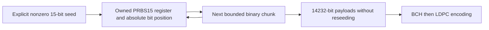
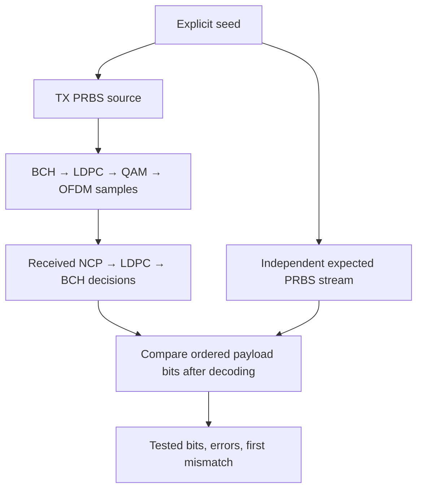

# Continuous PRBS source and verification

PRBS supplies known binary test traffic so the experiment can measure what the
receiver actually recovered. This module owns sequence generation and a separate
truth comparator. BCH, LDPC, mapping, interleaving and waveform processing keep
their existing owners. No MAC address is needed to generate or compare this source.

## Sequence definition

The experiment selects PRBS15 with the sequence polynomial

\[
P(x)=x^{15}+x^{14}+1,
\qquad s_{n+15}=s_{n+14}\oplus s_n.
\]

Here the polynomial defines that **sequence recurrence**. Hardware drawings may
use reciprocal-polynomial or opposite shift conventions; the recurrence and bit
ordering here are the complete contract, rather than the name PRBS15 alone.
The seed is a nonzero 15-bit integer. Its bits zero through fourteen are the
first fifteen emitted bits, least-significant bit first. The implementation
emits register bit zero, shifts right, and inserts old bit fourteen XOR old bit
zero into bit fourteen. Bits above fourteen and an all-zero seed are rejected.
For seed `0x7fff`, the first 32 bits are:

```text
11111111111111101010101010101001
```

Every nonzero state has period \(2^{15}-1=32767\) bits. The absolute bit counter
continues past that period; repetition is a sequence property, not a request to
reset counters. A payload consumes the next14232 bits for the current short-code
BCH input. Codeword boundaries, empty calls,128-symbol PHY randomizer resets,
PLC frames and idle symbols do not reseed PRBS. Idle/filler symbols consume no
payload bits. Independent channel/noise draws must never consume PRBS state.



This is the simulator's chosen traffic pattern, not a CableLabs-mandated MAC
payload or a replacement for DOCSIS PHY randomization. The existing seeded
ChaCha8 source remains available separately. Other PRBS polynomials and automatic
PRBS phase acquisition are not implemented.

## Independent recovered-stream comparison

A verifier owns a second generator initialized from the same explicit seed.
It receives **decoded payload decisions only after reception**, compares the next
ordered source bits and advances even when there are errors. It retains tested
bit count, error count and the absolute first error position, both for each call
and cumulatively. It does not trust LDPC/BCH success flags or change their output.

\[
E=\sum_{n=0}^{N-1}\mathbf{1}\{\widehat{s}_n\ne s_n\},
\qquad \mathrm{BER}=E/N\quad(N>0).
\]

An empty comparison is valid and adds no observations. With no bits tested there
is no BER estimate. A null first-error position means no mismatch has been seen,
not that the input was necessarily nonempty.



The caller supplies recovered bits in source order. The verifier does not infer
missing/duplicated codewords or realign to a shifted sequence. The waveform
experiment separately checks recovered word count and pending bits, so an
incomplete transmission cannot be reported as successful zero-error recovery.
Received PLC descriptors and NCP select the supported physical-layer profile;
modem-addressed profile assignment belongs to a later MAC/CMTS model.

Generation and comparison are bounded to1048576 bits per call. Larger streams
use repeated calls with constant generator state and bounded caller chunks.
Invalid seeds, nonbinary comparisons, excessive chunks and64-bit position
overflow return errors. Rejected calls preserve sequence state and comparison
history. The generator exposes its current position and returned bits directly;
a new common observer producer is not added by this stage.

## Verification and runnable demonstration

`prbs_source` integration tests use literal vectors derived independently from
the stated recurrence, rather than by the production shift-register function.
They are local mathematical vectors, **not external interoperability vectors**.
Tests check three seeds, all32767 distinct nonzero states, balance, payload/chunk
continuity, exact injected errors across codeword/period edges and rejected-call
invariance. A focused internal test checks absolute-counter overflow.

The [payload waveform example](../payload-transport/reference-experiment.md)
now selects PRBS15 explicitly. At each spacing, four payloads span56928 source
bits, crossing the PRBS period and PHY reset while preserving independent state.
The JSON records source kind/seed and `prbs_comparison`, alongside decoder flags,
actual LDPC iterations and per-word truth comparison. The original seeded API
still produces seeded trials and a null PRBS comparison.

```bash
./scripts/cargo-local.sh test -p docsis-ofdm-fec --test prbs_source --locked
./scripts/cargo-local.sh run -p docsis-ofdm-fec --example payload_waveform --locked
```

This remains a bounded reference experiment, not a configurable-duration runner.
See [source ownership](source.md) and [architecture](../../architecture.md).
