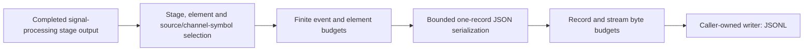

# Bounded stage export

The JSONL adapter serializes the existing selected typed events. It does not
receive mutable source, codec, interleaver or channel state and performs no DSP.
The caller owns the destination writer; the CLI creates a new file for it.

Each line contains `schema_version: 1` and an `event` holding the original stage,
direction, context, domain, units, `element_start`, `total_elements`, shape and
selected typed data. Unknown/missing time remains unknown. Selecting a window
does not reindex it into a new channel or discard grid/normalization metadata.

The selector allows at most32 selected stages,100000 events,65536 elements per
event and1048576 selected elements in total. Export separately bounds one encoded
record to1MiB and a stream to64MiB. Output is buffered only for one bounded record.
Serialization/byte-limit rejection happens before writing that record. I/O can
fail partway through a write; the adapter closes permanently and reports a typed
error. The partial prefix remains owned by the caller. Selector exhaustion simply
stops further selected callbacks while science continues; byte/I/O errors follow
the job's explicit failed-observer policy.

Existing producers now include `source.payload` and `legacy.noise.output`.
Source events contain completed bits and diagnostic source-word identity. The
legacy noise event contains the preexisting coding experiment's completed normalized
output symbols, after Gaussian draws (or unchanged in its noiseless mode).
It is **not** a new waveform impairment model. Tests compare disabled, enabled and
exhausted exports against identical seeded source/AWGN runs, excluding elapsed
time; failed source/noise callbacks also preserve later generator draws when the
stage is used independently.

The channel CLI uses source and received-payload selections in
[the probe request](../../../examples/cli/channel-probes.json). Test-point export is
also a public generic Rust writer adapter for future consumers. See
[channel CLI](../channel-runner/cli.md), [stage observation](test-points.md), and
[public APIs](../../reference/public-api.md).
