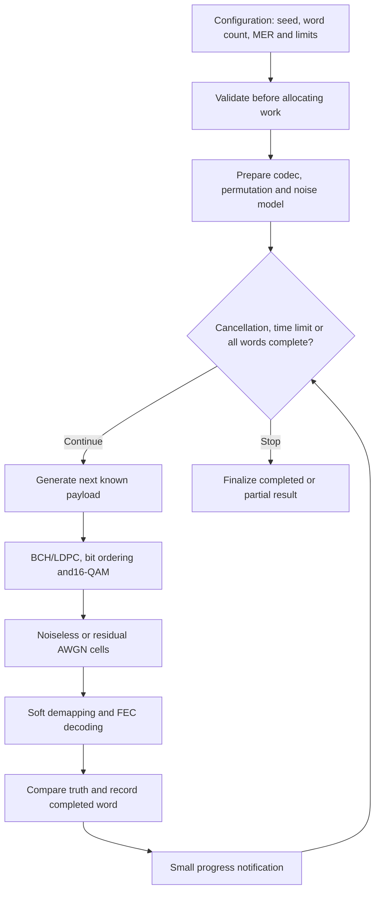

# Experiment-runner design

The root simulation files coordinate the existing bounded16-QAM coding experiment.
They separate configuration policy, scientific execution and result accounting.
They are distinct from the now-implemented [channel job/CLI](../channel-runner/cli.md),
which supplies the duration-based OFDM waveform path.

Configuration sets a reproducible seed, requested codeword count, LDPC iteration
limit, runtime budget and noise choice. Inputs are validated before execution.
Optional measured RxMER supplies residual noise at the existing equalized-cell
reference plane; channel-estimate gain is not added again to those measurements.

The runner connects reusable scientific stages. It retains original payloads
for comparisons, records each completed trial and checks cancellation/runtime
between codewords. A bounded word already in progress may complete after a stop
request. Codec setup occurs before the trial timer starts.

Result accounting separates pre-LDPC errors, post-LDPC errors, recovered payload
errors, decoder-reported failures, BCH corrections and iteration counts. Completed
trials survive cancellation or runtime exhaustion, with an explicit partial status.
Zero observed errors is a measured outcome for the compared bits, not proof of
zero error probability under all conditions.

This experiment bypasses cell randomization and does not generate MAC/NCP/PLC
framing or a waveform. The separate256-QAM coding loop and PLC/pilot components
have broader individual stage coverage; they are not silently included in the
root CLI runner. A future channel runner must connect them with continuous
interleaver state, source/channel time, warm-up and drain.

See [CLI usage](../../cli.md), [coding assumptions and equations](../../reference/coding-mode.md),
[coding loop](coding-loop.md) and [the implementation checklist](../../development/checklist.md).
