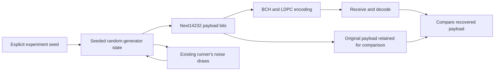

# Payload source design

The source module gives an experiment known input bits. Keeping those original
bits allows us to measure actual recovery errors rather than trusting a decoder's
success flag alone.

A seed initializes a repeatable stream. Each requested payload contains14232
binary values, matching the current short-code BCH information size. The source
owns its generator state and advances it as bits are generated; it does not read
host entropy, files or a modem.

In the existing16-QAM runner, payload and AWGN draws share this stream. Therefore
reproducing a trial requires the same seed **and draw order**, including whether
noise was injected. Resetting the seed for every codeword would produce a different
experiment from the current continuous source stream. Observing results must not
consume random draws.

The existing generator uses seeded ChaCha8 output. It is **not a PRBS generator**.
The separate [continuous PRBS15 source and verifier](prbs.md) now define their own
polynomial, seed, bit order, bounded chunks and continuous comparison state.
The actual payload waveform example selects PRBS explicitly; existing seeded APIs
retain their behavior. Neither source builds DOCSIS MAC traffic or PLC descriptors.

See [coding loop](coding-loop.md) for independent codeword verification and
[runner](runner.md) for the bounded trial lifecycle.
