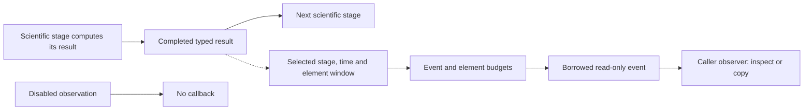

# Stage-observation design

Test points let an experiment inspect intermediate values without duplicating
scientific calculations or adding print statements inside DSP stages. They can
support diagnosis, plots and later exports.

Models describe stage identity, direction, coordinate domain, units, timing,
normalization and data shape. Selection decides which stage/time/element ranges
are visible. The observer consumes an immutable borrowed view; it does not receive
mutable codec, interleaver or randomizer state.

Scientific results are computed before observation. Disabling observations,
exhausting a budget or failing a callback must not change those completed values.
Callback failures still consume the dispatch budget and are reported to the caller;
they are not silently retried. The later whole-run runner will need its own policy
for whether an observation failure ends a job or merely stops collecting views.

Windows retain original element offsets and total source size. PLC windows also
retain the full local grid; physical-bin windows retain spacing and frequency
origin. Missing history stays missing, including JSON null when serialized.
A selected window is not a new, shorter physical channel.

Current producers cover pilot stages, PLC transmit stages, assembled physical
bins and thirteen [waveform TX/channel/RX boundaries](../waveform/observations.md).
Waveform windows retain full numerology, sample clock, absolute sample origin
and direction as well as physical frequency coordinates. Ten [payload/NCP TX/RX producers](../payload-transport/observations.md) add
source/channel cell records and actual control/data recovery boundaries.
Other processing stages expose some results directly but are not all wired
to this common observation mechanism. A registry entry is not permission to claim
that every stage in the architecture already has a producer.

The observer does not write files or own the scientific result. A caller may copy
a selected window while the callback is active; borrowed data cannot outlive that
call. Selection and finite budgets bound the amount of optional data collected.
See [observation limits](../pilot-signals.md#direct-apis-and-observation) and
[the architecture's stage map](../../architecture.md#test-points-and-data-access).
