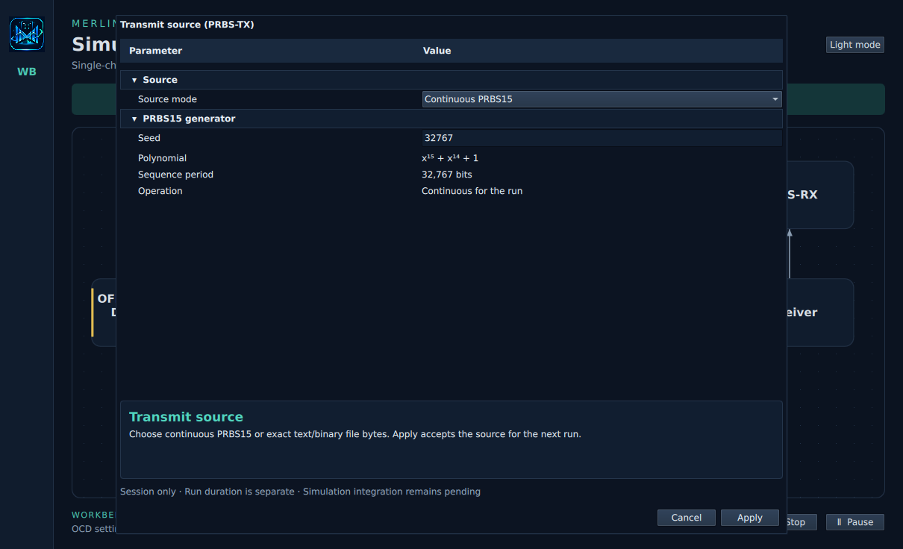
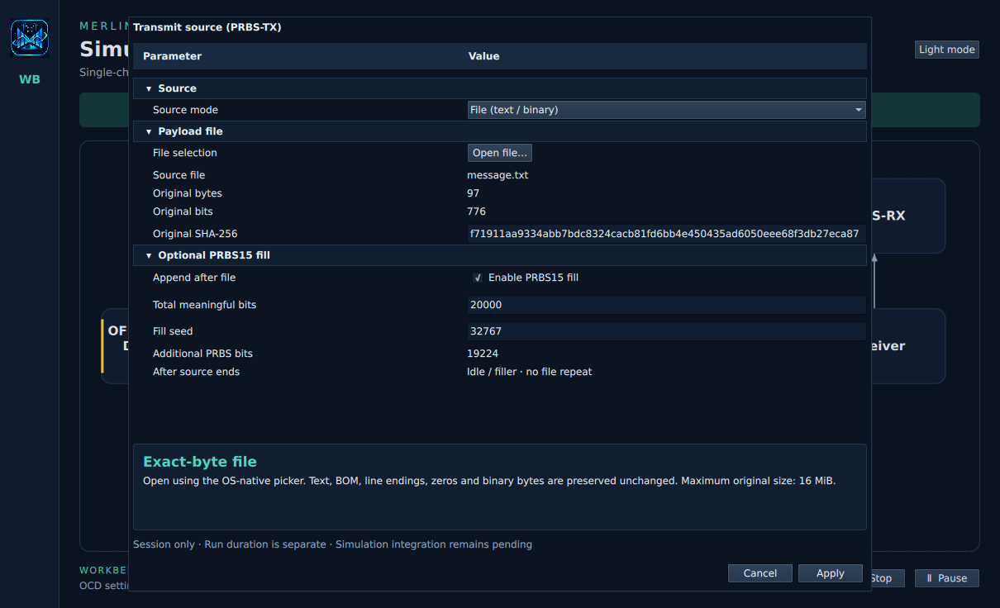
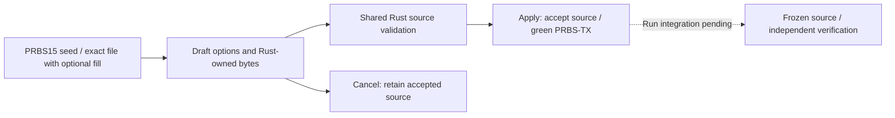

# Transmit source (PRBS-TX)

Click **PRBS-TX** on the workbench to configure test traffic. The dialog uses a
Parameter/Value tree with collapsible groups and descriptions below. This editor
accepts session settings; it does not start a simulation or save a workbench file.

Choose **Continuous PRBS15** to set a seed from 1 to 32767. The initial draft
uses 32767 (`0x7fff`); it is not accepted until Apply. The polynomial and period
are fixed. The stream continues across codewords; run duration is configured
separately. See the [PRBS15 contract](simulation/prbs.md).

Choose **File (text / binary)**, then **Open file** to use the Ubuntu desktop's
native GTK chooser. There is no Qt file browser fallback. Canceling the picker
preserves the current draft. The application reports a diagnostic if native
selection is unavailable. File contents remain unchanged in Rust: BOM, line
endings, nulls and invalid UTF-8 are all permitted. The limit is 16 MiB.
Filename, byte/bit counts and original SHA-256 are read-only; select the hash
field to inspect/copy its full value.

**Append PRBS15** is off initially. Without it, the original file is sent once,
followed by idle/filler. Enable it to enter an explicit **Total meaningful bits**
target and independent fill seed (1–32767). The target includes original-file
bits and must be at least that count and at most 134217728. The summary shows
additional PRBS bits. No automatic target is inferred from profile or duration.
Empty files, equal targets and partial-byte fill follow the existing
[file-source rules](simulation/file-source/README.md). Coding padding is separate.

Apply validates and accepts the source for a future run. Cancel/Escape discards
draft changes. Invalid seeds, missing files, failed reads and invalid fill
targets leave accepted source/readiness unchanged. Files are held as immutable
snapshots; later filesystem changes do not alter accepted bytes.

PRBS-TX stays yellow until explicit acceptance, then turns green. This does not
configure PRBS-RX or enable Start: remaining blocks and job integration are still
required. A completed run may have incomplete file recovery; original-file bits,
appended fill and coding padding have separate accounting in the Rust engine.

See the [workbench](workbench.md) and [architecture](../architecture.md#prbs-tx-source-configuration).
