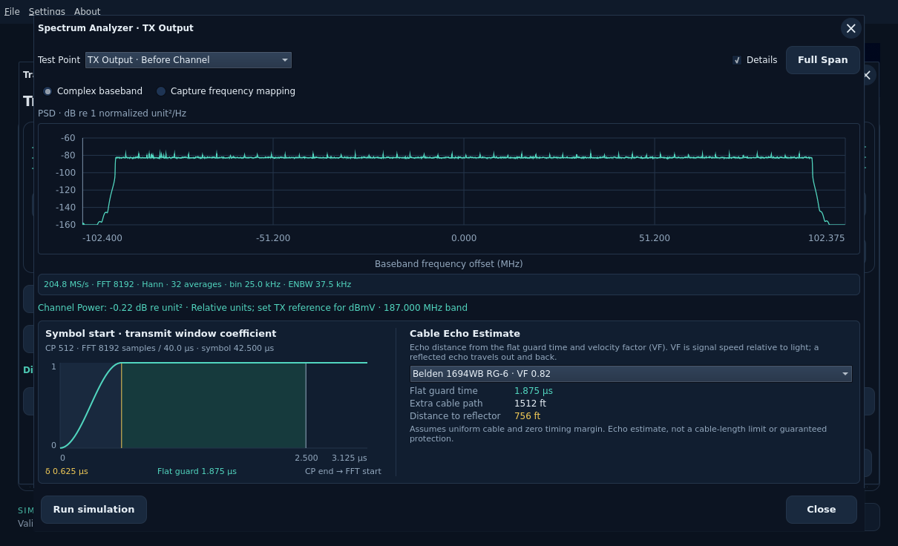
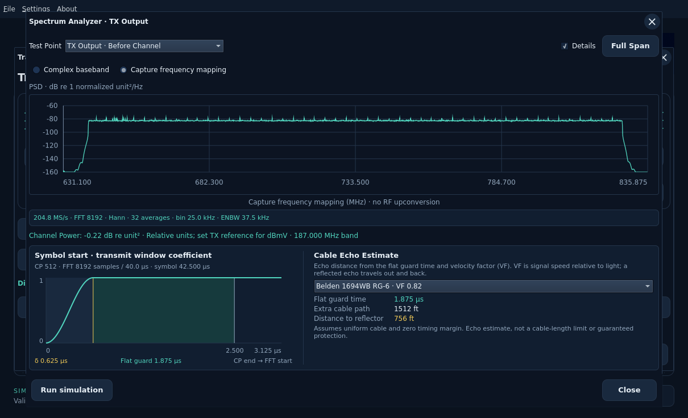
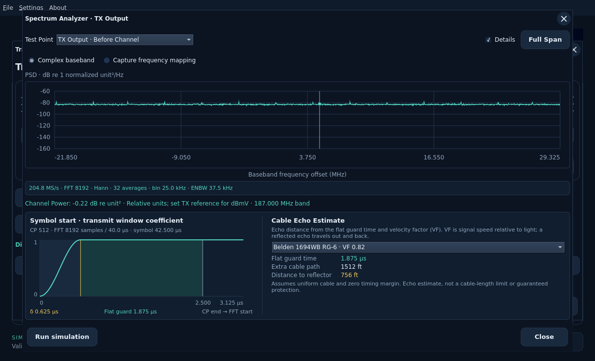
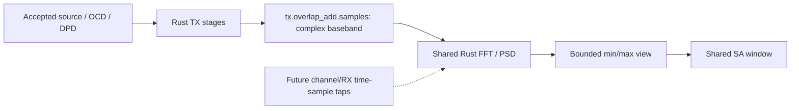

# Spectrum Analyzer (SA)

The SA is a reusable workbench window for time-domain complex I/Q test points.
Its first connection is **TX output**, after cyclic prefix, windowing and
overlap-add and before channel impairments. TX IFFT/prefix/window and receiver
input/framed/useful/FFT-bin views are also connected. The FFT and all signal calculations run in Rust; Qt draws the
bounded trace and handles selection/zoom.

Accept OCD, DPD Profile A (ID 0) and PRBS-TX source settings. Transmitter turns
green when these form a supported Rust request. Click **Transmitter**, then
**Spectrum Analyzer** directly below **TX Output** in the staged
[Transmitter workbench](transmitter-workbench.md). After main Start completes,
the SA reads that run's actual selected TX samples. Before a completed run,
TX Output can generate its independent preview; **Run simulation** regenerates
that preview from frozen source settings. This does not start the full closed
loop. Opening the SA while the main run is busy never starts another preview.

**Run simulation** is at the lower left; **Close** stays at the lower right.
**Cancel preview** appears only while the separate TX preview is running. It
cancels that preview, preserving accepted inputs and any previous completed
snapshot. Use **Stop** on the main workbench to stop the full simulation.
Sample rate, FFT length, window, averaging and bin/ENBW details appear as a compact
strip below the frequency axis. Clear **Details** to hide this readout;
mouse zoom and Full Span keep working. Warnings and Channel Power stay visible.

The signal is **complex baseband**, centered at DC. There is no RF upconversion.
Baseband describes the frequency range around zero; complex describes its I/Q
representation, which retains amplitude and phase and distinguishes positive
from negative frequency offsets. It is the same baseband signal, not another band.
The default axis shows positive and negative frequency offset: at 25 kHz spacing
the 8192-point FFT spans −102.4 through +102.375 MHz. **Capture frequency mapping**
instead labels the same bins using the selected capture's frequency origin.
Changing the axis never changes or upconverts samples.

Choose **Complex baseband** or **Capture frequency mapping** with the radio
buttons above the plot. The choice preserves any zoomed bin range and does not
rerun the simulation. The old Frequency axis caption and raw Tap text are removed;
the named Test Point selector identifies the signal. Fixed RX FFT-bin views hide
the axis choices.

The vertical axis is normalized power spectral density, **dB re one sample unit
squared per Hz**. It is not calibrated dBm, dBmV or dBFS. No RF output level or
reference impedance is assumed. This is a simulation analyzer, not RF compliance
evidence. The same unit/reference-plane distinction must be preserved when more
workbench taps are connected.

Generation uses actual selected PRBS/file bits, existing FEC/control coding,
mapping, interleaving, pilots and OFDM synthesis. Idle priming establishes
interleaver history before consuming source bits. A finite file is sent once;
accepted optional fill is honored, with idle/filler after EOF. Generated source
bit counts include queued preview words and do not prove full transmission or
recovery. No receiver runs for this preview.

The transmitter-only preview uses 32 periodic-Hann FFT windows with 50% overlap;
retained run taps use the available complete windows, with the count displayed.
Both average **linear
power before conversion to dB**. FFT size is 8192 or 4096 at 204.8 MS/s; displayed
bin spacing and equivalent noise bandwidth follow that geometry. This analysis
window is separate from the transmitter's OFDM roll-off window.

Scroll the mouse wheel over the trace to zoom in/out around the pointer. Drag
left or right with the left mouse button to select a frequency range; the shaded
band previews the selection. **Full Span** restores the entire retained spectrum.
Zoom In/Out buttons have been removed. Click the plot and use +/- to zoom or Home
to reset; Left/Right selects a bin group. The same controls apply to TX and RX SA
test points and the RxMER/Channel Estimate measurement viewers. Navigation does
not rerun the simulation.

Hover or use Left/Right on the plot to select a bin group. The trace shows each
group's peak and a min/max envelope; full-resolution FFT data stays in Rust.
Mouse gestures and **Full Span** query new bounded views without
regenerating the signal. At close zoom, individual bins become visible. Zero
power remains explicit in retained Rust data; the finite drawing floor is visual only.
The area below the frequency axis now contains the symbol-timing and cable panel.
Sample counts, selection text and completion messages remain omitted. Generation
status and diagnostics are available in the Run simulation button tooltip.

**Cancel** or closing the SA requests cooperative worker cancellation. The UI
remains responsive. Previous complete results stay available if inputs have not
changed. Applying new source, profile or OCD settings cancels older work and
invalidates its spectrum; rejected edits and Cancel preserve accepted state.
Only one preview worker runs at a time. Settings/results are session-only.

See [workbench readiness](workbench.md), [PRBS-TX](source-input.md) and
[design and validation](../development/features/transmitter-spectrum/design.md).

## Symbol timing and cable echo budget

Below the PSD, the left panel shows the actual **transmit-window coefficient**
near symbol start. This is a dimensionless window view, not the time-domain I/Q
signal amplitude. The overview reports CP, useful FFT length/time and symbol
cadence. Yellow marks the roll-off/overlap boundary; the CP-end marker identifies
the useful FFT start. The flat guard label subtracts roll-off from CP duration.
All values use the frozen settings that produced the displayed spectrum.

Select **Belden 1694WB RG-6**, **CommScope P3 500** or **Custom cable / velocity
factor** on the right. Custom VF must be greater than zero and at most one; an
empty value leaves distances unknown. Cable selection updates the estimate
without rerunning the simulation or changing any samples.

The **Cable Echo Estimate** grid gives context for the distances:

| Field | Meaning |
| --- | --- |
| Velocity factor (VF) | Signal speed in the cable divided by the speed of light. |
| Flat guard time | Available timing interval after roll-off, before useful FFT samples. |
| Extra cable path | Additional distance a delayed copy can travel within that interval. |
| Distance to reflector | One-way distance for an echo that travels out and back. |

The ideal timing budget is `(CP samples − roll-off samples) / sample rate`.
For CP512/RP128, it is 1.875 µs. With VF0.82, this corresponds to about 1512 ft
of **extra path**, or 756 ft of **two-way reflector spacing**. The estimate assumes
one homogeneous cable and zero reserved receiver timing margin. It is not maximum
plant reach, a general distance-to-fault measurement, or guaranteed echo
protection. Actual echoes also depend on topology, strength and receiver behavior.

Applying new accepted inputs clears the panel until a new snapshot completes.
Full time-domain I/Q trace inspection remains pending. The
[design and source evidence](../development/features/transmitter-spectrum/design.md#ui-sa-04-symbol-timing-and-cable-echo-budget)
records the PHY derivation and manufacturer VF references.

## Channel Power

Time-domain SA views integrate the fixed occupied channel band independently of
mouse zoom. The readout includes the integration bandwidth; pilot energy, internal
gaps and noise remain in the integral. A transmitter-only preview reports relative
power. Completed-run TX/RX and channel TP views use the run's optional TX electrical
reference to report rms dBmV and a separate band-average dBmV/6 MHz level. FFT-bin
views remain separately labeled bin power. See [channel conditioning](channel-measurements.md#launch-amplifier-attenuator-and-tappoints)
for calibration, noise and saved settings. Plotting capture frequencies does not
perform RF upconversion.
