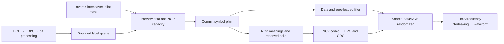

# Stateful symbol packing

The packer carries short8/9 uniform256-QAM codewords across successive symbol
plans. Each16200-bit codeword becomes2025 labels after bit processing. Data fills
eligible positions from low to high; NCP reservations fill from high to low.
Partial codewords continue in the next symbol without resetting the randomizer.

This is a **pre-interleaving plan**, not a transmitted waveform. The separate [NCP codec](ncp.md) now generates actual message bits, CRC and
control FEC from these plans. Pilot signs, boost, PLC signaling,
time/frequency interleaving and IFFT remain separate work.

## Run the example

From the repository root:

```bash
./scripts/cargo-local.sh run -p docsis-ofdm-fec --example symbol_packing --locked
```

The example queues three seeded random BCH/LDPC codewords and prints compact JSON
plans using a synthetic800-position domain. It does not use PRBS or represent a
complete physical carrier allocation. Each summary includes the symbol index,
data/pilot/filler/NCP cell counts, NCP meanings and remaining queue size.
`ncp_wire_encoded` is explicitly `false`. A start entry contains a profile ID,
data-position pointer and diagnostic codeword ID. The latter is not transmitted.



## Geometry and signaling

`NI` is the fixed reduced interleaver-domain size after removing PLC, continuous
pilots and excluded bins. Limits are7537 at25kHz and3745 at50kHz. The caller must
supply the correct inverse-interleaved scattered-pilot placeholders for each
symbol. Do not pass physical `CarrierLayout::symbol_roles` directly: physical
pilot bins and pre-interleaving positions are different domains.

Pointers count data positions, including zero-loaded positions, and skip pilot
placeholders. NCP modulation is uniformly QPSK,16-QAM or64-QAM in this mode.
Each NCP block has48 encoded bits; the CRC consumes another encoded block:

$$
L_{\mathrm{NCP}}=\frac{48}{\log_2 M_{\mathrm{NCP}}},\qquad
C_{\mathrm{data}}=N_I-N_{\mathrm{SP}}-(n_{\mathrm{entries}}+1)L_{\mathrm{NCP}}.
$$

Here $C_{\mathrm{data}}$ includes payload and possible zero-loaded filler.
Entries describe codeword starts and an optional terminal NULL or Z marker;
the extra block accounts for CRC. The planner searches bounded reservation sizes
before consuming any queued labels. There may be at most ten active starts per
8K symbol, or across any consecutive pair of4K symbols.

A Z marker identifies the start of zero-loaded filler. Such cells carry BPSK and
clock the randomizer; they are not payload. A NULL entry handles continuation
without a new start. At a tight exact-end boundary the planner may reserve an
extra NULL and carry the data tail to the next symbol rather than overfill NCP.
Scattered-pilot placeholders do not clock the randomizer. Reserved NCP cells clock it with the [encoded NCP labels](ncp.md).

## Public Rust API

Use `transmission::packing::{PackingSettings, SymbolPacker}`:

1. Construct validated settings: spacing, fixed NI, NCP modulation and profile ID.
2. `enqueue(labels)` transfers ownership of exactly2025 labels in0..255 and returns
   a job-local codeword ID. Up to16 complete/partial words may be queued.
3. `pack_symbol(roles)` returns owned cells and NCP meanings for the next symbol.
   Queue offsets and symbol indices change only after a valid plan is found.
4. `PackedSymbol::summary()` counts categories without exporting every label.

Rejected enqueue inputs are dropped; existing queued data remains unchanged.
Rejected symbol plans leave the queue and symbol index unchanged. Input roles
are borrowed and never modified. Empty queues produce zero-loaded filler.
Zero-loaded data/NCP profiles are not implemented; the generated terminal filler
is supported. Profile-ID validation checks field width, not full profile setup.

Keep one transmitter and receiver randomizer across successive plans and call
`begin_symbol` using the plan's consecutive index. Do not restart per codeword.
A caller running a longer job should bound work, check progress and cancellation
between symbols, and avoid accumulating every plan in memory.

## Verification and remaining stages

Tests cover pointer ranks, descending NCP placement, multiple starts, NULL/Z
reservations, partial-word carry, input rejection and queue bounds. A noiseless
integration test recovers four actual BCH/LDPC payloads with zero errors across
more than128 symbols, retaining the decoder's actual iteration count.

That integration test uses synthetic pilot masks, synthetic NCP labels for
randomizer clocking, and diagnostic word IDs/offsets as a boundary oracle. It
verifies packing continuity and coding recovery, not NCP receiver discovery or
external DOCSIS interoperability.

A second integration test now uses real [NCP encoding and receiver discovery](ncp.md)
instead of diagnostic boundaries. Four major stages remain:

1. Stateful time and frequency interleaving with inverse pilot mapping.
2. Continuous/scattered pilot and PLC signal generation.
3. IFFT, cyclic prefix, windowing and the inverse receiver.
4. Streamed one-second noiseless integration with warm-up and drain.

Pinned evidence: CM-SP-PHYv3.1-I20-230419 §7.5.5.5.1–2, PDF125–128
(packing and pointer domain); §7.5.6, PDF129 (NI limits); §7.5.14.4,
PDF163–164 (NCP placement); §8.3.4.2–3, PDF182–184 (start limits,
terminal markers and encoded NCP/CRC block sizes).
