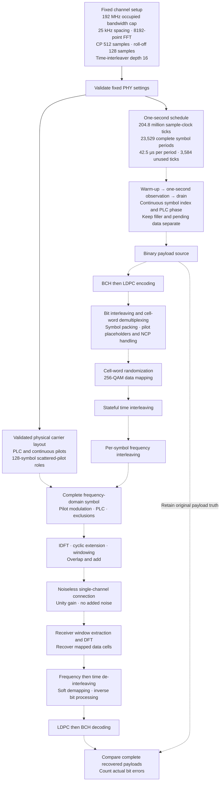

# Single-channel downstream transmission

The next experiment represents one fixed downstream OFDM channel with a noiseless
connection. Select configuration before the run and hold it constant throughout.
Channel bonding and dynamic CMTS reconfiguration are outside this scope.

The public Rust `transmission` module currently validates numerology and calculates
a one-second schedule. [Carrier layout](carrier-layout.md) now validates physical
bin geometry and generates scattered-pilot roles. [QAM mapping](qam-mapping.md)
and reference soft demapping are available through16K-QAM. Waveform generation,
full control-cell packing and time/frequency interleaving are pending.
[Data/NCP randomization](cell-randomizer.md) is now available as a standalone
stateful API; PLC randomization and channel-runner integration remain pending.
The [256-QAM coding loop](qam256-coding-loop.md) connects bit processing,
randomization and reverse decoding as independent codeword trials.
A [stateful symbol packer](symbol-packing.md) now carries256-QAM codewords
across pre-interleaving plans with NCP reservations. The [NCP codec](ncp.md)
now provides actual control FEC, CRC and receiver boundary discovery.
Physical-domain integration remains pending. The existing CLI remains the
separate16-QAM coding experiment.

## Transmission flow

Solid connections below show implemented configuration and timing. Dashed
connections show the planned channel path. Warm-up and drain are outside the
one-second observation interval.



Freezing a validated snapshot is a requirement for the upcoming runner; the
current settings API validates values but does not create or execute that runner.

## Fixed setup

| Parameter | Supported values | Initial choice |
| --- | --- | --- |
| Occupied bandwidth |24–192MHz, multiples of6MHz |192MHz |
| Sample clock |204.8Msamples/s |204.8Msamples/s |
| Subcarrier spacing |25 or50kHz |25kHz |
| FFT size |8192 at25kHz;4096 at50kHz |8192 |
| Useful symbol time |40µs at25kHz;20µs at50kHz |40µs |
| Cyclic prefix |0.9375,1.25,2.5,3.75,5µs |2.5µs (512samples) |
| Roll-off period |0,0.3125,0.625,0.9375,1.25µs |0.625µs (128samples) |
| Time-interleaver depth |1–16 at25kHz;1–32 at50kHz |16 |
| Upcoming data constellation |256-QAM |8coded bits per data cell |
| Observation |One simulated second |One second |
| Initial propagation model |Unity gain, no noise or impairments |Noiseless |

These choices are application defaults, not mandated CMTS settings. Roll-off must
be shorter than the prefix. Zero roll-off is evaluation-only, not operational.
Roll-off means a window taper duration, not a raised-cosine QAM filter coefficient.

Occupied bandwidth does not specify the data-carrier count. The upcoming layout
must separately define frequency reference, band-edge/internal exclusions, PLC,
continuous/scattered pilots and NCP allocation. Do not assign all192MHz/spacing
carriers to payload. Physical layout inputs are now explicit; NCP transport still
requires the upcoming packer and interleavers.

## One-second timing

For sample clock $F_s=204800000$, FFT size $N$, prefix $N_{CP}$ and roll-off $N_{RP}$:

$$
\Delta f=\frac{F_s}{N},\qquad T_u=\frac{N}{F_s},\qquad
T_{sym}=\frac{N+N_{CP}}{F_s}.
$$

The windowed symbol has $N+N_{CP}+N_{RP}$ samples; adjacent windows overlap by
$N_{RP}$ samples. Roll-off does not add to symbol cadence. For one second:

$$
S=\left\lfloor\frac{F_s}{N+N_{CP}}\right\rfloor,\qquad
R=F_s-S(N+N_{CP}).
$$

The default gives **23,529 complete symbol periods**, each **42.5µs**, and
**3,584 unused sample ticks (17.5µs)**. Observation is exactly one second; only
whole symbol periods within it are scheduled. This is simulated time, independent
of host computation time. Window-edge tails are accounted for separately.

```rust
use docsis_ofdm_fec::transmission::TransmissionSettings;

let settings = TransmissionSettings::default();
let schedule = settings.one_second_timing()?;
assert_eq!(schedule.complete_symbols, 23_529);
# Ok::<(), docsis_ofdm_fec::LabError>(())
```

## Interleaver lifecycle for the upcoming runner

Stream symbols and waveform samples through bounded buffers. A second at this
clock contains204.8million complex samples; retaining all samples is unnecessary.
Keep cancellation and progress between bounded operations.

Freeze validated configuration at startup. Carry sample position and OFDM-symbol
index across codewords. Pilot/randomizer phase follows the PLC preamble and its
128-symbol cycle; it must not restart for each codeword.

Time interleaving operates on mapped cells before frequency interleaving, retaining
delay-line state between symbols. Frequency interleaving applies the specified
per-symbol permutation and LFSR initialization. It is not an arbitrary rotating
frequency shift. The receiver reverses frequency first, then time interleaving.

Establish initialized transmitter/receiver state before the observation, then drain
delayed cells afterward. Report warm-up, observation and drain separately. Mark
startup/filler cells so that they do not become payload truth or error counts.
Count complete payload blocks and retain boundary bits; never report zero BER for
blocks not compared. Exact warm-up/drain lengths depend on the implemented delay
structure and are not calculated by the current timing API.

## Pinned evidence and next steps

CM-SP-PHYv3.1-I20-230419 defines:

- §7.5.6.1–§7.5.6.3, PDF129–133: interleaving and pilot handling.
- §7.5.7, Table38, PDF133–135: FFT, sample clock and spacing.
- §7.5.8.1, Tables39–40, PDF135–136: CP/RP values and constraints.
- §7.5.9, PDF136: occupied bandwidth definition and6MHz increments.
- §7.4.10.1–§7.4.10.2.1, PDF69–70: overlapping windows and symbol cadence,
  delegated by downstream §7.5.8.1.
- §7.5.5 and AnnexA: bit demultiplexing, randomization and constellation mapping.

Verified256-QAM bit processing and a [stateful symbol packer](symbol-packing.md)
and [NCP encoding/decoding](ncp.md) are now available separately. Four major
stages remain: time/frequency interleaving; pilot/PLC signal generation; IFFT,
prefix/windowing and inverse receiver; and full one-second noiseless integration.
The timing and packing tests do not establish full channel recovery.
