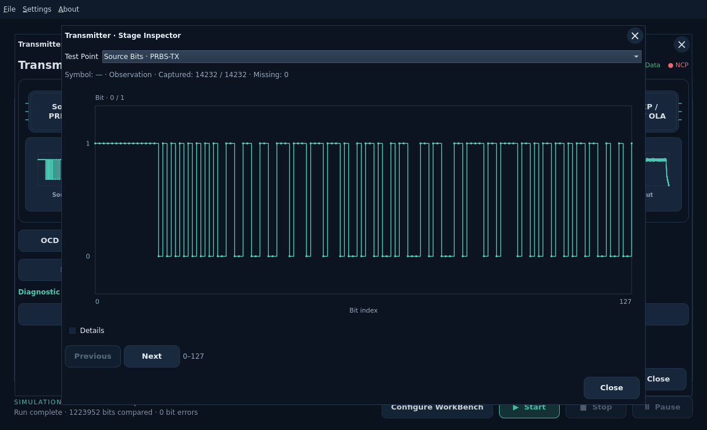
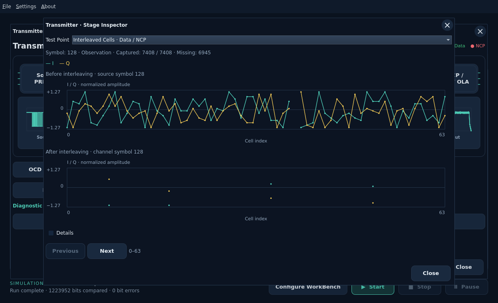
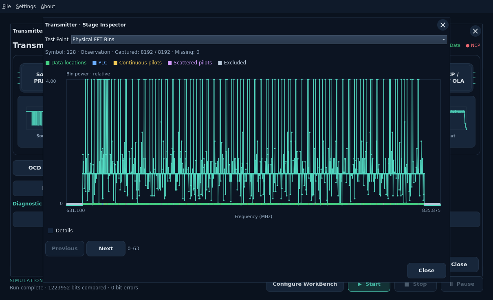
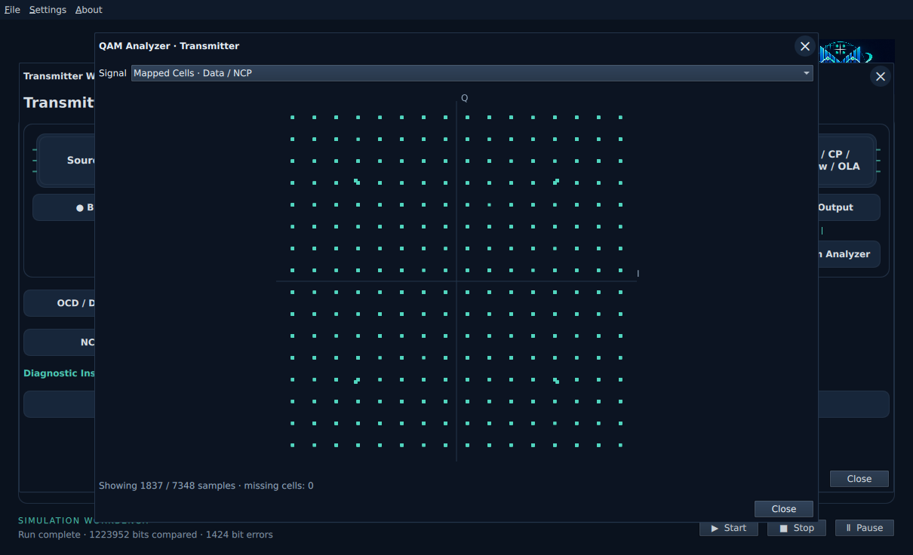
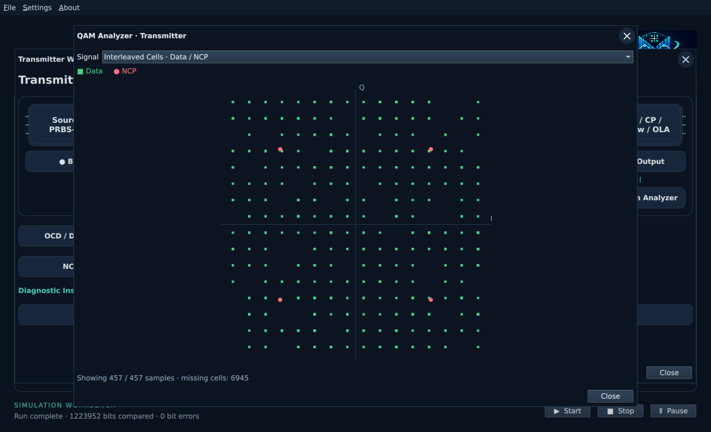
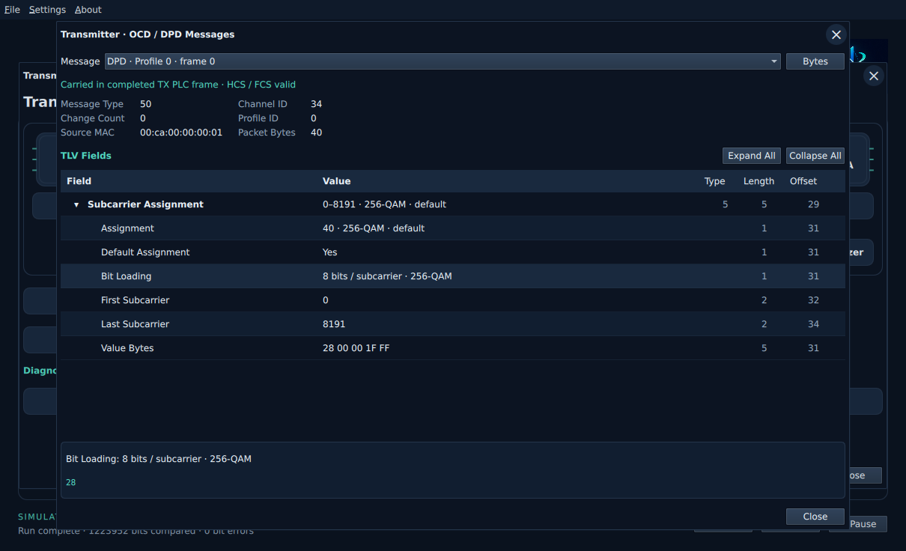

# Transmitter workbench

Click **Transmitter** to open its signal path. Each upper stage has a clickable graph preview
below it. The upper processing blocks retain their original layout. Opening this workbench does not start a run or change inputs.
The **Source · PRBS-TX** chip identifies the source configuration block.
Its inspector names the boundary **Source Bits · PRBS-TX**: generated PRBS15 or
accepted file bits with optional fill, before BCH/LDPC encoding.
See the [source editor](source-input.md) and [terminology](terminology.md).

Click **SA**, captioned **TX Output**, to see complex-baseband output before the
channel. Its preview shows the actual retained output spectrum. The Test Point selector also offers IFFT, cyclic-prefix
and window boundaries. After main **Start**, the SA uses that run's actual TX
samples. Before a full run, TX Output can generate the existing transmitter-only
preview with **Run simulation**; that preview does not populate other inspectors.
Wheel/drag zoom and **Full Span** use the shared analyzer controls.

Use main **Start** to capture the other stages. Missing data is reported explicitly.
Click **Bits**, **LDPC Word**, **Bits / Labels**, **Mapped I/Q**, **Ordered Cells**
or **Physical Bins** to open its graphical stage inspector with original indices and symbol identity.
**Details** reveals exact values; **Previous / Next** navigate captured pages. Nulls and pilot placeholders
remain distinct from zero-valued samples. The coding boundary is the LDPC word;
a separate BCH-word snapshot is not currently captured. **NCP / Pilots** opens
their shared physical frame-bin view.

| Preview | Full graph |
| --- | --- |
| Bits | Digital 0/1 trace, 128 consecutive bits per page. |
| LDPC Word | A raster of 2048 coded bits: 64 columns read left to right, then down. |
| Bits / Labels | Actual interleaved bits or label-value strip, depending on the captured boundary. The selector offers both. |
| Mapped I/Q | Transmitted constellation with Data green and NCP red. |
| Ordered Cells | Separate before/after I/Q sequences against cell index, on a common amplitude scale. |
| Physical Bins | Relative bin-power envelope and colored carrier-role band for one captured symbol. |
| SA · TX Output | Existing Spectrum Analyzer, with its IFFT/CP/window/output selector. |

The LDPC raster distinguishes zero and one; it does not invent an information /
parity boundary absent from the retained snapshot. Bit/label views keep their
actual indices and do not assume fixed modulation or reconstructed bit groups.
Ordered-cell graphs identify the source and channel symbols separately. Their
comparison is not a complete per-cell interleaver permutation or time history.

Physical Bin colors distinguish Data locations, PLC, continuous/scattered pilots
and excluded bins. Data locations can carry transported NCP. Missing samples
remain gaps; excluded zeros remain zeros. Power is the captured bin's I² + Q² in
relative sample units, not a PSD or a calibrated channel-power measurement. The
map shows the full retained span independently of the exact-value Details page;
hover for actual bin, frequency, power and role. No multi-symbol waterfall is
shown. Preview cards use captured data and show No capture until it is available.

**QAM Analyzer** displays mapped or interleaved Data/NCP cells, PLC data, or the
PLC preamble. Data/NCP views include their combined cells and filler; they are not
payload-only classifications. Missing interleaver history is not plotted as zero.
The view shows up to2048 actual points and reports the available count.

Mixed mapped/interleaved views show **green squares for Data** and **red circles
for NCP**, with a legend above the plot. Explicit filler uses amber diamonds;
unclassified samples use a neutral marker and label. Colors identify symbol roles,
not error status. NCP is drawn last so overlapping data does not hide control cells.
Both palettes preserve these role colors. Display reduction keeps rare roles
represented within the same2048-point limit.

Classification follows the actual TX packing plan and its retained source grid.
The first interleaved snapshot uses the same interleaver transport for role labels;
when the necessary history is unavailable, samples remain unclassified. Missing
cells are not drawn. PLC Data/Preamble remain separate selections.

**OCD / DPD Messages** or **Message Inspector** opens actual packets reassembled
from captured TX PLC frames. Select OCD, Profile A DPD or NCP DPD, expand TLVs for
their hex values, and use **Bytes / TLV Tree** to switch views. Headers include
channel, profile, change count and source identity. TLV offsets count from the
start of the complete MAC packet; HCS/FCS validation uses those same bytes.
These are not the imported modulation-profile PNM bytes.

The message inspector shows an aligned **Field / Value / Type / Length / Offset**
tree. Use the disclosure arrow or double-click a row to fold its child fields;
**Expand All** and **Collapse All** apply to the current packet. Select a row,
then use Right/Left to expand/collapse or move to its parent. Up/Down move between
visible rows; Enter or Space toggles a branch.

Top-level values summarize the encoded setting or inclusive subcarrier range.
Children expose assignment/loading fields and exact value bytes. Type identifies
the parent TLV; decoded children are fields, not additional TLVs. Length counts
bytes. Offsets are absolute positions in the complete packet: the parent points
at its type byte, and child fields point inside its value after the two-byte
TLV header. Select a row for its complete value, description and selectable hex.
Unsupported values remain marked and available as bytes.

**Bytes** switches to the complete original packet; **TLV Tree** returns to the
same folding state. Choosing another message resets folding and selection. These
views inspect retained transmissions and never change OCD/DPD configuration.

**Carried in completed TX PLC frame** means all samples of that frame were
transmitted. **Scheduled · TX PLC frame incomplete** means the captured generated
frame was not completely emitted before the run ended. This conservative status
does not establish receiver acceptance. Incomplete packets and capture limits
are reported. Capture is limited to64 PLC frames and32 displayed packets.

Inspectors read completed or partial results without rerunning the simulation.
Applying changed inputs clears stale observations. Existing readiness and main
Start/Stop/Pause behavior are preserved.
