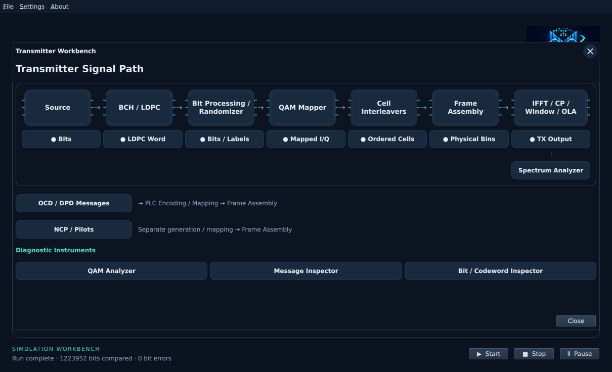
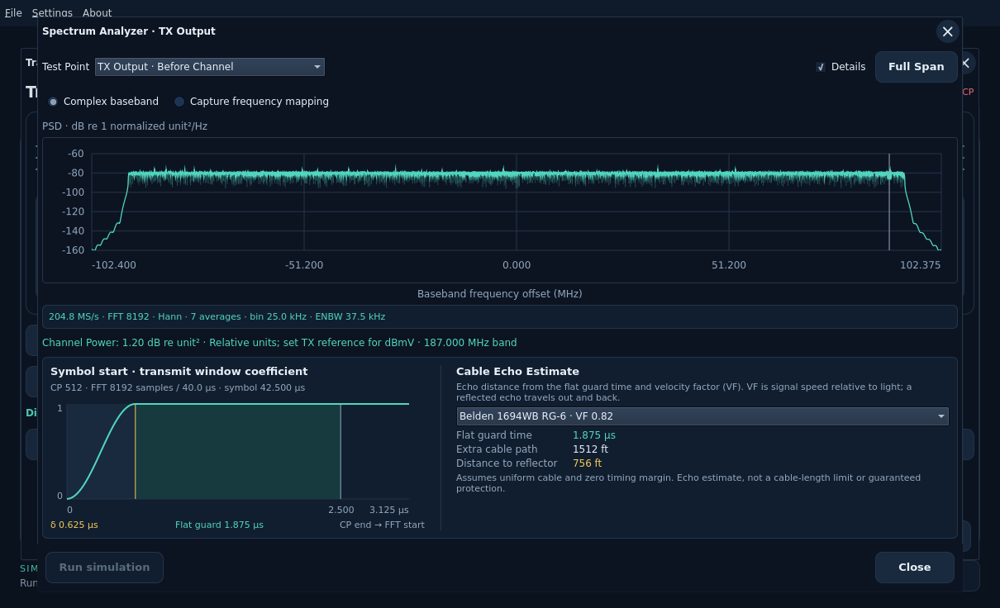
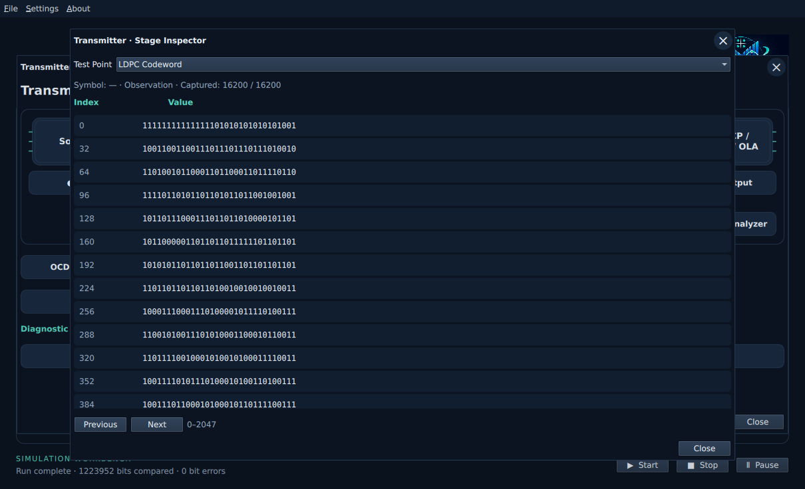
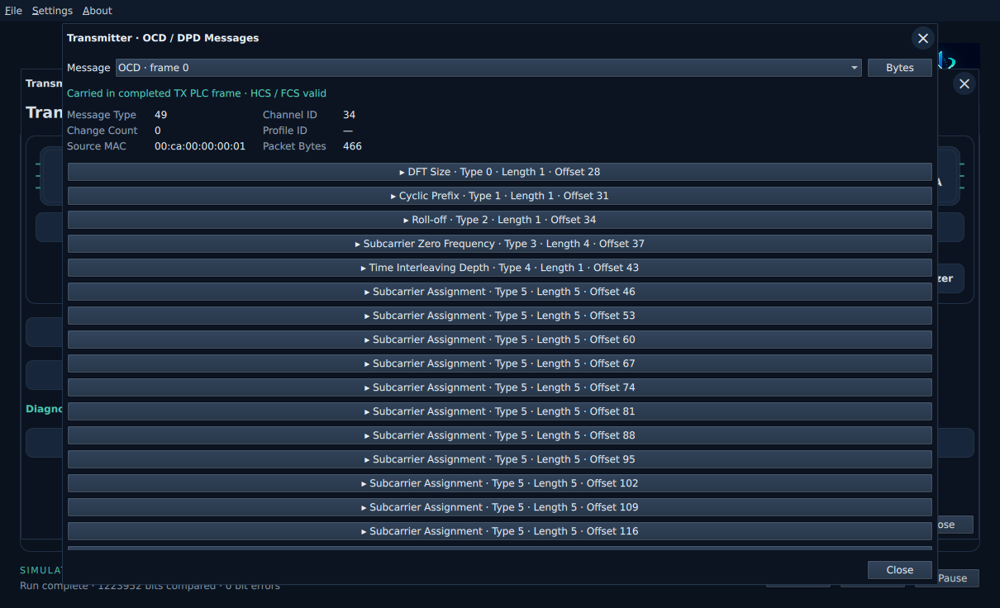
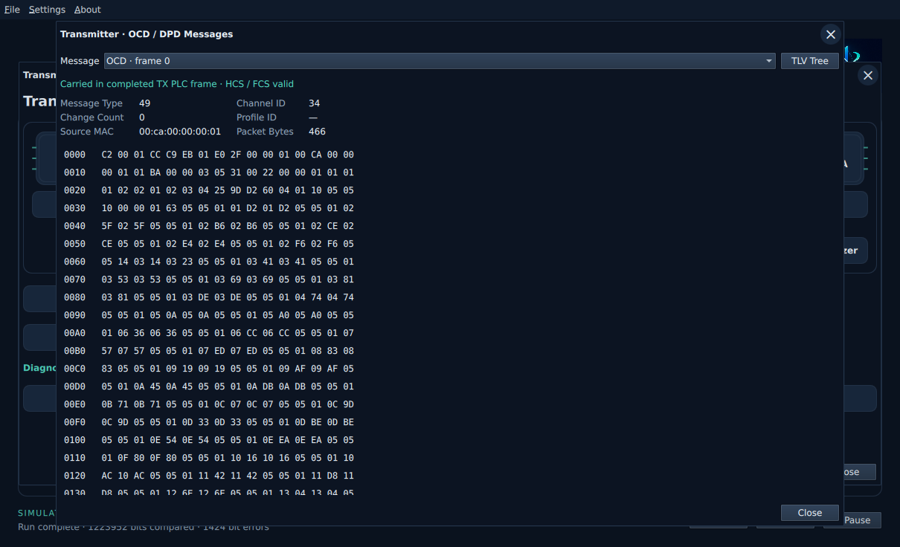

# Transmitter workbench

Click **Transmitter** to open its signal path. Each rounded stage has a selectable
test point below it. Opening this workbench does not start a run or change inputs.
The small MERLIN label above the main workbench title has been removed.

Click **Spectrum Analyzer**, directly below **TX Output**, to see complex-baseband
output before the channel. The Test Point selector also offers IFFT, cyclic-prefix
and window boundaries. After main **Start**, the SA uses that run's actual TX
samples. Before a full run, TX Output can generate the existing transmitter-only
preview with **Run simulation**; that preview does not populate other inspectors.
Wheel/drag zoom and **Full Span** use the shared analyzer controls.

Use main **Start** to capture the other stages. Missing data is reported explicitly.
Click **Bits**, **LDPC Word**, **Bits / Labels**, **Mapped I/Q**, **Ordered Cells**
or **Physical Bins** to inspect a bounded page with original indices and symbol
identity. **Previous / Next** navigate captured values. Nulls and pilot placeholders
remain distinct from zero-valued samples. The coding boundary is the LDPC word;
a separate BCH-word snapshot is not currently captured. **NCP / Pilots** opens
their shared physical frame-bin view.

**QAM Analyzer** displays mapped or interleaved Data/NCP cells, PLC data, or the
PLC preamble. Data/NCP views include their combined cells and filler; they are not
payload-only classifications. Missing interleaver history is not plotted as zero.
The view shows up to2048 actual points and reports the available count.

**OCD / DPD Messages** or **Message Inspector** opens actual packets reassembled
from captured TX PLC frames. Select OCD, Profile A DPD or NCP DPD, expand TLVs for
their hex values, and use **Bytes / TLV Tree** to switch views. Headers include
channel, profile, change count and source identity. TLV offsets count from the
start of the complete MAC packet; HCS/FCS validation uses those same bytes.
These are not the imported modulation-profile PNM bytes.

**Carried in completed TX PLC frame** means all samples of that frame were
transmitted. **Scheduled · TX PLC frame incomplete** means the captured generated
frame was not completely emitted before the run ended. This conservative status
does not establish receiver acceptance. Incomplete packets and capture limits
are reported. Capture is limited to64 PLC frames and32 displayed packets.

Inspectors read completed or partial results without rerunning the simulation.
Applying changed inputs clears stale observations. Existing readiness and main
Start/Stop/Pause behavior are preserved.
