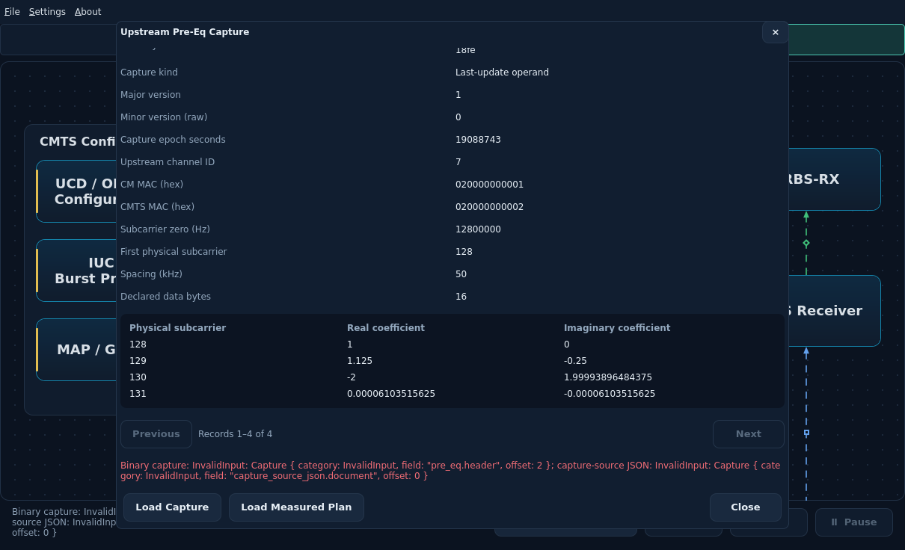
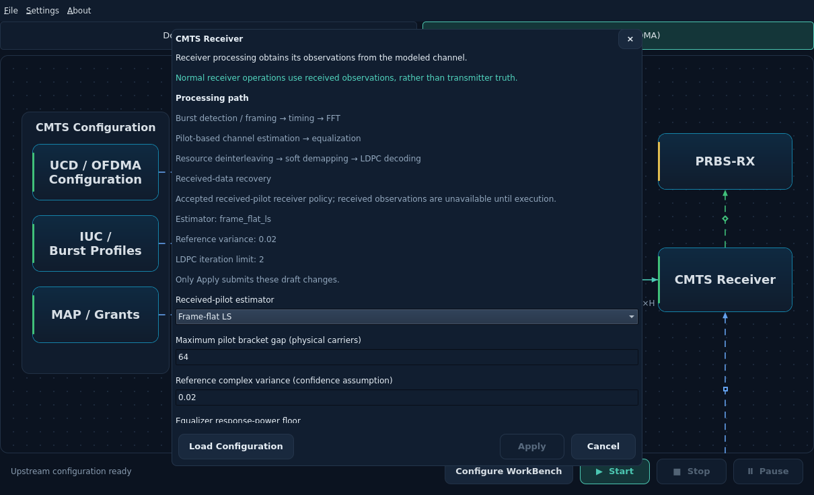
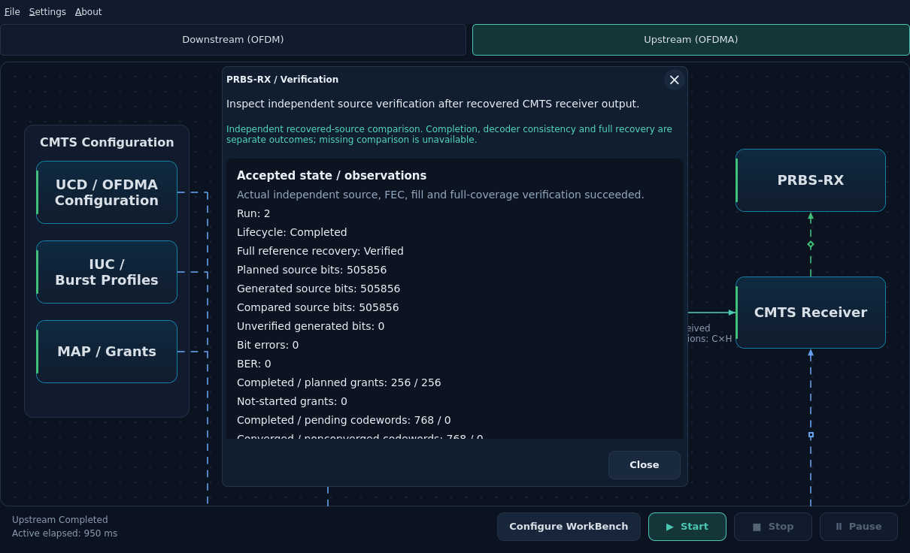
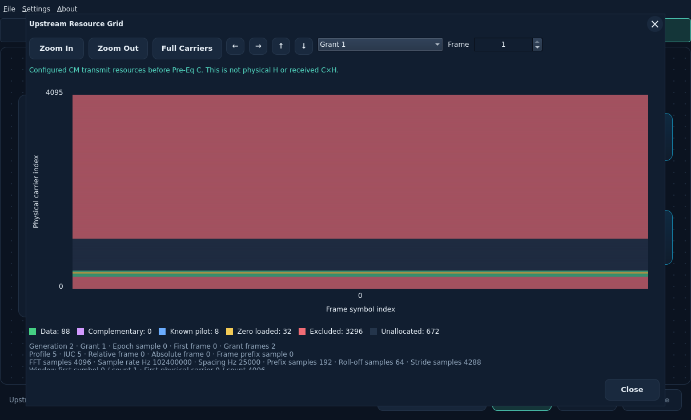

# Upstream OFDMA workbench

Select **Upstream** to use the CM transmitter → Channel Simulator →
CMTS receiver diagram. The separate CMTS Configuration group supplies control
information; it is not the source of upstream payload samples. Click a block,
or focus it and press Enter or Space, to open its window. Escape, Cancel and X
close an editor without applying its changes.

## Load a configuration

Click **Configure** or **UCD / OFDMA Configuration**, then **Load Configuration**.
Choose a MERLIN upstream configuration JSON document, such as the
[50 kHz example](../../examples/cli/upstream/us-50khz.json). The native file picker
can be cancelled without changing the current editor. Loading validates the
selected document before replacing the accepted upstream configuration. Invalid
input leaves the previous configuration available. A successful load reopens
the same section with its newly accepted values.

Before a document is loaded, the editors show an explicit missing-configuration
message. They do not invent a complete channel.

The same action loads a complete [measured experiment](upstream/measurements.md),
including its explicit UCD, RxMER, Pre-Eq associations and replay context. The
[50 kHz measured example](../../examples/measurements/upstream/measured/capture-driven.json)
and [25 kHz example](../../examples/measurements/upstream/measured/capture-driven-25khz.json)
use constructed captures, not field measurements. The backend validates the full
plan before accepting it. Captured settings are read-only in the scalar editors;
edit the complete plan and reload it to change those settings. Loading a synthetic
configuration explicitly restores its applicable editors.

## Save, reopen and close

Use **File → Save** or **Save As** while the Upstream tab is selected. The first
Save asks for a native destination; later Save uses that upstream destination.
Downstream keeps its separate file. The saved project includes accepted current
configuration, runtime options, receiver observations and complete measured-plan
inputs, with original source bytes and provenance preserved. Drafts and previous
run results are not saved. A blank New upstream project needs a configuration
before Save becomes available.

**File → Open** detects the saved direction before asking about unsaved changes
to that project. Save, Discard and Cancel apply to the target, independent of the
selected tab. Opening a valid upstream project selects Upstream after adoption;
failed or cancelled operations preserve both accepted projects and destinations.
Closing resolves both projects' unsaved changes before shutting down; cancelling
the second prompt leaves the first project available too. See the shared
[file guide](workbench.md#workbench-configuration-files).

## Inspect original captures

Open **UCD / OFDMA Configuration**, **RxMER** or **CM Pre-Eq**, then **View Capture**.
Choose **Load Capture** to inspect that family's binary capture or lossless
capture-source JSON. Inspection-only JSON exports are not original captures.
Cancel leaves the previous view intact; rejected input shows its diagnostic and
preserves the previous source and page.

The viewer distinguishes the original binary and delivered file hashes and byte
counts. Metadata retains the original identifiers, timestamp, raw flags and grid.
Pages contain up to 64 source records: UCD offsets and octets, RxMER physical
subcarriers and unavailable readings, or Pre-Eq physical subcarriers and complex
coefficients. Applied C and last-update operands remain separately labelled.

Inspection does not apply or associate the capture, configure a channel, or make
Start ready. Use **Load Measured Plan** to admit a complete experiment. The backend
requires explicit association and supported model combinations; measured RxMER
currently requires unity physical H and unity effective C. A last-update Pre-Eq
operand needs its explicit operation, base and probe context.

## Edit accepted settings

The following blocks open editors containing the values admitted from the loaded
configuration:

| Block | Editable settings |
| --- | --- |
| UCD / OFDMA Configuration | Existing preset selection and supported channel numerology fields. |
| IUC / Burst Profiles | Existing data IUC selection and each source burst group's modulation and pilot settings. |
| MAP / Grants | Synthetic grant identity, timing, frame count and existing physical minislot selection. |
| PRBS-TX | PRBS15 source seed. The CM Transmitter window also links to this editor. |
| Channel Simulator | Supported native channel delay, noise, phase, frequency offset and seed fields. |
| CMTS Receiver | Received-pilot estimator policy, reference variance and LDPC iteration limit. |
| CM Pre-Eq | Initial bank identity when an explicit synthetic correction plan exists. |

Settings are limited to the backend's supported modes. The complete loaded source
structure is preserved, including fields outside these editors. Complex channel
and Pre-Eq coefficient banks, events and probe plans remain in that source;
the scalar editors do not replace them. Without an explicit Pre-Eq plan, the
window identifies native unity correction rather than manufacturing a bank.

**Apply** submits changed values for Rust validation. The window stays open while
the candidate is prepared and closes only when it has been accepted. On rejection,
the original diagnostic remains visible and the accepted settings stay intact.
Reopening displays accepted values. **Cancel**, Escape or X discards local edits;
cancelling a pending edit cannot stop another simulation or import.

Configuration inspection does not advance the source or produce a waveform.
A green configuration block indicates accepted settings; it does not establish
received data or a successful simulation. Missing observations remain unavailable.
CM Pre-Eq is transmit correction **C**, the physical channel is **H**, and their
combined response is **C×H**. A CM Pre-Eq capture is not a CMTS channel estimate.

## Run and inspect results

After accepting a configuration, click **Start**. Preparation and simulation run
in the background. The status shows the actual completed grants and independently
compared bits. **Active elapsed** is the backend execution time in milliseconds;
it excludes acknowledged pauses and is separate from waveform duration.

**Pause** requests a safe pause; the button changes to **Resume** after the worker
acknowledges it. **Stop** requests cooperative cancellation. The application slot
stays occupied until the worker actually finishes, including while paused or
cancelling. Completed scientific work remains in the resulting partial report.
Switching tabs cannot redirect those controls to another direction.

Open **PRBS-RX** to inspect the actual report's run identity, lifecycle, planned,
generated and compared bits, unverified generated bits, BER, grant coverage and
completed/pending codewords. Decoder convergence, parity, shortening and fill
outcomes remain separate from independent source comparison. **Completed** means
the scheduled work ended normally; **Verified** requires the backend's complete
source/FEC/fill/coverage acceptance. With no comparison, BER is **Unavailable**.
Nonzero BER uses scientific notation; exact zero is shown as `0`. The report also
shows the original continuous PRBS15 source seed. Use **Inspect FEC / LLR** from
CMTS Receiver or PRBS-RX for [actual decoder/soft observations](upstream/instruments.md#ldpc-and-soft-observations).

A cancelled or timed-out report can contain useful completed work without full
recovery. Failure context remains visible when supplied by the backend. While a
new run is being prepared or executed, an older report is labelled **Retained
previous report** with its original run identity. It is replaced only by a new
accepted report. Configuration changes invalidate results tied to the old settings.

## Inspect configured resources

Open **CM Transmitter**, then **Resource Grid**. This passive view reads the
accepted transmit allocation through the public Rust API; it does not start a
simulation or show received samples. The horizontal axis is the original frame
symbol; the vertical axis is the original physical carrier index.

Use **Zoom In**, **Zoom Out**, the arrow buttons, drag or the mouse wheel to
request another rectangle of at most 4096 cells, the Qt presentation policy.
The public backend supports a separate, larger query ceiling. **Full Carriers** restores the original FFT
carrier span within the same cell budget. **Frame** selects a relative frame of
the configured grant. The grant selector identifies that one configured base
grant; it does not invent later grants from an execution batch.

Select a cell to inspect its exact backend metadata, including its role, original
minislot, loading, sample timing and nullable visit/bit offsets. The legend keeps
data, complementary, known pilot, zero-loaded, excluded and unallocated positions
distinct. Metadata and counts describe the selected rectangle; full-frame/grant
capacity remains separately reported. Positions precede transmit correction C,
physical H and received C×H. See the [resource-grid guide](upstream/resource-grid.md)
for these reference planes and coordinate definitions.

Queries run away from the GUI thread. Controls wait for an accepted response;
busy, stale, rejected or unavailable data never appears as a new valid grid.
Changing configuration invalidates the old view. Switching tabs preserves the
current observation and cell inspection without advancing source or run state.

## Inspect scientific observations

Use **CM Transmitter → QAM / Spectrum** for actual retained observations.
**Inspect Response** in Channel Simulator, CM Pre-Eq and CMTS Receiver separates
configured H/C/C×H from actual received estimates. **RxMER → View Capture** also
plots original dB/null readings on their physical-carrier grid. See the
[upstream instruments guide](upstream/instruments.md) for controls, units, retention
and unavailable states.

## Direction isolation

Switching tabs preserves each direction's accepted settings. One simulation may
run across the application, including a paused simulation. Return to its direction
to control it. File project actions currently remain available on Downstream only;
loading upstream configuration cannot replace the downstream project or its Save
destination. Settings and About are shared.

Shared FEC/verification presentation and final integration retain their separate
acceptance tasks. See the
[workbench overview](workbench.md) for shared controls and presentation limits.
