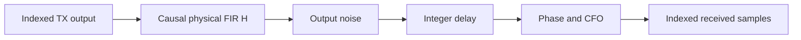

# OFDMA channel simulator

The typed channel transports indexed complex samples between the upstream
[transmitter](transmitter.md) and a separately configured receiver.

Exact unity bypass preserves every input bit pattern, including signed zero,
metadata and sample origin, without consuming random draws. Nonunity transport
keeps causal FIR history across chunks and emits its terminal response/delay once.
Seeded complex AWGN uses an explicit complex noise power. Phase and CFO follow
the emitted sample clock. Rejected blocks preserve filter history, RNG and cursors.

A separate RxMER residual synthesizer works in the declared normalized probe
reference plane. It preserves missing readings and selects, averages, holds or
interpolates error powers rather than dB values. Its current high-level composition
permits unity H, unity transmitter correction C and disabled sample noise/timing;
other combinations reject before consuming source. This prevents counting the
same measured impairment twice.

C describes transmitter correction; H describes the physical channel. Received
pilots estimate effective C times H. Neither a correction bank nor a residual
noise target is an exact measurement of H. Synthetic playback and capture-backed
association have separate admission gates.

Local channel/power/replay tests pass. Passive observations and complete synthetic schedule
admission also pass locally. Capture-backed and final backend acceptance remain in the
[checklist](../../development/checklist.md#int-us-ch-01).
See [channel contracts](../../development/features/ofdma/channel.md) and
[local validation](../../development/features/ofdma/design.md#int-us-ch-01-channel-implementation-unit).
