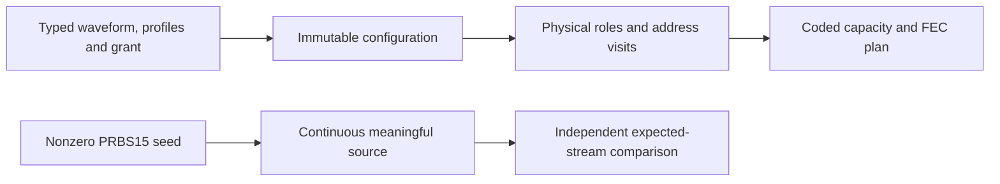

# OFDMA configuration and continuous source

The independent `docsis_ofdma` library accepts one channel/profile inventory and
one explicit synthetic grant. Select a retained profile by its identifier;
selection alone does not choose one fixed QAM order or code family.

Supported numerologies are 2K at 50 kHz and 4K at 25 kHz, both at
102.4 million complex samples per second. Configuration validates prefix,
rolloff, physical exclusions, profile/IUC identity, pilot family and finite
resource limits before publishing an immutable snapshot. A rejected replacement
leaves the old configuration intact. Represented ranging and probing settings
have explicit execution restrictions.

Resource planning preserves physical holes and distinguishes ordinary data,
complementary cells and known pilots. Grant selection chooses among three
upstream LDPC families and accounts separately for meaningful source bits,
information-fill ones, shortened zeros, parity and grant pad. These roles are
not interchangeable.

The source uses a nonzero 15-bit seed and emits the low bit first, with recurrence
`s[n+15] = s[n+14] XOR s[n]`. Source position continues across chunks and grants.
Rejected identity/count/range requests consume no bits. PHY randomization is a
separate stage. The independent verifier compares recovered bits at their
original absolute positions; it rejects gaps/reordering without searching for
a better phase. Zero compared bits have no BER value.

This foundation does not start a run, load measurements or generate a waveform.
Versioned document admission and the final public Rust/Python session remain
under integration. See [architecture](../../architecture.md#unified-upstream-configuration-and-source),
[configuration design](../../development/features/ofdma/configuration.md) and
[executed foundation tests](../../development/features/ofdma/design.md#validation).
